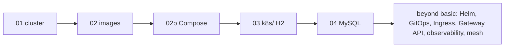

# part-order-app-java Walkthroughs

Step-by-step, hand-built walkthroughs for everything in
[part-order-app-java](../part-order-app-java/), from creating a local cluster to
distributed tracing. Each walkthrough is a folder with an index (`README.md`) and
numbered step files, written so a trainer can demo it live and a trainee can follow on their own machine.

Walkthroughs are written one at a time. A link below means the walkthrough exists; plain text means it is planned.

## Basic Kubernetes (`basic/`)

| # | Walkthrough | Covers |
| --- | --- | --- |
| 01 | [Docker Desktop cluster](basic/01-docker-desktop-cluster/README.md) | enable Kubernetes, contexts, smoke test, metrics-server |
| 02 | [Build the Docker images](basic/02-build-docker-images/README.md) | multi-stage Dockerfiles, running together, multi-arch publish, image pull policy |
| 02b | [Run the apps with Docker Compose](basic/02b-docker-compose/README.md) | compose.yaml, health checks and ordering, scaling, MySQL override with a volume, operating a project |
| 03 | [Deploy on Kubernetes: `k8s/` H2 stack](basic/03-k8s-h2-stack/README.md) | Namespace, ConfigMap, Deployment, probes, Service, NodePort, HPA, rollouts |
| 04 | [Shared state with MySQL: `k8s-with-mysql/`](basic/04-k8s-mysql-stack/README.md) | StatefulSet, PVC, Secrets, init script, initContainer, 2 replicas, failure drills |

## Beyond basic (`beyond-basic/`)

| # | Walkthrough | Covers |
| --- | --- | --- |
| 05 | [Package with Helm: `helm/`](beyond-basic/05-helm/README.md) | charts, values overlays, templates and helpers, optional MySQL, releases, rollback |
| 06 | [RBAC: who can do what](beyond-basic/06-rbac/README.md) | ServiceAccounts, Roles and bindings, client certificates, CI token, `kubectl auth can-i`, escalation guard |
| 07 | Argo CD GitOps | `helm/part-order-app/argocd`, `git-ops-argocd/` |
| 08 | `k8s-with-mysql-operator/` | MySQL operator and InnoDB cluster |
| 09 | `k8s-with-ingress/` | Ingress on GKE |
| 10 | `k8s-with-gateway-api/` | Gateway API and TLS on GKE |
| 11 | `k8s-cluster-monitoring-logging/` | Prometheus, Grafana, Loki |
| 12 | `k8s-istio/` | service mesh, mTLS |
| 13 | `k8s-with-tracing/` | OpenTelemetry and Tempo |

`k8s-rbac/` is an empty directory in the app, so walkthrough 06 ships its own reference manifests (in its `manifests/` folder) instead of matching repo files.

Start with **[01 — Docker Desktop cluster](basic/01-docker-desktop-cluster/README.md)**.
