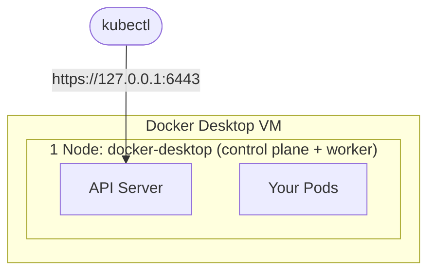
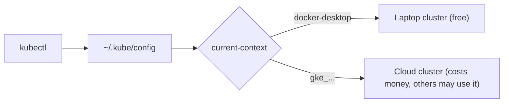

# Step 1 — Concepts: What "Your Cluster" Actually Is

> [Back to index](README.md) · Next: [Step 2 — Enable Kubernetes](02-enable-kubernetes.md)

## Goal

Know what is running on your laptop after you tick "Enable Kubernetes", and how `kubectl` decides which cluster to talk to.

## What you are building

A cluster is a control plane (the brain that decides what runs where) plus nodes (machines that run Pods). Docker Desktop gives you both in **one node** inside its own VM, which is enough for everything in this series.



Everything `kubectl` does is one conversation with the API Server. There is no other door.

## Vocabulary you need before touching anything

| Term | Meaning | Where you will see it |
| --- | --- | --- |
| Cluster | control plane + nodes, one API endpoint | `kubectl cluster-info` |
| Node | a machine that runs Pods | `kubectl get nodes` |
| kubeconfig | a file (`~/.kube/config`) listing clusters, users and contexts | `kubectl config view` |
| Context | a named (cluster, user, namespace) triple | `kubectl config get-contexts` |
| Current context | the one every `kubectl` command goes to | `kubectl config current-context` |
| Namespace | a folder inside a cluster; each app stack in this series gets its own | `kubectl get ns` |



## Why this matters

`kubectl apply` has no "are you sure?" and no notion of "this is my laptop". It
goes to whatever the current context says. People who keep a cloud cluster and
a local cluster in the same kubeconfig eventually run a destructive command
against the wrong one. Every later walkthrough in this series starts with a
context check for that reason, and Step 3 turns that check into a script.

The second thing worth knowing now: Docker Desktop's Kubernetes shares the
Docker daemon you already use. Images you `docker build` are visible to the
cluster without any registry. Whether a manifest is *allowed* to use them is
decided by `imagePullPolicy`, which [walkthrough 02](../02-build-docker-images/07-images-in-kubernetes.md) covers.

## Try it

This works even with Kubernetes switched off, because it only reads a file:

```bash
docker version --format '{{.Client.Version}} / server {{.Server.Version}}'
kubectl version --client
kubectl config get-contexts
```

Expected: Docker prints two versions, `kubectl` prints a client version, and the
context list shows at least `docker-desktop` once Kubernetes has been enabled
once. The row marked `*` is the current context.

If `kubectl` is missing:

```bash
brew install kubectl
```

## Common mistakes

| Symptom | Cause | Fix |
| --- | --- | --- |
| `kubectl: command not found` | `kubectl` not installed (Docker Desktop installs it only in some versions) | `brew install kubectl` |
| No `docker-desktop` row in the context list | Kubernetes has never been enabled | continue to Step 2 |
| Several contexts and you are unsure which is current | normal when you also use a cloud cluster | look for the `*` column, or run `kubectl config current-context` |

Next: **[Step 2 — Enable Kubernetes](02-enable-kubernetes.md)**.
