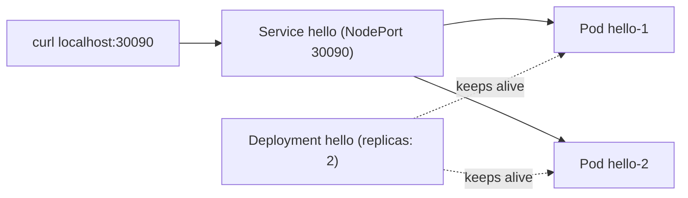

# Step 4 — Smoke Test: Deploy, Expose, Reach, Delete

> [Back to index](README.md) · Previous: [Step 3](03-verify-and-contexts.md) · Next: [Step 5 — metrics-server](05-metrics-server.md)

## Goal

Run a throwaway nginx on the cluster and reach it from your browser, using the same three objects (Namespace, Deployment, Service) and the same NodePort mechanism the real app uses.

## Why this matters

A cluster that answers `kubectl get nodes` can still be unable to schedule a
Pod, pull an image, or route traffic. The cheapest way to find that out is to
deploy something you do not care about. If this fails, the cause is the
cluster, not your app, which saves you from debugging Spring Boot when the real
problem is Docker's network or image pulls.

It also introduces the three objects you will read in every later walkthrough,
in their smallest form. Background: [05-services.md](../../../../kubernetes/kubernetes-intro/05-services.md).



## 1. A Namespace to isolate the test

Create `hello.yaml`:

```yaml
apiVersion: v1
kind: Namespace
metadata:
  name: smoke-test
```

Everything you add below goes in this namespace, so cleanup is one delete and nothing leaks into `default`.

## 2. The Deployment

Append to `hello.yaml`:

```yaml
---
apiVersion: apps/v1
kind: Deployment
metadata:
  name: hello
  namespace: smoke-test
spec:
  replicas: 2
  selector:
    matchLabels:
      app: hello
  template:
    metadata:
      labels:
        app: hello
    spec:
      containers:
        - name: nginx
          image: nginx:1.27
          ports:
            - containerPort: 80
```

`selector.matchLabels` must match `template.metadata.labels`. That is how the Deployment knows which Pods are "its own".

Apply and watch it self-heal:

```bash
kubectl apply -f hello.yaml
kubectl get pods -n smoke-test -w          # Ctrl+C when both are Running
kubectl delete -n smoke-test "$(kubectl get pod -n smoke-test -o name | head -1)" --wait=false
kubectl get pods -n smoke-test             # a replacement is already starting
```

## 3. The Service

Append to `hello.yaml`:

```yaml
---
apiVersion: v1
kind: Service
metadata:
  name: hello
  namespace: smoke-test
spec:
  type: NodePort
  selector:
    app: hello
  ports:
    - port: 80
      targetPort: 80
      nodePort: 30090
```

`nodePort: 30090` is pinned so the URL is predictable. Left out, Kubernetes picks a random port in 30000-32767. The real app uses `30080` and `30081` the same way.

```bash
kubectl apply -f hello.yaml
kubectl get svc -n smoke-test
```

## Try it

```bash
curl -I http://localhost:30090
```

Expected: `HTTP/1.1 200 OK` and a `Server: nginx/1.27...` header.

If that does not connect (this varies by Docker Desktop version and cluster type), use a port-forward, which works on any local cluster:

```bash
kubectl port-forward -n smoke-test svc/hello 8088:80
# in another terminal
curl -I http://localhost:8088
```

Clean up in one command:

```bash
kubectl delete -f hello.yaml
kubectl get ns smoke-test        # Terminating, then gone
```

## Checkpoint

<details>
<summary>Full <code>hello.yaml</code></summary>

```yaml
apiVersion: v1
kind: Namespace
metadata:
  name: smoke-test
---
apiVersion: apps/v1
kind: Deployment
metadata:
  name: hello
  namespace: smoke-test
spec:
  replicas: 2
  selector:
    matchLabels:
      app: hello
  template:
    metadata:
      labels:
        app: hello
    spec:
      containers:
        - name: nginx
          image: nginx:1.27
          ports:
            - containerPort: 80
---
apiVersion: v1
kind: Service
metadata:
  name: hello
  namespace: smoke-test
spec:
  type: NodePort
  selector:
    app: hello
  ports:
    - port: 80
      targetPort: 80
      nodePort: 30090
```

</details>

This matches [hello.yaml](hello.yaml) in this folder exactly.

## Common mistakes

| Symptom | Cause | Fix |
| --- | --- | --- |
| Pods stuck in `ImagePullBackOff` | no internet from Docker Desktop, or Docker Hub rate limit | `docker pull nginx:1.27` on the host to see the real error; log in with `docker login` |
| Pods `Pending` with `Insufficient cpu` | Docker Desktop resources too small | raise them (Step 2) |
| Service exists but `curl` refuses to connect | selector does not match Pod labels, so the Service has no endpoints | `kubectl get endpointslices -n smoke-test` should list two IPs; fix the `app:` label |
| `namespaces "smoke-test" not found` on apply of the Deployment | applied the Deployment from a separate file before the Namespace | keep the Namespace first in `hello.yaml`, or apply it first |
| `nodePort ... already allocated` | another Service already uses 30090 | pick a free port in 30000-32767 |

Next: **[Step 5 — metrics-server](05-metrics-server.md)**.
