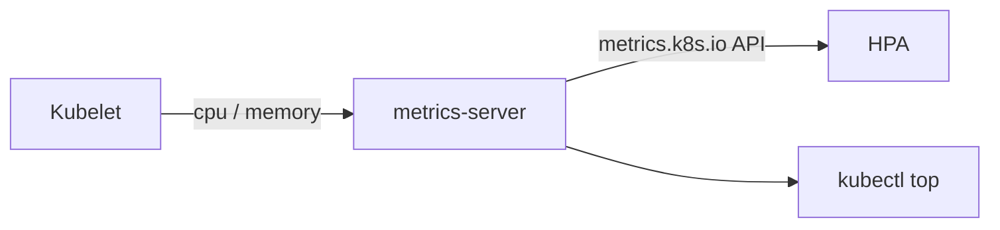

# Step 5 — Install metrics-server

> [Back to index](README.md) · Previous: [Step 4](04-smoke-test.md) · Next: [Step 6 — Recap and Exercises](06-recap-and-exercises.md)

## Goal

Make `kubectl top` work, and add a metrics check to `check-cluster.sh`.

## Why this matters

The app stack in [k8s/part-inventory-service/hpa.yaml](../../../part-order-app-java/k8s/part-inventory-service/hpa.yaml)
scales on CPU (target 70%) and memory (target 80%). Those numbers come from the
Kubernetes Metrics API, which **nothing provides by default**: it is served by
an add-on called metrics-server. Without it the HPA does not error loudly. It
sits there reporting `<unknown>/70%` and never scales, which looks like a broken
autoscaler when it is really a missing component.

metrics-server also needs a tweak on Docker Desktop. It scrapes each node's
kubelet over HTTPS, and Docker Desktop's kubelet uses a self-signed certificate
that metrics-server refuses, so the scrape fails with a TLS error. The
`--kubelet-insecure-tls` flag tells it to skip that verification. That is fine on a laptop and should never be used on a real cluster.



## 1. See the failure first

```bash
kubectl top nodes
```

Expected: `error: Metrics API not available`.

## 2. Install it

```bash
kubectl apply -f https://github.com/kubernetes-sigs/metrics-server/releases/latest/download/components.yaml
```

## 3. Allow the self-signed kubelet certificate

```bash
kubectl -n kube-system patch deployment metrics-server --type=json \
  -p='[{"op":"add","path":"/spec/template/spec/containers/0/args/-","value":"--kubelet-insecure-tls"}]'
kubectl -n kube-system rollout status deployment/metrics-server
```

The patch appends one argument to the container's argument list. Until it is applied, the metrics-server Pod stays `0/1 Ready` and its log shows `x509: cannot validate certificate`; that is the failure the flag fixes. The rollout then takes about a minute while the old Pod terminates.

## 4. Add the metrics check to the script

Append to the end of `check-cluster.sh`:

```bash
if kubectl top nodes >/dev/null 2>&1; then
  echo "OK   metrics-server answering (HPA will work)"
else
  echo "WARN metrics-server not answering - 'kubectl top' and the HPA need it"
fi
```

This is a `WARN`, not a `FAIL`: the cluster is usable without metrics, and only the HPA and `kubectl top` depend on it.

## Try it

Wait about a minute for the first samples, then:

```bash
kubectl top nodes
kubectl top pods -A
./check-cluster.sh
```

Expected:

```text
OK   context: docker-desktop
OK   node(s) Ready: 1
OK   kube-system pods Running
OK   metrics-server answering (HPA will work)
```

## Checkpoint

<details>
<summary>Full <code>check-cluster.sh</code></summary>

```bash
#!/bin/bash
# Sanity-check the Docker Desktop cluster before applying anything to it.
set -euo pipefail

EXPECTED_CONTEXT="${EXPECTED_CONTEXT:-docker-desktop}"

ctx="$(kubectl config current-context)"
if [ "$ctx" != "$EXPECTED_CONTEXT" ]; then
  echo "FAIL context is '$ctx', expected '$EXPECTED_CONTEXT'"
  echo "     fix with: kubectl config use-context $EXPECTED_CONTEXT"
  exit 1
fi
echo "OK   context: $ctx"

if ! kubectl get nodes >/dev/null 2>&1; then
  echo "FAIL API server not reachable - is Kubernetes enabled in Docker Desktop?"
  exit 1
fi
kubectl wait --for=condition=Ready node --all --timeout=60s >/dev/null
echo "OK   node(s) Ready: $(kubectl get nodes --no-headers | wc -l | tr -d ' ')"

not_ready="$(kubectl get pods -n kube-system --no-headers | grep -v -E 'Running|Completed' || true)"
if [ -n "$not_ready" ]; then
  echo "WARN kube-system pods not Running:"
  echo "$not_ready"
else
  echo "OK   kube-system pods Running"
fi

if kubectl top nodes >/dev/null 2>&1; then
  echo "OK   metrics-server answering (HPA will work)"
else
  echo "WARN metrics-server not answering - 'kubectl top' and the HPA need it"
fi
```

</details>

This matches [check-cluster.sh](check-cluster.sh) in this folder exactly.

> Side effect to expect: if the `k8s/` stack is already deployed, its HPA starts working the moment metrics are available, and it will likely scale `part-inventory-service` up to 5 replicas. See the gotchas table in [Step 6](06-recap-and-exercises.md).

## Common mistakes

| Symptom | Cause | Fix |
| --- | --- | --- |
| `kubectl top` still says `Metrics API not available` | first samples take about a minute | wait, then retry |
| metrics-server Pod is `Running` but not `Ready` | TLS error scraping the kubelet; the patch was not applied | `kubectl -n kube-system logs deploy/metrics-server`, look for `x509`; re-run the patch |
| Patch applied twice, Pod crash-loops with a duplicate flag error | the `add` operation appends every time | `kubectl -n kube-system edit deployment metrics-server` and remove the extra argument |
| Later, the HPA shows `<unknown>/70%` | metrics-server missing or unhealthy, or the Deployment has no `resources.requests` | run this step's check; the app Deployments set `requests` for this reason |

Next: **[Step 6 — Recap and Exercises](06-recap-and-exercises.md)**.
