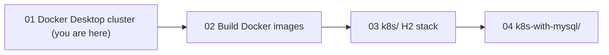

# Walkthrough 01 — Create a Local Cluster with Docker Desktop

Stand up a one-node Kubernetes cluster on your laptop, prove it works, and
leave it ready for the `part-order-app` stacks. Part of the
[part-order-app-java walkthrough series](../../README.md).

## What you'll build

Not an application: a **working, verified cluster** plus two small files you write by hand:

- [check-cluster.sh](check-cluster.sh) — a preflight script that refuses to continue if you are pointed at the wrong cluster, the API server is down, or metrics are missing
- [hello.yaml](hello.yaml) — a Namespace + Deployment + Service smoke test (nginx on NodePort 30090)

## Who this is for / prerequisites

- Someone who already knows Docker and is meeting Kubernetes for the first time (background: [06-cluster-and-nodes.md](../../../../kubernetes/kubernetes-intro/06-cluster-and-nodes.md))
- A Mac or Windows machine with Docker Desktop installed, plus `kubectl`
- About 4 CPU / 6 GB RAM that Docker Desktop is allowed to use
- Time: about 30-40 minutes, most of it waiting for Kubernetes to start the first time

## Steps

| Step | File | What you'll add | Est. time |
| --- | --- | --- | --- |
| 1 | [01-concepts.md](01-concepts.md) | Vocabulary: cluster, node, kubeconfig, context | 5 min |
| 2 | [02-enable-kubernetes.md](02-enable-kubernetes.md) | Resources, enable Kubernetes, first `check-cluster.sh` | 10 min |
| 3 | [03-verify-and-contexts.md](03-verify-and-contexts.md) | Context guard, reachability and readiness checks | 10 min |
| 4 | [04-smoke-test.md](04-smoke-test.md) | `hello.yaml`: deploy, expose, reach, delete | 10 min |
| 5 | [05-metrics-server.md](05-metrics-server.md) | metrics-server, so `kubectl top` and the HPA work | 10 min |
| 6 | [06-recap-and-exercises.md](06-recap-and-exercises.md) | Quick reference, gotchas, exercises | 10 min |

## Relationship to the reference implementation

There is no application source here, so the reference files are the two shipped
next to this README: [check-cluster.sh](check-cluster.sh) and [hello.yaml](hello.yaml).
The final checkpoint of Step 5 matches `check-cluster.sh` exactly, and the final
checkpoint of Step 4 matches `hello.yaml` exactly. Docker Desktop's own settings
screens cannot be checked into the repo; their expected end state is described in
words and verified by the script.

## Suggested demo flow

- Start with Docker Desktop's Kubernetes switched **off** and run `kubectl get nodes` live. The `connection refused` on port 6443 is the best possible motivation for Step 2, and it is the first error every trainee will hit later.
- Run `kubectl config get-contexts` on your own machine in Step 1. If you have a cloud cluster in there too, point at it and ask what `kubectl delete` would do right now. That is the case for the context guard in Step 3.
- In Step 3, run `EXPECTED_CONTEXT=nope ./check-cluster.sh` to trigger the guard without needing a second cluster.
- In Step 4, `kubectl delete pod` one of the two `hello` pods and watch the Deployment replace it before moving on to the Service. Trainees see self-healing before they see networking.
- In Step 5, run `kubectl top nodes` *before* installing metrics-server so the error is visible, then again after.

## Where this sits

Start with **[Step 1 — Concepts](01-concepts.md)**.
