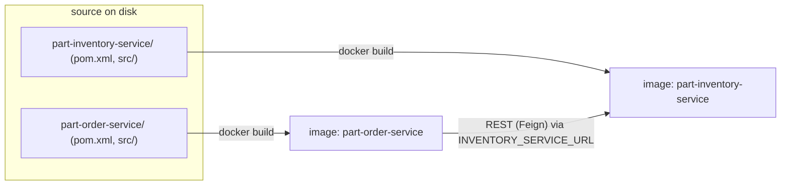

# Step 1 — Concepts: What Goes Into These Images

> [Back to index](README.md) · Next: [Step 2 — Single-Stage Dockerfile](02-single-stage-dockerfile.md)

## Goal

Understand what the two services need at build time and at run time, so each line of the Dockerfile you write next has a reason.

## What you are building

Two independent Spring Boot 4.0.2 services. Neither needs anything installed on your laptop beyond Docker.



| Image | Role | Listens on | Needs at runtime |
| --- | --- | --- | --- |
| `part-inventory-service` | owns parts and stock, REST API plus its own web UI | 8080 | nothing else (H2 in memory) |
| `part-order-service` | web UI, calls inventory over REST | 8080 | `INVENTORY_SERVICE_URL` pointing at inventory |

Both listen on **8080 inside the container**. On your laptop you map them to different host ports (8080 and 8081).

## Vocabulary

| Term | Meaning here |
| --- | --- |
| Build context | the folder you pass to `docker build` (the last argument); `COPY` can only see files inside it |
| Layer | one cached filesystem step per Dockerfile instruction; changing a line invalidates it and every layer after it |
| Stage | a `FROM ... AS name` block; only the **last** stage becomes the image |
| Tag | a human label on an image, `repo:tag`; `latest` is just a convention, not "newest" |
| Fat jar | a Spring Boot jar containing every dependency, runnable with `java -jar` |
| Profile | `SPRING_PROFILES_ACTIVE`; unset means the default `dev` (H2) from `application.yml` |

## Why this matters

There are two different environments in play, and confusing them is the main
source of bloated images. **Building** the app needs Maven, a full JDK and the
source tree. **Running** it needs only a Java runtime and one jar. A Dockerfile
that does both in one image ships the compiler, the source and Maven's
download cache to every server that ever runs it, and anyone who can pull the image can read your source.

Cache behaviour is the second thing worth internalising. Docker reuses a layer
only if its instruction and everything it copied are unchanged. That is why
the real Dockerfile copies `pom.xml` before `src`: edits to Java files
leave the earlier layers untouched. Step 3 shows how far that goes (and where it stops helping).

Finally, the profile decides persistence. With no profile set, the services
use in-memory H2 and re-seed `data.sql` on every boot. That is perfect for a
demo and wrong for more than one replica; see [k8s/NOTES.md](../../../part-order-app-java/k8s/NOTES.md)
and, later, `k8s-with-mysql/`.

## Try it

Set up a scratch lab with only the sources, no Dockerfiles. Run this from `applications-and-source-code/part-order-app-java/`:

```bash
mkdir -p ~/docker-lab/part-inventory-service ~/docker-lab/part-order-service
cp -R part-inventory-service/pom.xml part-inventory-service/src ~/docker-lab/part-inventory-service/
cp -R part-order-service/pom.xml     part-order-service/src     ~/docker-lab/part-order-service/
ls ~/docker-lab/part-inventory-service
```

Expected: `pom.xml  src`. No `Dockerfile`, no `mvnw`, no `target/`. The folder
names match the real ones on purpose, so the publish script in Step 6 works unchanged.

Check Docker is ready:

```bash
docker version --format '{{.Client.Version}} / server {{.Server.Version}}'
```

## Common mistakes

| Symptom | Cause | Fix |
| --- | --- | --- |
| `cp: cannot stat 'part-inventory-service/pom.xml'` | wrong working directory | `cd` to `applications-and-source-code/part-order-app-java/` first |
| Docker commands hang or fail to connect | Docker Desktop not running | start it and wait for the whale icon |
| Later: `COPY failed: file not found` | build context is not the service folder | the last argument to `docker build` must be the folder holding `pom.xml` |

Next: **[Step 2 — Single-Stage Dockerfile](02-single-stage-dockerfile.md)**.
