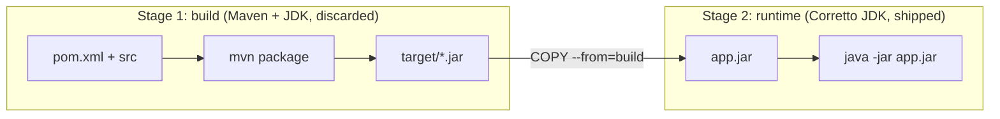

# Step 3 — Multi-Stage Dockerfile (the Real Inventory Dockerfile)

> [Back to index](README.md) · Previous: [Step 2](02-single-stage-dockerfile.md) · Next: [Step 4 — The Second Service](04-second-service.md)

## Goal

Replace the single-stage Dockerfile with the multi-stage one from the repo, so the final image contains only a Java runtime and the application jar.

## Why this matters

The Maven image is about 1.2 GB because it holds a build toolchain. At runtime
the app needs a JRE and one file. A multi-stage build uses the heavy image to
produce the jar, then starts a **fresh** image and copies just that jar across.
Only the last stage becomes the image you tag and push; everything in the
earlier stage is discarded (it stays in the local build cache, never in what you ship).



The second reason is cache layout. `pom.xml` changes rarely and `src/` changes
constantly, so they are copied in separate layers, with the rarely-changing one first.

## 1. Name the first stage

Replace the contents of `~/docker-lab/part-inventory-service/Dockerfile` with the build stage:

```dockerfile
# -------- Build stage --------
FROM maven:3.9.11-eclipse-temurin-25 AS build
WORKDIR /app

COPY pom.xml .

COPY src ./src
RUN mvn clean package -DskipTests
```

`AS build` is the handle the second stage uses to refer back to this one.

## 2. Add a clean runtime stage

Append:

```dockerfile


# -------- Runtime stage --------
FROM amazoncorretto:25-jdk
WORKDIR /app

COPY --from=build /app/target/*.jar app.jar
```

A second `FROM` starts from an unrelated, empty-of-your-stuff image. `COPY --from=build` is the only bridge between the stages. Unlike the exec-form `ENTRYPOINT`, a `COPY` source may use `*`, so no rename step is needed.

## 3. Start command, and two leftovers

Append:

```dockerfile

#USER nonroot

ENTRYPOINT ["java","-jar", "app.jar"]

EXPOSE 8080
```

Two lines deserve a comment, because they are in the repo and your checkpoint must match it:

- `#USER nonroot` is commented out. As written, the container runs as **root**. Enabling it also needs a user to exist in the image; `amazoncorretto:25-jdk` has no user named `nonroot` (`id nonroot` fails), so you would have to create one first. Treat it as an unfinished hardening step, covered in the exercises.
- `EXPOSE 8080` is documentation only. It does not publish the port; `-p` does. It sits after `ENTRYPOINT` here, which is legal because `EXPOSE` can appear anywhere.

## Try it

```bash
cd ~/docker-lab/part-inventory-service
docker build -t part-inventory-service:local .
docker images part-inventory-service
```

Expected: `:local` is about **1.0 GB**, compared with about 1.3 GB for `:single`. The saving is the Maven toolchain, the source and the build output.

Inspect where the size is:

```bash
docker history part-inventory-service:local
```

The two big rows are the JDK base (about 400 MB) and `COPY app.jar` (about 87 MB). Your own code is a few hundred KB of that jar.

Confirm the source is gone:

```bash
docker run --rm --entrypoint ls part-inventory-service:local /app
```

Expected: only `app.jar`.

Lint it with Docker's built-in checker:

```bash
docker build --check .
```

Expected: `Check complete, no warnings found.`

See the cache working. Change the content of a source file (Docker compares content, so `touch` alone does nothing), then rebuild:

```bash
echo "# cache demo" >> src/main/resources/application.yml
docker build -t part-inventory-service:local .
```

The `COPY pom.xml` layer is reused, but `COPY src` and everything after it rebuild. Note that the Maven dependencies are downloaded again on every source change. Separating that download into its own layer is Exercise 3.

## Checkpoint

<details>
<summary>Full <code>Dockerfile</code></summary>

```dockerfile
# -------- Build stage --------
FROM maven:3.9.11-eclipse-temurin-25 AS build
WORKDIR /app

COPY pom.xml .

COPY src ./src
RUN mvn clean package -DskipTests


# -------- Runtime stage --------
FROM amazoncorretto:25-jdk
WORKDIR /app

COPY --from=build /app/target/*.jar app.jar

#USER nonroot

ENTRYPOINT ["java","-jar", "app.jar"]

EXPOSE 8080
```

</details>

This matches [part-inventory-service/Dockerfile](../../../part-order-app-java/part-inventory-service/Dockerfile) exactly (the repo file has no trailing newline).

## Common mistakes

| Symptom | Cause | Fix |
| --- | --- | --- |
| `COPY --from=build` fails with `stage build not found` | first `FROM` is missing `AS build`, or the name is misspelled | match the name exactly, it is case-insensitive but must be identical |
| `no matching manifest for linux/arm64` | a base image tag that has no ARM build (not the case for these two) | check the tag on Docker Hub, or build with `--platform linux/amd64` |
| Image is still about 1.3 GB | the last `FROM` is still the Maven image | the **final** stage must be `amazoncorretto:25-jdk` |
| Whole build reruns on every tiny edit | `COPY . .` before the build, so any file change invalidates everything | copy `pom.xml` and `src` separately, as above |

Next: **[Step 4 — The Second Service](04-second-service.md)**.
