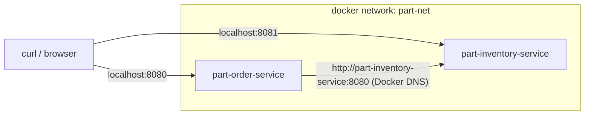

# Step 5 — Run Both Services Together

> [Back to index](README.md) · Previous: [Step 4](04-second-service.md) · Next: [Step 6 — Publish Multi-Arch](06-publish-multi-arch.md)

## Goal

Start both containers so the order service can call inventory by name, wrap that in `run-local.sh`, and prove the whole path works.

## Why this matters

Two containers on the default Docker bridge cannot find each other by name.
The order service reaches inventory through
[InventoryServiceClient.java](../../../part-order-app-java/part-order-service/src/main/java/com/forvia/partorderservice/client/InventoryServiceClient.java),
whose URL is `${INVENTORY_SERVICE_URL:http://localhost:8080}`. The default is
right for two processes on one laptop and wrong in a container, where
`localhost` is the container itself. If the variable is missing, the app still
starts and reports `UP`; it fails only when someone places an order, which is a
bad moment to find out.

A user-defined Docker network gives you DNS for container names, so
`http://part-inventory-service:8080` resolves. That is the same idea as a
Kubernetes Service name, and the Kubernetes ConfigMap later sets the same variable to the same value.



## 1. See the failure first

Start only the order service and place an order:

```bash
docker run -d --name order-alone -p 8080:8080 part-order-service:local
sleep 20
curl -s -w '\nHTTP %{http_code}\n' -X POST http://localhost:8080/api/part-orders/place-order \
  -H "Content-Type: application/json" \
  -d '{"sku":"SEAT-SAFE45-001","quantity":1}'
docker rm -f order-alone
```

Expected: `"status":500,"error":"Internal Server Error"` and `HTTP 500`. The health endpoint was `UP` a moment ago.

## 2. Create a network and start inventory

Create `run-local.sh`:

```bash
#!/bin/bash
# Run both services as containers that can reach each other by name.
set -euo pipefail

docker network inspect part-net >/dev/null 2>&1 || docker network create part-net

docker run -d --name part-inventory-service --network part-net \
  -p 8081:8080 part-inventory-service:local
```

The container is named exactly like the service on purpose: the name **is** the DNS name. `-p 8081:8080` publishes container port 8080 on host port 8081, because the order service will take host 8080.

## 3. Start the order service pointing at it

Append:

```bash

docker run -d --name part-order-service --network part-net \
  -p 8080:8080 \
  -e INVENTORY_SERVICE_URL=http://part-inventory-service:8080 \
  part-order-service:local
```

## 4. Wait until both are actually up

Append:

```bash

echo "waiting for both services to report UP..."
for port in 8081 8080; do
  until curl -fs "http://localhost:$port/actuator/health" | grep -q '"status":"UP"'; do
    sleep 3
  done
  echo "OK   :$port is UP"
done
```

Starting a container returns immediately, but Spring Boot takes several seconds to boot. Polling the health endpoint turns "I started it" into "it is ready".

## Try it

```bash
chmod +x run-local.sh
./run-local.sh
```

Expected:

```text
waiting for both services to report UP...
OK   :8081 is UP
OK   :8080 is UP
```

Place an order, which makes order-service call inventory over the network:

```bash
curl -X POST http://localhost:8080/api/part-orders/place-order \
  -H "Content-Type: application/json" \
  -d '{"sku":"SEAT-SAFE45-001","quantity":1}'
```

Expected: `"status":"Order placed successfully"`. Then check inventory's side effect:

```bash
curl -s http://localhost:8081/api/parts | head -c 300
```

`SEAT-SAFE45-001` now shows `"stock":99`. The web UIs are at <http://localhost:8080> (orders) and <http://localhost:8081> (inventory).

Now the H2 lesson. Restart inventory and look again:

```bash
docker restart part-inventory-service
sleep 20
curl -s http://localhost:8081/api/parts | head -c 300
```

Stock is back to **100**. The `dev` profile uses in-memory H2 and re-seeds from `data.sql` on every boot, so the order you just placed is gone. This is why `k8s/` runs one replica per service, and why `k8s-with-mysql/` exists.

Clean up when finished:

```bash
docker rm -f part-order-service part-inventory-service
docker network rm part-net
```

## Checkpoint

<details>
<summary>Full <code>run-local.sh</code></summary>

```bash
#!/bin/bash
# Run both services as containers that can reach each other by name.
set -euo pipefail

docker network inspect part-net >/dev/null 2>&1 || docker network create part-net

docker run -d --name part-inventory-service --network part-net \
  -p 8081:8080 part-inventory-service:local

docker run -d --name part-order-service --network part-net \
  -p 8080:8080 \
  -e INVENTORY_SERVICE_URL=http://part-inventory-service:8080 \
  part-order-service:local

echo "waiting for both services to report UP..."
for port in 8081 8080; do
  until curl -fs "http://localhost:$port/actuator/health" | grep -q '"status":"UP"'; do
    sleep 3
  done
  echo "OK   :$port is UP"
done
```

</details>

This matches [run-local.sh](run-local.sh) in this folder exactly. The repo has no equivalent script; the real source of truth for the URL is the `INVENTORY_SERVICE_URL` entry in [k8s/part-order-service/configmap.yaml](../../../part-order-app-java/k8s/part-order-service/configmap.yaml).

## Common mistakes

| Symptom | Cause | Fix |
| --- | --- | --- |
| `place-order` returns `HTTP 500` while health is `UP` | `INVENTORY_SERVICE_URL` missing or wrong, or the containers are on different networks | check `docker inspect part-order-service` for the env var and network |
| `port is already allocated` | something is on 8080 or 8081 | `lsof -i :8080`; stop it or change the host side of `-p` |
| `docker: Error response ... name "/part-order-service" is already in use` | containers from a previous run still exist | `docker rm -f part-order-service part-inventory-service` |
| Script hangs at "waiting for both services" | a service crashed on start | `docker logs part-inventory-service` and `docker logs part-order-service` |

Next: **[Step 6 — Publish Multi-Arch](06-publish-multi-arch.md)**.
