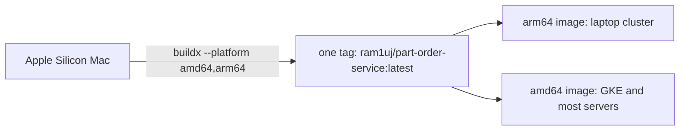

# Step 6 — Publish Multi-Architecture Images

> [Back to index](README.md) · Previous: [Step 5](05-run-together.md) · Next: [Step 7 — Images in Kubernetes](07-images-in-kubernetes.md)

## Goal

Write the script that builds both images for `linux/amd64` and `linux/arm64` and pushes them to Docker Hub under one tag.

## Why this matters

An image is built for a CPU architecture. On an Apple Silicon Mac, a plain
`docker build` produces `arm64`, and that image fails on most cloud nodes (which are `amd64`) with
`exec format error`, a confusing message that has nothing to do with your code.
A multi-arch image is one tag that points at several architecture-specific
images; the runtime pulls the one that matches the machine. That is what lets the same
`ram1uj/part-order-service:latest` run on your laptop cluster and on GKE.



Two consequences to know before typing:

- A multi-arch result cannot be stored in the local Docker image list, so `--push` is required, and the images go straight to the registry.
- `:latest` is only a name. Pushing a new image under it changes nothing in any manifest, so a running cluster does not notice. Step 7 and the recap cover the rollout restart that is needed.

## 1. Log in and build one service

```bash
docker login
```

In `~/docker-lab/` (the folder that holds both service folders), create `build-commands-mac.sh`:

```bash
#!/bin/bash

docker buildx build --platform linux/amd64,linux/arm64 \
  -t ram1uj/part-inventory-service:latest \
  ./part-inventory-service \
  --push
```

- `--platform` lists the targets; `buildx` builds each (emulating the foreign one with QEMU on a Mac, so it is slow).
- `./part-inventory-service` is the build context (the folder holding `pom.xml`), as in Step 1.
- `ram1uj` is the Docker Hub account that owns the published images. To publish your own, replace it with your username (and then update the `image:` lines in the manifests, which all say `ram1uj`).

## 2. Add the second service

Append:

```bash


docker buildx build --platform linux/amd64,linux/arm64 \
  -t ram1uj/part-order-service:latest \
  ./part-order-service \
  --push
```

## Try it

Publishing as `ram1uj` will be refused (it is not your account) and is not needed for the rest of the series, since the cluster can pull the published images. To try the flow with your own account, run it with your username:

```bash
sed 's#ram1uj#<your-dockerhub-user>#' build-commands-mac.sh > build-mine.sh
chmod +x build-mine.sh
./build-mine.sh
```

Then confirm both architectures landed:

```bash
docker buildx imagetools inspect <your-dockerhub-user>/part-order-service:latest
```

Expected: a manifest list showing `linux/amd64` and `linux/arm64` entries. You may also see two `unknown/unknown` entries; those are build attestations (provenance and SBOM) that `buildx` attaches, not extra architectures. The published `ram1uj/part-order-service:latest` looks exactly like this.

If you only want to check the Dockerfile builds for the other architecture, without a registry:

```bash
docker buildx build --platform linux/amd64 -t part-order-service:amd64 ./part-order-service --load
docker image inspect part-order-service:amd64 --format '{{.Architecture}}'
```

Expected: `amd64`, even on an Apple Silicon Mac. It runs under emulation and took about 2 minutes here, against about 1 minute for the native build.

## Checkpoint

<details>
<summary>Full <code>build-commands-mac.sh</code></summary>

```bash
#!/bin/bash

docker buildx build --platform linux/amd64,linux/arm64 \
  -t ram1uj/part-inventory-service:latest \
  ./part-inventory-service \
  --push


docker buildx build --platform linux/amd64,linux/arm64 \
  -t ram1uj/part-order-service:latest \
  ./part-order-service \
  --push
```

</details>

This matches [build-commands-mac.sh](../../../part-order-app-java/build-commands-mac.sh) exactly (the repo file has no trailing newline). In the repo it is run from `applications-and-source-code/part-order-app-java/`.

## Common mistakes

| Symptom | Cause | Fix |
| --- | --- | --- |
| `denied: requested access to the resource is denied` | not logged in, or pushing to an account that is not yours | `docker login`, and use your own username |
| `exec format error` when a pod starts | an image built for the wrong architecture reached the cluster | build and push multi-arch as above |
| `multiple platforms feature is currently not supported for docker driver` | the default builder cannot do multi-platform | `docker buildx create --use`, or enable the containerd image store in Docker Desktop settings |
| Cluster keeps running old code after a push | `:latest` unchanged in the manifest, so nothing triggers a rollout | `kubectl rollout restart deploy/<name> -n <namespace>` |

Next: **[Step 7 — Images in Kubernetes](07-images-in-kubernetes.md)**.
