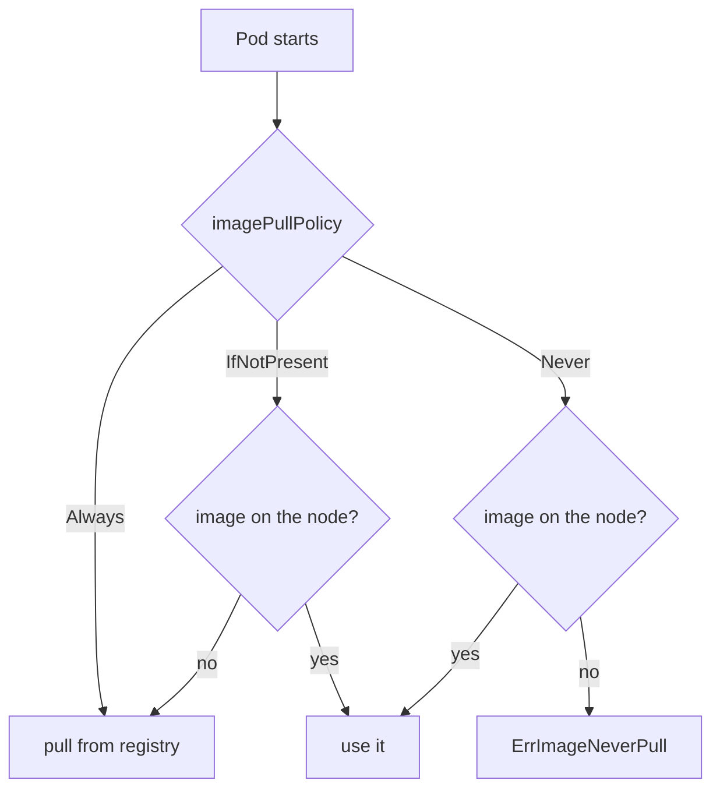

# Step 7 — Getting Images Into Kubernetes

> [Back to index](README.md) · Previous: [Step 6](06-publish-multi-arch.md) · Next: [Step 8 — Recap and Exercises](08-recap-and-exercises.md)

## Goal

Know which image your cluster will actually run, and choose between the published images, your own pushed images, and a local-only build.

## Why this matters

You can build a perfect `part-order-service:local` and the cluster will ignore
it, because Kubernetes decides where to get an image from the manifest, not from
what is on your machine. The shipped Deployments say:

```yaml
image: ram1uj/part-order-service:latest
imagePullPolicy: Always
```

`Always` means "contact the registry every time a Pod starts and use what it
returns", even if an identical name exists locally. Your local build is never
consulted, so the symptom of a wrong assumption is quiet: you rebuild, redeploy,
and see the old behaviour. The three options below differ in who owns the image and when it is refreshed.

| Policy | Behaviour | Typical use |
| --- | --- | --- |
| `Always` | check the registry on every Pod start | `:latest` tags, shipped manifests |
| `IfNotPresent` | use the local copy if there is one, else pull | pinned version tags, local images |
| `Never` | never pull; fail if not present locally | strictly local images |



## 1. Path A — use the published images

Do nothing. The cluster pulls `ram1uj/part-inventory-service:latest` and `ram1uj/part-order-service:latest` from Docker Hub. This is the right choice for following the rest of the series.

## 2. Path B — use your own pushed images

After Step 6, change the `image:` line in each Deployment to `<your-dockerhub-user>/...`. After every new push:

```bash
kubectl rollout restart deploy/part-order-service -n part-order-app
```

Without the restart nothing re-pulls, since the Deployment spec did not change.

## 3. Path C — local only, no registry (Docker Desktop cluster)

Docker Desktop's Kubernetes (the single-node **Kubeadm** type) shares the Docker daemon, so images from `docker build` are already on the node. A manifest has to opt in:

```yaml
image: part-order-service:local
imagePullPolicy: IfNotPresent
```

This gives the fastest edit-build-run loop. It does not work on a separate-node cluster such as `kind` or GKE, where the node cannot see your Docker daemon.

## Try it

Look at what the shipped manifests do, before changing anything:

From `applications-and-source-code/part-order-app-java/`:

```bash
grep -n "image:\|imagePullPolicy" k8s/*/deployment.yaml
```

Expected: both Deployments show a `ram1uj/...:latest` image with `imagePullPolicy: Always`. Your `:local` images are not referenced.

To see both behaviours without touching any real stack, use a throwaway namespace. This deploys the published image, then points it at your local build while the policy is still `Always`:

```bash
kubectl create namespace pull-test
kubectl create deployment part-order-service -n pull-test --image=ram1uj/part-order-service:latest
kubectl patch deployment part-order-service -n pull-test --type=json \
  -p='[{"op":"add","path":"/spec/template/spec/containers/0/imagePullPolicy","value":"Always"}]'

kubectl set image deployment/part-order-service -n pull-test part-order-service=part-order-service:local
sleep 20
kubectl get pods -n pull-test
```

Expected: the new Pod is stuck in `ErrImagePull` / `ImagePullBackOff`. With `Always`, Kubernetes asked Docker Hub for `part-order-service:local` and ignored your local image. The old Pod keeps serving, because a Deployment does not remove a working Pod until its replacement is ready.

Now switch the image and the policy in a single patch, so there is no failing step in between:

```bash
kubectl patch deployment part-order-service -n pull-test --type=json -p='[
  {"op":"replace","path":"/spec/template/spec/containers/0/image","value":"part-order-service:local"},
  {"op":"replace","path":"/spec/template/spec/containers/0/imagePullPolicy","value":"IfNotPresent"}]'
kubectl rollout status deployment/part-order-service -n pull-test
kubectl get pods -n pull-test -o jsonpath='{range .items[*]}{.spec.containers[0].image}{" "}{.status.containerStatuses[0].imageID}{"\n"}{end}'
```

Expected: the Pod runs `part-order-service:local`, and its `imageID` ends with the same `sha256:` that `docker images --no-trunc part-order-service:local` shows. That is your own build running in Kubernetes.

Clean up with `kubectl delete namespace pull-test`. The same two-field patch works on the real stack in `part-order-app` later; re-applying the manifest restores the published image. The left side of `part-order-service=...` is the container name from the manifest, which is also `part-order-service`.

## Checkpoint

This step creates no file, so the checkpoint is the exact lines to compare. In the shipped manifests ([k8s/part-order-service/deployment.yaml](../../../part-order-app-java/k8s/part-order-service/deployment.yaml)):

<details>
<summary>The two lines that decide which image runs</summary>

```yaml
          image: ram1uj/part-order-service:latest
          imagePullPolicy: Always
```

</details>

## Common mistakes

| Symptom | Cause | Fix |
| --- | --- | --- |
| Rebuilt locally, cluster runs old code | `Always` pulled the registry image, ignoring the local build | use Path C, or push (Path B) and restart |
| `ErrImageNeverPull` | `Never` set and the image is not on the node | `docker images` on the same engine as the cluster; check the cluster is the Kubeadm type |
| `ImagePullBackOff` on your own image | private repository, or a typo in the name | `kubectl describe pod`, read the Events section |
| Pods run but behave like last week's build | `:latest` pushed but no restart | `kubectl rollout restart deploy/<name> -n <ns>` |

Next: **[Step 8 — Recap and Exercises](08-recap-and-exercises.md)**.
