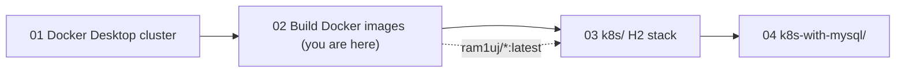

# Walkthrough 02 — Build the Docker Images

Hand-build the Dockerfiles for the two Spring Boot services, run them together
with plain `docker run`, publish them as multi-architecture images, and learn
how Kubernetes decides whether to use your local build or the published one.
Part of the [part-order-app-java walkthrough series](../../README.md).

## What you'll build

Two images and the scripts around them:

- `part-inventory-service` — owns parts and stock ([Dockerfile](../../../part-order-app-java/part-inventory-service/Dockerfile))
- `part-order-service` — web UI plus REST client for inventory ([Dockerfile](../../../part-order-app-java/part-order-service/Dockerfile))
- [run-local.sh](run-local.sh) — starts both containers on one Docker network and waits for them to be healthy
- a multi-arch publish script, matching [build-commands-mac.sh](../../../part-order-app-java/build-commands-mac.sh)

## Who this is for / prerequisites

- Comfortable with `docker run` and `docker build` basics; background in [03-docker-build.md](../../../../docker/03-docker-build.md) and [04-docker-best-practice.md](../../../../docker/04-docker-best-practice.md)
- Docker Desktop running (set up in [walkthrough 01](../01-docker-desktop-cluster/README.md))
- No Java or Maven on your machine: the build happens inside Docker
- A Docker Hub account only if you want to publish your own images (Step 6)
- Time: about 60-75 minutes. The first Maven build downloads dependencies and takes a minute or two per service.

## Steps

| Step | File | What you'll add | Est. time |
| --- | --- | --- | --- |
| 1 | [01-concepts.md](01-concepts.md) | Images, layers, build context, what the services need at runtime | 8 min |
| 2 | [02-single-stage-dockerfile.md](02-single-stage-dockerfile.md) | A first Dockerfile that works but is bloated | 10 min |
| 3 | [03-multi-stage-dockerfile.md](03-multi-stage-dockerfile.md) | The real inventory Dockerfile: multi-stage, cache-friendly | 12 min |
| 4 | [04-second-service.md](04-second-service.md) | The order-service Dockerfile and how it differs | 5 min |
| 5 | [05-run-together.md](05-run-together.md) | `run-local.sh`: network, env var, health wait, failure demo | 15 min |
| 6 | [06-publish-multi-arch.md](06-publish-multi-arch.md) | `buildx` multi-arch push script | 10 min |
| 7 | [07-images-in-kubernetes.md](07-images-in-kubernetes.md) | `imagePullPolicy` and three ways to feed the cluster | 8 min |
| 8 | [08-recap-and-exercises.md](08-recap-and-exercises.md) | Quick reference, gotchas, exercises | 10 min |

## Relationship to the reference implementation

By the end, the trainee's files should match these real files:

| Trainee file | Reference |
| --- | --- |
| `part-inventory-service/Dockerfile` (Step 3) | [part-inventory-service/Dockerfile](../../../part-order-app-java/part-inventory-service/Dockerfile) |
| `part-order-service/Dockerfile` (Step 4) | [part-order-service/Dockerfile](../../../part-order-app-java/part-order-service/Dockerfile) |
| `build-commands-mac.sh` (Step 6) | [build-commands-mac.sh](../../../part-order-app-java/build-commands-mac.sh) |
| `run-local.sh` (Step 5) | [run-local.sh](run-local.sh) (written for this walkthrough; the repo has no equivalent) |

The final checkpoint of each is diffed against its reference. The two
Dockerfiles intentionally keep a few oddities from the repo (a commented-out
`USER` line, an `EXPOSE` after `ENTRYPOINT`) so they match byte for byte; Step 3 and the recap point them out.

## Suggested demo flow

- Do Step 2 and Step 3 back to back and finish with `docker images`: the single-stage image is about 1.29 GB, the multi-stage one about 1.01 GB. Then run `docker run --rm part-inventory-service:single ls /app` to show the source tree and `pom.xml` shipped inside the first image and not in the second.
- Run `docker history part-order-service:local` and point at the two big layers: the ~400 MB JDK and the ~87 MB application jar. Trainees tend to assume their code is most of the image.
- In Step 5, deliberately start `part-order-service` **without** `INVENTORY_SERVICE_URL` and place an order. The `HTTP 500` is the exact failure they will meet again in Kubernetes if the ConfigMap is missing.
- Still in Step 5, `docker restart part-inventory-service` after placing an order and show stock jump back to 100. That one demo is the whole reason `k8s-with-mysql/` exists.
- In Step 7, show `imagePullPolicy: Always` in [k8s/part-order-service/deployment.yaml](../../../part-order-app-java/k8s/part-order-service/deployment.yaml) *before* anyone builds a local image, then ask whose image the cluster will run.

## Where this sits

Start with **[Step 1 — Concepts](01-concepts.md)**.
