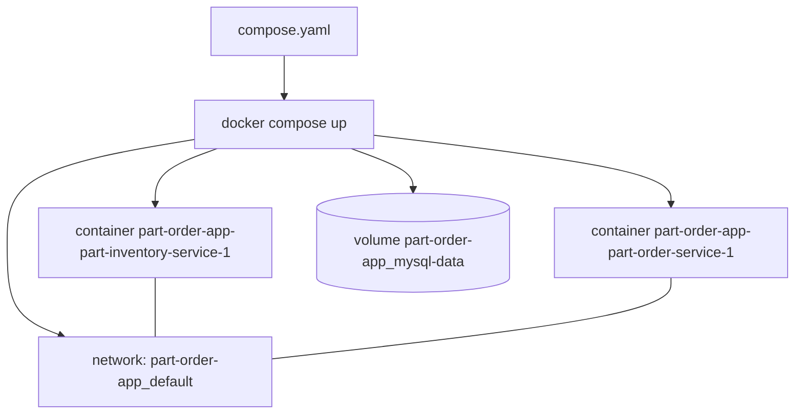

# Step 1 — Concepts: The Compose Model

> [Back to index](README.md) · Next: [Step 2 — The First Service](02-first-service.md)

## Goal

Understand what a Compose file describes, what Docker creates from it, and how each part corresponds to something you will meet again in Kubernetes.

## What you are building

A Compose file declares **services**, and Docker Compose turns it into a **project**: a set of containers, one private network, and any named volumes, all prefixed with the project name.



Inside that network Docker runs a small DNS server. Each container is reachable by
its **service name**, so the order service can call `http://part-inventory-service:8080`
without knowing an IP. This is the mechanism you set up by hand with
`docker network create part-net` and container names in walkthrough 02, Step 5.

| Compose concept | What it is | Kubernetes counterpart |
| --- | --- | --- |
| `services:` entry | a container definition plus how to run it | Deployment (+ Service) |
| service name | DNS name on the project network | Service name |
| `image:` / `build:` | where the image comes from | `image:` in the Pod spec; building is separate |
| `environment:`, `.env` | settings and secrets as env vars | ConfigMap, Secret |
| `ports: "8080:8080"` | publish a container port on the host | NodePort / port-forward |
| `healthcheck:` | a command that decides healthy / unhealthy | readiness / liveness probes |
| `depends_on: condition: service_healthy` | start order based on health | initContainer + readiness |
| `volumes:` (named) | storage that outlives the container | PersistentVolumeClaim |
| `deploy.replicas` / `--scale` | number of copies | `replicas` |
| `-f a.yaml -f b.yaml` | merge files, later wins | Helm values overlays |

## Why this matters

Compose is the shortest path from "two containers I start by hand" to "a
described system". Everything you were typing in walkthrough 02 (network,
names, ports, environment variable, waiting for health) becomes a file that
anyone can run with one command and that Git can track. It is how most teams run
their app and its database on a laptop, and often in CI.

Knowing exactly what it does **not** do is just as useful, because those gaps are why
Kubernetes exists:

- It manages **one host**. If the machine is down, so is everything.
- There is **no load balancer**: scaled copies share one DNS name, and the answer rotates (Step 5 shows what that means).
- There are **no rolling updates or automatic rollback**; `up` replaces a changed container.
- Recovery is limited to a `restart:` policy; nothing re-schedules a failed container onto another machine.
- Secrets are plain environment variables or files.

Keep the table above in mind: the same stack appears again as Kubernetes manifests
and as a Helm chart, and each Compose line has a counterpart there.

## Try it

Check the tooling and your starting point:

```bash
docker compose version
docker ps --format '{{.Names}}\t{{.Ports}}'      # note anything already using 8080
ls ~/docker-lab ~/docker-lab/part-inventory-service
```

Expected: a Compose version (v2 or newer), no container publishing host port 8080, and the lab folders from walkthrough 02 with `Dockerfile`, `pom.xml` and `src` in each service folder.

If `~/docker-lab` is missing, redo walkthrough 02, Steps 1-4. A quick check that the Dockerfile still builds avoids a confusing failure later:

```bash
docker build --check ~/docker-lab/part-inventory-service
```

Expected: `Check complete, no warnings found.`

## Common mistakes

| Symptom | Cause | Fix |
| --- | --- | --- |
| `docker: 'compose' is not a docker command` | only the old `docker-compose` v1 is installed | update Docker Desktop; this walkthrough uses the `docker compose` plugin |
| Port 8080 already in use later | a container or process holds it | `docker ps`, `lsof -i :8080` |
| `~/docker-lab` missing or has no `src/` | walkthrough 02 not done | redo its Steps 1-4 |

Next: **[Step 2 — The First Service](02-first-service.md)**.
