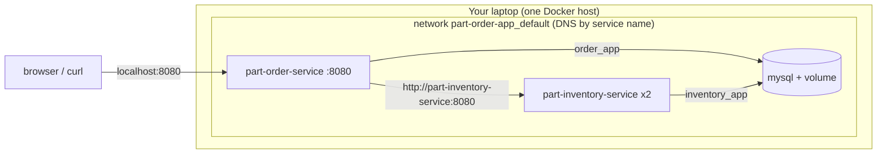
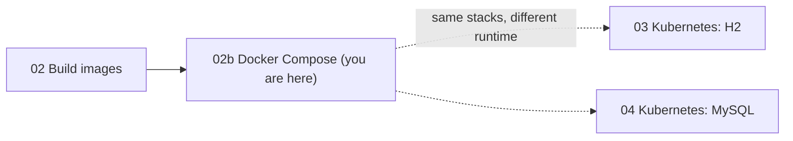

# Walkthrough 02b — Run the Apps with Docker Compose

Run both Spring Boot services, and then the MySQL-backed version with two
inventory replicas, from a single `compose.yaml`: no Kubernetes involved.
It replaces the hand-typed `docker network create` and `docker run` commands from
[walkthrough 02](../02-build-docker-images/README.md) with a file you can read, version and
repeat, and it gives you a way to try the app's architecture before Kubernetes. Part of the
[part-order-app-java walkthrough series](../../README.md).

## What you'll build

Two Compose files and their helpers, shipped next to this README:

- [compose.yaml](compose.yaml): the `dev` / H2 stack. Two services, health checks, start-up ordering, and the order UI on `http://localhost:8080`.
- [compose.mysql.yaml](compose.mysql.yaml): an override that adds MySQL, a named volume and the init script, switches both services to the `prod` profile, and runs two inventory replicas.
- [.env](.env) and [mysql/init-users.sh](mysql/init-users.sh): the passwords and the script that creates two databases and two scoped users, the same ones as walkthrough 04.

## Who this is for / prerequisites

- [Walkthrough 02](../02-build-docker-images/README.md) done through Step 4: you need the `~/docker-lab/` folder with `part-inventory-service/` and `part-order-service/`, each holding `pom.xml`, `src/` and the `Dockerfile` you wrote. Compose builds from them.
- Docker Desktop with Compose v2 or later (`docker compose version`; these commands were run with v5.5.1). No Kubernetes is needed, and none of this touches your cluster.
- Ports: the order UI uses host port 8080, so stop any other container holding it. MySQL's port is **not** published to the host (see Step 6 for why).
- Time: about 75 minutes

## Steps

| Step | File | What you'll add | Est. time |
| --- | --- | --- | --- |
| 1 | [01-concepts.md](01-concepts.md) | The Compose model and how it maps onto Kubernetes | 8 min |
| 2 | [02-first-service.md](02-first-service.md) | `compose.yaml` with the inventory service; up, logs, exec, down | 12 min |
| 3 | [03-two-services.md](03-two-services.md) | The order service, service-name DNS, a published port | 10 min |
| 4 | [04-health-and-ordering.md](04-health-and-ordering.md) | `healthcheck`, `depends_on: service_healthy`, `--wait` | 12 min |
| 5 | [05-scaling-h2.md](05-scaling-h2.md) | `--scale`, DNS round-robin, and the H2 state problem again | 8 min |
| 6 | [06-mysql-service.md](06-mysql-service.md) | `.env`, init script, `compose.mysql.yaml` with MySQL and a volume | 15 min |
| 7 | [07-prod-stack.md](07-prod-stack.md) | App overrides for `prod`, 2 replicas, persistence, `down -v` | 15 min |
| 8 | [08-operating-compose.md](08-operating-compose.md) | Logs, exec, rebuild one service, `config`, cleanup | 10 min |
| 9 | [09-recap-and-exercises.md](09-recap-and-exercises.md) | Quick reference, gotchas, exercises | 10 min |

## Relationship to the reference implementation

The repo has no Compose files, so the four files in this folder are the reference, written for this walkthrough and tested against the same images:

| Trainee file (in `~/docker-lab/`) | Reference |
| --- | --- |
| `compose.yaml` (Step 4) | [compose.yaml](compose.yaml) |
| `.env` (Step 6) | [.env](.env) |
| `mysql/init-users.sh` (Step 6) | [mysql/init-users.sh](mysql/init-users.sh) |
| `compose.mysql.yaml` (Step 7) | [compose.mysql.yaml](compose.mysql.yaml) |

The values mirror the Kubernetes stacks so you can compare them line by line: the `dev` / `prod` profiles, the databases and users from [k8s-with-mysql/](../../../part-order-app-java/k8s-with-mysql/), and the same actuator health paths the Deployments' probes use. The final checkpoint of each file is diffed against its reference.

## Suggested demo flow

- In Step 2 do **not** publish the inventory port. Reach it with `docker compose exec`. Trainees see the Compose version of "ClusterIP: internal only" before any theory.
- In Step 4, change one health check path to a URL that returns 404 and run `docker compose up -d --wait`. After about a minute it prints `dependency failed to start: container ... is unhealthy`, and `docker compose ps -a` shows the order service stuck in `Created`. That is `depends_on` doing its job.
- In Step 5 place an order, scale inventory to 2, and run `getent hosts part-inventory-service` inside the order container: two IP addresses for one name. Then sample the stock twelve times and get a 6/6 split. It is the same failure as walkthrough 03, Step 8, with no HPA involved.
- In Step 7 contrast `docker compose down` (data survives) with `down -v` (everything gone), and point out that after `down -v` the apps heal themselves on the next `up`, unlike the wiped-volume-under-running-apps failure in walkthrough 04.
- In Step 8, run `docker compose -f compose.yaml -f compose.mysql.yaml config` and read the merged result aloud. It is the one command that removes all doubt about which file won.

## Where this sits

The number `02b` keeps the existing numbering intact: it fits between building the images and deploying them to Kubernetes.

Start with **[Step 1 — Concepts](01-concepts.md)**.
