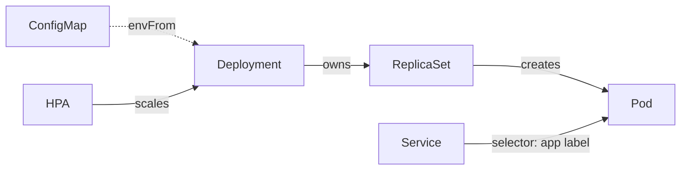
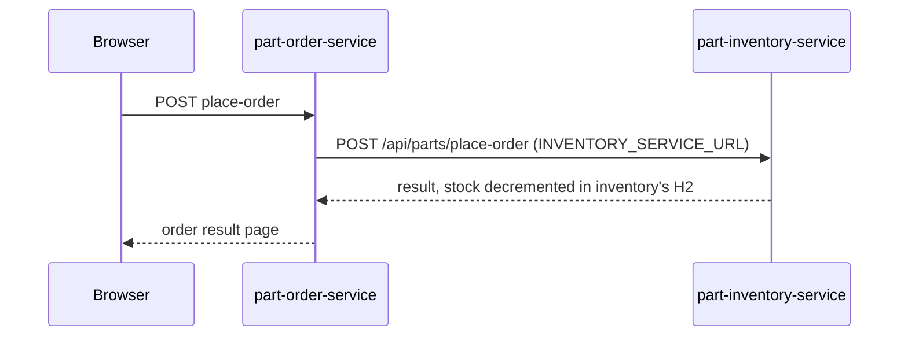

# Step 1 — Concepts: The Objects and How They Connect

> [Back to index](README.md) · Next: [Step 2 — The Namespace](02-namespace.md)

## Goal

Know what each manifest in the stack is for, how they refer to one another, and why the stack is deliberately limited to one replica per service.

## What you are building

Eight YAML files, four kinds of workload-facing object per service, and one shared Namespace.

| Object | One-line job | File |
| --- | --- | --- |
| Namespace | a folder that holds and isolates everything else | `namespace.yaml` |
| ConfigMap | key/value settings, kept out of the image | `configmap.yaml` (per service) |
| Deployment | keeps N identical Pods running, handles rollouts | `deployment.yaml` (per service) |
| Pod | the running container (created for you by the Deployment) | none |
| Service | a stable name and virtual IP in front of changing Pods | `service.yaml` (per service) |
| HorizontalPodAutoscaler | changes the replica count from CPU and memory use | `hpa.yaml` (inventory only) |



The links between objects are **labels and names**, not file order:

- A Deployment's `selector.matchLabels` must match its Pod template's `labels`.
- A Service's `selector` matches the same Pod labels.
- A Deployment's `envFrom` names a ConfigMap, and an HPA's `scaleTargetRef` names a Deployment.

A typo in any of those is the commonest reason a stack "applies fine" and does nothing.

## Why this matters

Everything is configuration of the same two Spring Boot images from walkthrough 02,
so the interesting design decisions are about **what to leave out**:

- **One replica each.** Both services run the `dev` profile, which uses an in-memory H2 database inside each Pod. A second replica would have its own empty, disconnected copy of the data. Scaling stateful-by-accident apps is the mistake this stack is built to avoid, and Step 8 shows what happens when it is made anyway.
- **No database, no Secret, no config server.** `application.yml` defaults to `dev`, and the config-server import is `optional:`, so nothing else has to exist.
- **Config in ConfigMaps, not in the image.** The same image runs with `dev` here and `prod` in `k8s-with-mysql/`, selected only by an environment variable. That is how a single build travels between environments.

The request path to keep in mind:



Only the order service is reachable from outside. Background reading: [03-pods-and-services.md](../../../../kubernetes/kubernetes-intro/03-pods-and-services.md), [04-deployments.md](../../../../kubernetes/kubernetes-intro/04-deployments.md), [07-configmap-and-secrets.md](../../../../kubernetes/kubernetes-intro/07-configmap-and-secrets.md).

## Try it

Check the cluster and make the working folders. Run `check-cluster.sh` from walkthrough 01 if you kept it:

```bash
kubectl config current-context        # docker-desktop
kubectl get ns part-order-app         # expect: NotFound. If it exists, delete it first
mkdir -p ~/k8s-lab/part-order-app/part-inventory-service ~/k8s-lab/part-order-app/part-order-service
cd ~/k8s-lab/part-order-app
```

The folder layout matches the repo's `k8s/` on purpose:

```text
part-order-app/
  namespace.yaml
  part-inventory-service/   configmap.yaml  deployment.yaml  service.yaml  hpa.yaml
  part-order-service/       configmap.yaml  deployment.yaml  service.yaml
```

Expected from the second command: `Error from server (NotFound): namespaces "part-order-app" not found`.

## Common mistakes

| Symptom | Cause | Fix |
| --- | --- | --- |
| `namespaces "part-order-app" already exists` later | an earlier deployment of this stack is still there | `kubectl delete namespace part-order-app`, wait until it is gone |
| `kubectl` commands answer from another cluster | wrong context | `kubectl config use-context docker-desktop` |
| Confusion about "where did my Pods go" | looking in the `default` namespace | add `-n part-order-app` to every command (Step 2 shows how to make it the default) |

Next: **[Step 2 — The Namespace](02-namespace.md)**.
