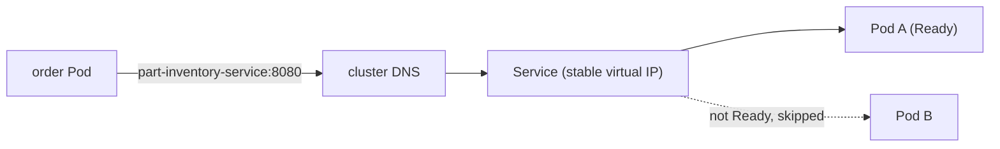

# Step 6 — The Inventory Service and In-Cluster DNS

> [Back to index](README.md) · Previous: [Step 5](05-probes-and-resources.md) · Next: [Step 7 — The Order Service](07-order-service.md)

## Goal

Give the inventory Pods a stable name and address with a Service, and prove that another Pod can reach it by that name.

## Why this matters

A Pod's IP changes every time it is replaced, which you just caused twice by
deleting it and rolling the Deployment. Nothing can depend on a Pod IP. A
Service is a fixed virtual IP and a DNS name that forwards to whichever Pods
currently match its selector and are **Ready**. This is the mechanism behind
`INVENTORY_SERVICE_URL=http://part-inventory-service:8080`: the name in that URL is this Service's `metadata.name`.



Two fields are easy to confuse: `port` is what **callers use on the Service**,
`targetPort` is the **container's** port. Here `targetPort: http` points at the
named port from Step 4, so renaming the number later does not break the Service.

Background: [05-services.md](../../../../kubernetes/kubernetes-intro/05-services.md).

## 1. Write the manifest

Create `part-inventory-service/service.yaml`:

```yaml
apiVersion: v1
kind: Service
metadata:
  name: part-inventory-service
  namespace: part-order-app
  labels:
    app: part-inventory-service
spec:
  # internal only - part-order-service is the only consumer
  type: NodePort
  selector:
    app: part-inventory-service
  ports:
    - name: http
      port: 8080
      targetPort: http
```

- `selector: app: part-inventory-service` must match the Pod labels from Step 4. This is the link.
- **`type`**: the comment says "internal only", which is what `ClusterIP` means, and `ClusterIP` is also what [k8s/NOTES.md](../../../part-order-app-java/k8s/NOTES.md) describes and what git history holds. The working copy of this file was changed to `NodePort` so the inventory API is reachable from your laptop without a port-forward. Both work for this walkthrough. `ClusterIP` is the safer default for a service that nobody outside the cluster should call; with `NodePort` Kubernetes also opens a **randomly chosen** port (30000-32767) on the node.

```bash
kubectl apply -f part-inventory-service/service.yaml
```

## Try it

```bash
kubectl get svc part-inventory-service -n part-order-app
kubectl get endpointslices -n part-order-app
```

Expected: a Service with a cluster IP and, if you used `NodePort`, a port like `8080:30313/TCP`. The EndpointSlice lists **one IP**, the Pod's. If it is empty, the selector does not match or the Pod is not Ready.

Now prove the DNS name works, from inside the cluster, using a throwaway Pod:

```bash
kubectl run curl-test -n part-order-app --rm -i --restart=Never \
  --image=curlimages/curl --command -- curl -s http://part-inventory-service:8080/api/parts
```

Expected: the JSON parts list, then the Pod is deleted. Use the long name too, to see the structure of the address:

```bash
kubectl run curl-test -n part-order-app --rm -i --restart=Never \
  --image=curlimages/curl --command -- \
  curl -s -o /dev/null -w "%{http_code}\n" http://part-inventory-service.part-order-app.svc.cluster.local:8080/api/parts
```

Expected: `200`. The form is `<service>.<namespace>.svc.cluster.local`; the short name works only inside the same Namespace.

From your laptop, either read the NodePort or use a port-forward:

```bash
PORT=$(kubectl get svc part-inventory-service -n part-order-app -o jsonpath='{.spec.ports[0].nodePort}')
curl http://localhost:$PORT/api/parts | head -c 200      # NodePort only

kubectl port-forward -n part-order-app svc/part-inventory-service 8081:8080   # works for any type
curl http://localhost:8081/api/parts | head -c 200
```

## Checkpoint

<details>
<summary>Full <code>part-inventory-service/service.yaml</code></summary>

```yaml
apiVersion: v1
kind: Service
metadata:
  name: part-inventory-service
  namespace: part-order-app
  labels:
    app: part-inventory-service
spec:
  # internal only - part-order-service is the only consumer
  type: NodePort
  selector:
    app: part-inventory-service
  ports:
    - name: http
      port: 8080
      targetPort: http
```

</details>

This matches [part-inventory-service/service.yaml](../../../part-order-app-java/k8s/part-inventory-service/service.yaml) as it stands in the working copy (`type: NodePort`). If your checkout shows `type: ClusterIP`, that is the committed version and only that line differs.

## Common mistakes

| Symptom | Cause | Fix |
| --- | --- | --- |
| EndpointSlice has no endpoints | Service `selector` does not match Pod labels, or the Pod is not Ready | compare `kubectl get pods --show-labels` with the selector; check readiness |
| `curl: (6) Could not resolve host` from a test Pod | Pod is in a different Namespace, or the Service name is misspelled | use the long `.svc.cluster.local` form or run the test Pod in `part-order-app` |
| `Connection refused` on the Service | `targetPort` does not match what the container listens on | the named port `http` must map to 8080 in the Deployment |
| Works via port-forward, fails via Service | port-forward targets a Pod directly and skips the selector | check endpoints; the Service path is the one the order service uses |

Next: **[Step 7 — The Order Service](07-order-service.md)**.
