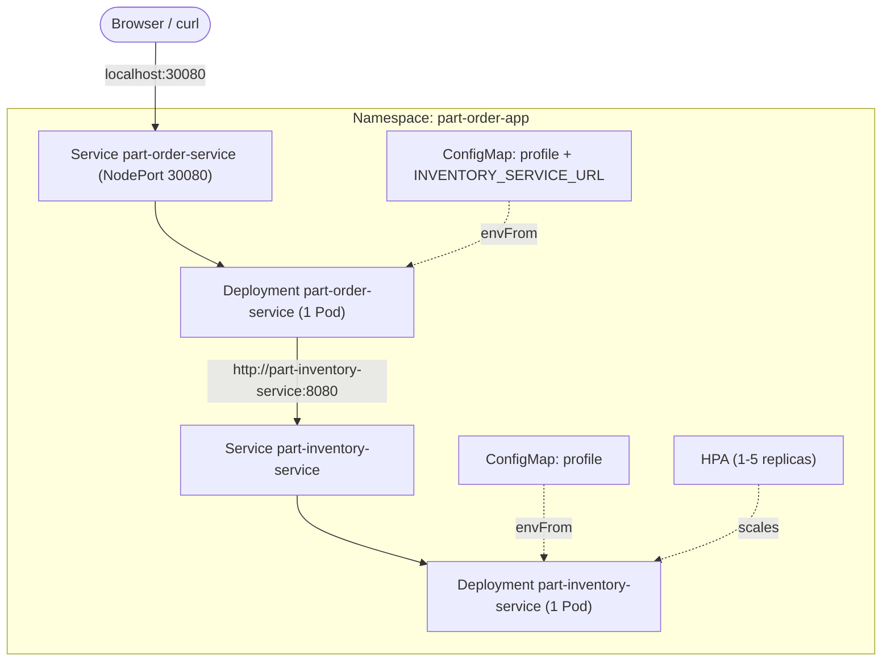
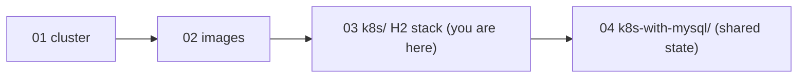

# Walkthrough 03 — Deploy the App on Kubernetes (the `k8s/` H2 Stack)

Hand-write the manifests that run `part-inventory-service` and
`part-order-service` on your Docker Desktop cluster: a Namespace, two
ConfigMaps, two Deployments with probes and resource limits, two Services, and
a HorizontalPodAutoscaler. Then learn why that last one is a trap with this
stack. Part of the [part-order-app-java walkthrough series](../../README.md).

## What you'll build

The `dev`-profile stack from [k8s/](../../../part-order-app-java/k8s/): both services on the in-memory H2 database, one replica each, with the order service's web UI reachable at `http://localhost:30080`.

## Who this is for / prerequisites

- A verified Docker Desktop cluster: [walkthrough 01](../01-docker-desktop-cluster/README.md), including metrics-server (Step 8 needs it)
- The images, from [walkthrough 02](../02-build-docker-images/README.md). The manifests pull the published `ram1uj/*:latest` images, so Path A there is enough; you do not have to build anything.
- If you already deployed the repo's `k8s/` stack, delete it first so the names and port 30080 are free: `kubectl delete namespace part-order-app`
- Time: about 90 minutes, most of it waiting for Spring Boot Pods to become Ready

## Steps

| Step | File | What you'll add | Est. time |
| --- | --- | --- | --- |
| 1 | [01-concepts.md](01-concepts.md) | The objects, how they connect, why one replica | 8 min |
| 2 | [02-namespace.md](02-namespace.md) | `namespace.yaml` | 5 min |
| 3 | [03-configmaps.md](03-configmaps.md) | Both ConfigMaps and the inventory service URL | 10 min |
| 4 | [04-inventory-deployment.md](04-inventory-deployment.md) | Inventory Deployment: image, port, config, self-healing | 12 min |
| 5 | [05-probes-and-resources.md](05-probes-and-resources.md) | Readiness and liveness probes, requests and limits | 12 min |
| 6 | [06-inventory-service.md](06-inventory-service.md) | Inventory Service and in-cluster DNS | 10 min |
| 7 | [07-order-service.md](07-order-service.md) | Order Deployment and NodePort Service; place an order | 15 min |
| 8 | [08-hpa-and-shared-state.md](08-hpa-and-shared-state.md) | HPA, and what it does to in-memory state | 15 min |
| 9 | [09-operating-the-stack.md](09-operating-the-stack.md) | Logs, restarts, rollback, a broken probe, teardown | 12 min |
| 10 | [10-recap-and-exercises.md](10-recap-and-exercises.md) | Quick reference, gotchas, exercises | 10 min |

## Relationship to the reference implementation

By the end, every trainee file should match the real manifest under [k8s/](../../../part-order-app-java/k8s/):

| Trainee file | Reference |
| --- | --- |
| `namespace.yaml` | [namespace.yaml](../../../part-order-app-java/k8s/namespace.yaml) |
| `part-inventory-service/configmap.yaml` | [configmap.yaml](../../../part-order-app-java/k8s/part-inventory-service/configmap.yaml) |
| `part-inventory-service/deployment.yaml` | [deployment.yaml](../../../part-order-app-java/k8s/part-inventory-service/deployment.yaml) |
| `part-inventory-service/service.yaml` | [service.yaml](../../../part-order-app-java/k8s/part-inventory-service/service.yaml) |
| `part-inventory-service/hpa.yaml` | [hpa.yaml](../../../part-order-app-java/k8s/part-inventory-service/hpa.yaml) |
| `part-order-service/configmap.yaml` | [configmap.yaml](../../../part-order-app-java/k8s/part-order-service/configmap.yaml) |
| `part-order-service/deployment.yaml` | [deployment.yaml](../../../part-order-app-java/k8s/part-order-service/deployment.yaml) |
| `part-order-service/service.yaml` | [service.yaml](../../../part-order-app-java/k8s/part-order-service/service.yaml) |

The final checkpoint for each file is diffed against its reference. The
authoritative design notes are [k8s/NOTES.md](../../../part-order-app-java/k8s/NOTES.md); this walkthrough teaches the same stack in build order.

## Suggested demo flow

- At Step 4, apply the Deployment **without** probes and run `kubectl logs` right after `READY` shows `1/1`. The app is still booting. At Step 5 add the probes and show the same Pod take 30-40 seconds to become Ready. Trainees see why probes exist before reading what they are.
- Delete a running Pod in Step 4 and watch the ReplicaSet replace it; do it again in Step 9 with `rollout undo` for the other half of "Kubernetes keeps this alive".
- In Step 6, resolve `part-inventory-service` from a throwaway `curlimages/curl` Pod. The short DNS name is what the ConfigMap in Step 3 relied on, so this closes a loop opened earlier.
- In Step 8, let the HPA run for 3-4 minutes and then sample stock 12 times from inside the cluster. Seeing `100` and `98` returned by the same Service address is the most convincing demonstration of the H2 limitation you will get.
- In Step 9, patch the readiness path to a bad URL and watch the rollout stall with the old Pod still serving. It shows readiness gating a rollout, which is the real job of that probe.

## Where this sits

Start with **[Step 1 — Concepts](01-concepts.md)**.
