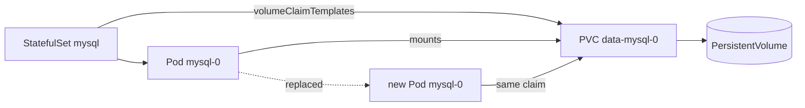

# Step 1 — Concepts: What Changes When State Leaves the Pod

> [Back to index](README.md) · Next: [Step 2 — Namespace and Secret](02-namespace-and-secret.md)

## Goal

Understand what is different from the H2 stack, what a StatefulSet and a PersistentVolumeClaim add, and why credentials now need a Secret.

## What you are building

The same two services, but the database is a real server, shared by both, with storage that outlives its Pod.

| | `k8s/` (walkthrough 03) | `k8s-with-mysql/` (this one) |
| --- | --- | --- |
| Spring profile | `dev` | `prod` |
| Data | H2 in memory, per Pod | MySQL on a persistent volume, shared |
| Replicas per service | 1 | 2 |
| Seed data | `data.sql` on every boot | none; Hibernate creates empty tables |
| Credentials | none | a Secret, one key per consumer |
| Startup ordering | none needed | an `initContainer` waits for MySQL |
| order NodePort | 30080 | 30081 |
| Namespace | `part-order-app` | `part-order-app-mysql` |

New objects:

| Object | Job | File |
| --- | --- | --- |
| Secret | holds passwords; referenced by name, never copied into manifests that run the app | `mysql/secret.yaml` |
| StatefulSet | like a Deployment, but each Pod gets a stable name (`mysql-0`) and its own volume | `mysql/statefulset.yaml` |
| PersistentVolumeClaim | a request for storage that survives Pod replacement | created by `volumeClaimTemplates` |
| Headless Service (`clusterIP: None`) | DNS name that resolves straight to the Pod, no virtual IP | `mysql/service.yaml` |
| initContainer | runs to completion before the main container starts | inside each app Deployment |



## Why this matters

Walkthrough 03 ended with a failure: scale the inventory service and the same
URL returns different stock depending on which Pod answers. The only real fix
is to move state out of the application process into one place all replicas
share. Three Kubernetes ideas make that safe, and each corresponds to a file:

1. **Storage must outlive the Pod.** A container's filesystem disappears with it. A PVC is a separate object; when `mysql-0` is replaced, the new Pod re-attaches the same claim and finds its data.
2. **A database is not interchangeable like a web server.** A Deployment's Pods are anonymous and can start in any order. A StatefulSet gives `mysql-0` a stable identity and its own claim (`data-mysql-0`), so "which volume does this instance own" always has an answer.
3. **Secrets are not secure by being Secrets.** A `Secret` is only base64, and this repo's file even commits it in plaintext `stringData`, which its own header calls local-only. What the object does give you is a place to *reference* credentials, so each Deployment pulls exactly one key and never sees the root password.

The sharing arrangement is also deliberate: one MySQL server, two databases, two
users. `inventory_app` can touch only `part_inventory_db` and `order_app` only
`part_order_db`, so even if one service is compromised or buggy it cannot read the other's tables.

Background: [08-deployment-vs-statefulsets.md](../../../../kubernetes/kubernetes-intro/08-deployment-vs-statefulsets.md), [07-configmap-and-secrets.md](../../../../kubernetes/kubernetes-intro/07-configmap-and-secrets.md).

## Try it

```bash
kubectl config current-context        # docker-desktop
kubectl get storageclass              # expect a (default) class, e.g. hostpath
kubectl get ns part-order-app-mysql   # expect NotFound
mkdir -p ~/k8s-lab/part-order-app-mysql/{mysql,part-inventory-service,part-order-service}
cd ~/k8s-lab/part-order-app-mysql
```

The storage class check matters: without a default one, a PVC stays `Pending` forever and so does the Pod waiting for it.

Target layout, matching the repo:

```text
part-order-app-mysql/
  namespace.yaml
  mysql/                   secret.yaml  service.yaml  init-configmap.yaml  statefulset.yaml
  part-inventory-service/  configmap.yaml  deployment.yaml  service.yaml
  part-order-service/      configmap.yaml  deployment.yaml  service.yaml
```

## Common mistakes

| Symptom | Cause | Fix |
| --- | --- | --- |
| No StorageClass listed | the cluster has no dynamic provisioner | on Docker Desktop re-enable Kubernetes; elsewhere install a provisioner |
| `part-order-app-mysql` already exists | an earlier run of this stack | `kubectl delete namespace part-order-app-mysql`, then wait |
| Low memory, Pods `Pending` | Docker Desktop has too little RAM for MySQL plus four app Pods | raise it (walkthrough 01, Step 2) |

Next: **[Step 2 — Namespace and Secret](02-namespace-and-secret.md)**.
