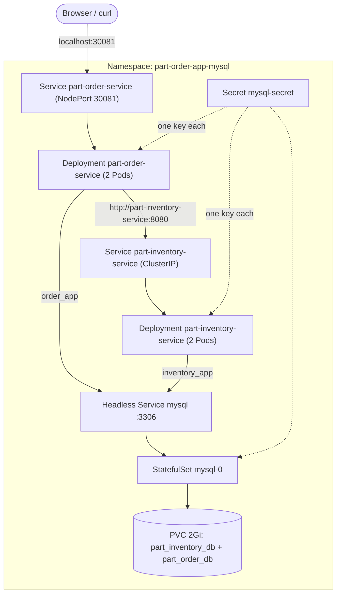
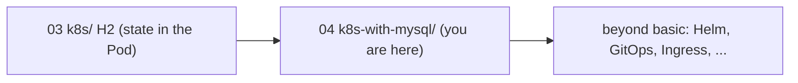

# Walkthrough 04 — Shared State with MySQL (the `k8s-with-mysql/` Stack)

Move the data out of the Pods. Hand-write the manifests for a MySQL
StatefulSet with a persistent volume, and rewire both Spring Boot services to
use it through the `prod` profile, so each can safely run two replicas. Part of
the [part-order-app-java walkthrough series](../../README.md).

## What you'll build

The stack in [k8s-with-mysql/](../../../part-order-app-java/k8s-with-mysql/): one shared MySQL holding two databases with two scoped users, and both services at 2 replicas, with the order UI at `http://localhost:30081`.

## Who this is for / prerequisites

- Walkthrough [03](../03-k8s-h2-stack/README.md) done, or at least its Steps 4-7; this one builds on those Deployments and explains only what changes
- A working cluster with a default StorageClass (Docker Desktop provides `hostpath`)
- Docker Desktop with about 4 CPU / 6 GB (see [walkthrough 01, Step 2](../01-docker-desktop-cluster/02-enable-kubernetes.md)): MySQL requests 512 Mi and four app Pods request 256 Mi each
- This stack lives in its own Namespace and NodePort (30081), so it can run beside the 03 stack. If you already deployed the repo's version, `kubectl delete namespace part-order-app-mysql` first.
- The images are the published `ram1uj/*:latest` ones, as in 03
- Time: about 2 hours, including MySQL first-boot waits

## Steps

| Step | File | What you'll add | Est. time |
| --- | --- | --- | --- |
| 1 | [01-concepts.md](01-concepts.md) | What changes from the H2 stack and why | 8 min |
| 2 | [02-namespace-and-secret.md](02-namespace-and-secret.md) | `namespace.yaml`, `secret.yaml` | 10 min |
| 3 | [03-mysql-statefulset.md](03-mysql-statefulset.md) | Headless Service, StatefulSet, persistent volume | 15 min |
| 4 | [04-init-script.md](04-init-script.md) | Init ConfigMap: two databases, two scoped users; the empty-volume rule | 15 min |
| 5 | [05-mysql-probes-and-resources.md](05-mysql-probes-and-resources.md) | `exec` probes and resources, completing the StatefulSet | 10 min |
| 6 | [06-inventory-service.md](06-inventory-service.md) | `prod` ConfigMap, initContainer, Secret key, 2 replicas | 20 min |
| 7 | [07-order-service.md](07-order-service.md) | Order service, NodePort 30081, first order across replicas | 15 min |
| 8 | [08-state-and-failure.md](08-state-and-failure.md) | Scoped users, MySQL restarts, wiping the volume | 15 min |
| 9 | [09-recap-and-exercises.md](09-recap-and-exercises.md) | Quick reference, gotchas, exercises | 10 min |

## Relationship to the reference implementation

By the end, every trainee file should match the real manifest under [k8s-with-mysql/](../../../part-order-app-java/k8s-with-mysql/):

| Trainee file | Reference |
| --- | --- |
| `namespace.yaml` | [namespace.yaml](../../../part-order-app-java/k8s-with-mysql/namespace.yaml) |
| `mysql/secret.yaml` | [secret.yaml](../../../part-order-app-java/k8s-with-mysql/mysql/secret.yaml) |
| `mysql/service.yaml` | [service.yaml](../../../part-order-app-java/k8s-with-mysql/mysql/service.yaml) |
| `mysql/init-configmap.yaml` | [init-configmap.yaml](../../../part-order-app-java/k8s-with-mysql/mysql/init-configmap.yaml) |
| `mysql/statefulset.yaml` | [statefulset.yaml](../../../part-order-app-java/k8s-with-mysql/mysql/statefulset.yaml) |
| `part-inventory-service/{configmap,deployment,service}.yaml` | [part-inventory-service/](../../../part-order-app-java/k8s-with-mysql/part-inventory-service/) |
| `part-order-service/{configmap,deployment,service}.yaml` | [part-order-service/](../../../part-order-app-java/k8s-with-mysql/part-order-service/) |

The final checkpoint of each file is diffed against its reference. The
authoritative design notes, with sequence diagrams and the "left out" table, are in [k8s-with-mysql/NOTES.md](../../../part-order-app-java/k8s-with-mysql/NOTES.md).

## Suggested demo flow

- At the end of Step 3, create a throwaway database, delete `mysql-0`, and show the row is still there. Then in Step 4 watch that same database disappear when you reset the volume. Persistence and "what the volume remembers" become one story.
- Step 4 has the most useful failure in the series: mount the init script into an **already initialised** volume and show the databases were not created. Do it live; it is exactly what trainees will hit when they edit the script later.
- In Step 6 leave `kubectl get pods -w` running while you apply, so the group sees `Init:0/1` and why it is not an error.
- In Step 7 repeat the sampling loop from [walkthrough 03, Step 8](../03-k8s-h2-stack/08-hpa-and-shared-state.md): twelve requests, one answer. Contrast it with the `100` / `98` split from before.
- In Step 8 try to read `part_order_db` as `inventory_app` and show `Access denied`. Then wipe the volume and show the apps return HTTP 500 until restarted, which is a real operational hazard.

## Where this sits

Start with **[Step 1 — Concepts](01-concepts.md)**.
