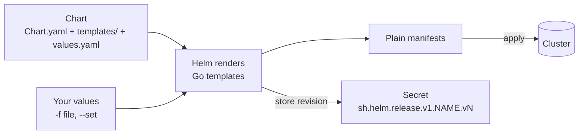

# Step 1 — Concepts: Charts, Releases and Values

> [Back to index](README.md) · Next: [Step 2 — Your First Chart](02-first-chart.md)

## Goal

Know what a chart, a release, a values file and a revision are, and what happens between typing `helm install` and Kubernetes receiving YAML.

## What you are building

Helm is a package manager and templating engine for Kubernetes manifests. It does two jobs:

1. **Render**: combine templates with values to produce ordinary Kubernetes YAML.
2. **Track**: apply that YAML as a named *release* and remember every version of it, so you can upgrade and roll back.



| Term | Meaning | Example here |
| --- | --- | --- |
| Chart | a folder: metadata, templates, default values | `part-order-app/` |
| Values | the inputs; `values.yaml` holds defaults, `-f` and `--set` override | `values-prod.yaml` |
| Template | a manifest with `{{ ... }}` placeholders | `templates/deployment.yaml` |
| Release | one installed instance of a chart, with a name you choose | `helm install web ...` |
| Revision | a numbered version of a release; every install/upgrade/rollback adds one | `helm history web` |
| Namespace | the release lives in one (`-n`), like any other object | `part-order-app-mysql` |

The same chart can be installed many times under different release names and namespaces. That is what lets this series run dev and prod side by side.

## Why this matters

Compare `k8s/` and `k8s-with-mysql/` from walkthroughs 03 and 04. The two
folders hold about 20 near-identical files that differ in a few lines: the Spring
profile, the replica count, the namespace, the NodePort, and the extra MySQL
objects. Maintain them by hand and every fix has to be made twice, and one
copy eventually falls behind. Helm turns "the differences" into values and
"the shared shape" into one template, so you change a probe once and both
environments get it.

The trade is readability. A template mixes YAML with logic, and a mistake can
produce YAML that is valid but wrong. The working discipline, which this walkthrough
uses throughout, is to **render before you install** (`helm template`), read the
output, and trust the rendered YAML rather than the template.

Helm also records state. Each revision is stored as a Secret in the release's
namespace, which is how `helm rollback` knows what "revision 2" was. That
record is separate from what is running: if someone edits a Deployment with
`kubectl`, Helm's record does not change, and the next `helm upgrade` can overwrite their edit.

## Try it

```bash
helm version --short
helm env | grep -E "HELM_(NAMESPACE|KUBECONTEXT)"
kubectl config current-context        # docker-desktop
helm list -A                          # existing releases, probably none
```

Expected: a Helm version (3.x or 4.x), your `docker-desktop` context, and an empty release list.

Look at what Helm's own scaffold generates, to see what you will deliberately not use:

```bash
mkdir -p ~/helm-lab && cd ~/helm-lab
helm create demo
find demo -type f | sort
rm -rf demo
```

Expected: `Chart.yaml`, `values.yaml`, `.helmignore` and a `templates/` folder with a Deployment, Service, Ingress, HPA, ServiceAccount, helpers, `NOTES.txt` and a test. The charts in this series are hand-built and much smaller, because every file you did not write is a file you have to explain.

## Common mistakes

| Symptom | Cause | Fix |
| --- | --- | --- |
| `Kubernetes cluster unreachable` | wrong or stopped cluster | `kubectl config current-context`; run `./check-cluster.sh` from walkthrough 01 |
| Release not found with `helm list` | listing the wrong namespace | `helm list -A` shows all namespaces; releases are per-namespace |
| Confusing Helm's release record with live state | they are separate | `helm get manifest NAME` shows what Helm applied; `kubectl get` shows what exists |

Next: **[Step 2 — Your First Chart](02-first-chart.md)**.
