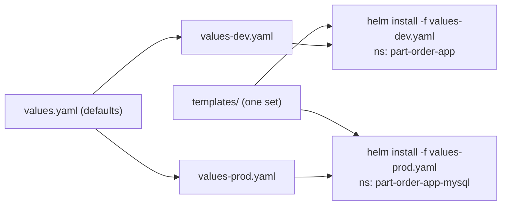
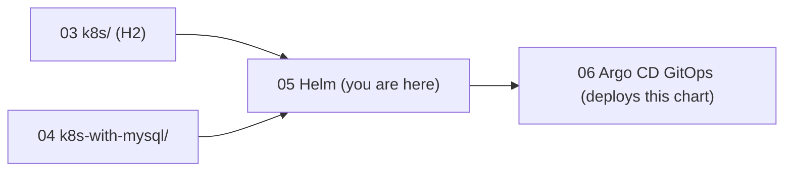

# Walkthrough 05 — Package the App with Helm

Learn Helm by building two charts from an empty folder: a tiny `nginx-app` to
see the mechanics, then the real `part-order-app` chart, which reproduces both
the H2 stack (walkthrough 03) and the MySQL stack (walkthrough 04) from one set
of templates and two values files. Part of the
[part-order-app-java walkthrough series](../../README.md).

## What you'll build

- [nginx-app](../../../part-order-app-java/helm/nginx-app/): a 4-file chart (Deployment + Service) with `values-dev.yaml` and `values-prod.yaml` overlays. It is the same chart Argo CD deploys in the GitOps walkthrough.
- [part-order-app](../../../part-order-app-java/helm/part-order-app/): the full application chart. `springProfile: dev` gives 2 ConfigMaps, 2 Deployments and 2 Services; `springProfile: prod` with `mysql.enabled: true` adds a Secret, an init ConfigMap, a headless Service and a StatefulSet, and doubles the replicas.

## Who this is for / prerequisites

- Walkthroughs [03](../../basic/03-k8s-h2-stack/README.md) and [04](../../basic/04-k8s-mysql-stack/README.md) done, or at least read: this one parameterises exactly those manifests and explains only what Helm adds
- Helm 3 or 4 installed (`brew install helm`). The commands here were run with Helm 4.2.3; where 3 and 4 differ, the text says so
- A working cluster ([walkthrough 01](../../basic/01-docker-desktop-cluster/README.md))
- If the 03 or 04 stacks are still running, their NodePorts (30080, 30081) are taken. Step 9 shows the `--set` override, or delete them first
- Time: about 2.5 hours

## Steps

| Step | File | What you'll add | Est. time |
| --- | --- | --- | --- |
| 1 | [01-concepts.md](01-concepts.md) | Chart, release, values, revision; the render pipeline | 8 min |
| 2 | [02-first-chart.md](02-first-chart.md) | `nginx-app`: Chart.yaml, values.yaml, two templates | 15 min |
| 3 | [03-releases.md](03-releases.md) | Install, upgrade with overlays, history, rollback, uninstall | 20 min |
| 4 | [04-chart-foundation.md](04-chart-foundation.md) | `part-order-app`: Chart.yaml, .helmignore, values.yaml, `_helpers.tpl` | 15 min |
| 5 | [05-inventory-templates.md](05-inventory-templates.md) | Inventory ConfigMap, Deployment, Service as templates | 20 min |
| 6 | [06-order-templates.md](06-order-templates.md) | Order service templates; one service referring to another | 12 min |
| 7 | [07-optional-mysql.md](07-optional-mysql.md) | `if mysql.enabled`: MySQL templates and conditional blocks | 25 min |
| 8 | [08-overlays-and-notes.md](08-overlays-and-notes.md) | `values-dev.yaml`, `values-prod.yaml`, `NOTES.txt`, `existingSecret` | 15 min |
| 9 | [09-install-and-operate.md](09-install-and-operate.md) | Install both side by side; upgrade, rollback, uninstall | 25 min |
| 10 | [10-recap-and-exercises.md](10-recap-and-exercises.md) | Quick reference, gotchas, exercises | 10 min |

## Relationship to the reference implementation

By the end, every file you write should match its counterpart under [helm/](../../../part-order-app-java/helm/):

| Trainee file | Reference |
| --- | --- |
| `nginx-app/Chart.yaml`, `values.yaml`, `values-dev.yaml`, `values-prod.yaml` | [nginx-app/](../../../part-order-app-java/helm/nginx-app/) |
| `nginx-app/templates/deployment.yaml`, `service.yaml` | [nginx-app/templates/](../../../part-order-app-java/helm/nginx-app/templates/) |
| `part-order-app/Chart.yaml`, `.helmignore`, `values*.yaml` | [part-order-app/](../../../part-order-app-java/helm/part-order-app/) |
| `part-order-app/templates/_helpers.tpl`, `NOTES.txt` | [templates/](../../../part-order-app-java/helm/part-order-app/templates/) |
| `part-order-app/templates/part-inventory-service/*`, `part-order-service/*`, `mysql/*` | [templates/](../../../part-order-app-java/helm/part-order-app/templates/) |

The final checkpoint of each file is diffed against the reference. Not covered
here: `part-order-app/argocd/application.yaml` (that belongs to the Argo CD
walkthrough) and `README.md` (the chart's own reference, which this walkthrough checks claim by claim: see Step 9).

## Suggested demo flow

- Do **not** install anything until Step 3. Up to there, use only `helm template` and `helm lint`. Trainees see that Helm is "just YAML rendering" first, and the fast feedback loop (edit, render, read) is the habit worth teaching.
- In Step 2, mistype a value name on purpose (`.Values.replicaCont`). The output shows `replicas:` with nothing after it, and `helm lint` still says it passed. Nothing else in the walkthrough teaches caution as effectively.
- In Step 3, run `helm upgrade web . --set replicaCount=2` **without** `-f` right after an overlay install, and watch the image revert to the chart default. Then show `--reuse-values`. This is the most common real-world Helm mistake.
- In Step 7, run `helm template ... | grep -c '^kind:'` with `mysql.enabled=false` and `=true` back to back: 6 objects against 10. It makes "one chart, two shapes" concrete.
- In Step 9, `helm list -A` with both releases up, then `helm uninstall` the MySQL release and show the PVC still there. That leftover volume surprises people exactly once.

## Where this sits

Start with **[Step 1 — Concepts](01-concepts.md)**.
