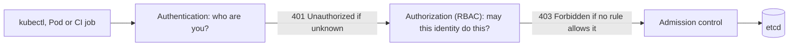

# Step 1 — Concepts: Authentication, Authorization and the Cast

> [Back to index](README.md) · Next: [Step 2 — Baseline](02-baseline.md)

## Goal

Understand where RBAC sits in an API request, which four objects make it up, and who the actors around the part-order-app are, before writing a single manifest.

## Why this matters

Every `kubectl` command, and every controller and Pod that talks to the cluster, ends up as an HTTP request to the API server. Two separate questions are asked about each request, in order:



Mixing these two up is the most common RBAC confusion. Authentication proves an
identity (a client certificate, a token); it grants **nothing**. RBAC then looks
at that identity and decides. A valid certificate with no bindings is a person who
got into the building and can open no door. You will see exactly that in Step 7.

The second thing to absorb is that Kubernetes has **no user database**. There is no
`kubectl create user`. A `User` or `Group` is only a name read off the credential
presented (for a certificate, `CN` is the user and each `O` is a group). A
`ServiceAccount` is the one identity that *is* an API object, and it is what Pods
and pipelines use.

## The four objects

| Object | Scope | What it holds |
| --- | --- | --- |
| `Role` | one namespace | a list of rules: apiGroup + resource + verb |
| `ClusterRole` | whole cluster | the same, and may also cover cluster-scoped resources such as Nodes |
| `RoleBinding` | one namespace | a Role *or* ClusterRole, bound to subjects, effective in that namespace only |
| `ClusterRoleBinding` | whole cluster | a ClusterRole bound to subjects, effective everywhere |

Three rules to keep in your head for the whole walkthrough:

- **Additive only.** There is no deny rule. A subject's access is the union of every Role bound to it; anything not granted is refused.
- **A Role does nothing until it is bound.** Writing the Role and forgetting the binding is the classic first mistake (Step 4 does it on purpose).
- **A ClusterRole plus a RoleBinding** gives "this reusable rule set, but only in this namespace". The built-in `view` role bound in Step 5 is this pattern.

A rule names three things, and you will translate `kubectl` commands into them in Step 4:

| Part | Example | How to find it |
| --- | --- | --- |
| apiGroup | `""` (core), `apps`, `autoscaling` | `kubectl api-resources` |
| resource | `pods`, `deployments`, `pods/log` (a subresource) | `kubectl api-resources` |
| verb | `get`, `list`, `watch`, `create`, `update`, `patch`, `delete` | `kubectl get <thing> -v=6` shows the HTTP call |

## The cast

| Actor | Identity | Gets | Built in |
| --- | --- | --- | --- |
| `part-inventory-service`, `part-order-service` Pods | their own ServiceAccounts | no API permissions, no token | Step 3 |
| A developer, `alice` | client certificate, group `part-order-devs` | Role `app-developer` plus read access to Nodes | Steps 4-7 |
| A viewer, `vera` | group `part-order-viewers` | the built-in `view` ClusterRole, in this namespace | Step 5 |
| The pipeline | ServiceAccount `ci-deployer`, token | Role `app-deployer` | Step 8 |
| A Pod that really calls the API | ServiceAccount `pod-lister`, mounted token | Role `pod-lister` | Step 9 |

The design principle behind all of them is **least privilege**: start from nothing and add the specific verbs a task needs, rather than starting from `cluster-admin` and removing things.

## What you will use to check your work

| Tool | What it answers |
| --- | --- |
| `kubectl auth whoami` | which identity the API server sees you as |
| `kubectl auth can-i <verb> <resource>` | would this request be allowed (add `--as`, `--as-group`, `-n`) |
| `kubectl auth can-i --list` | everything an identity may do in a namespace |
| `--as` and `--as-group` | act as another identity, which only an administrator may do |

## Try it

Nothing to build yet. Confirm your tools are recent enough:

```bash
kubectl version --client
kubectl auth whoami
```

Expected: a client version of 1.28 or newer, and a table with a `Username`. If `auth whoami` is unknown, upgrade `kubectl`.

## Checkpoint

This step creates no file. You should be able to answer, without looking:

<details>
<summary>Self-check</summary>

- A request has a valid certificate but no binding grants anything. Is the status 401 or 403? (403: authenticated, not authorized.)
- Can you write a Role that *denies* something? (No, RBAC is additive; you just do not grant it.)
- A `RoleBinding` references a `ClusterRole`. Where is it effective? (Only in the RoleBinding's namespace.)

</details>

## Common mistakes

| Symptom | Cause | Fix |
| --- | --- | --- |
| Expecting `kubectl create user alice` to exist | users are not API objects | an identity comes from a certificate, a token or an external provider |
| "RBAC isn't working, everything is allowed" | you are testing as a cluster administrator | test with `--as`, a token or a second kubeconfig (Step 2) |
| Role created but nothing changes | no RoleBinding | bind it to a subject (Step 5) |

Next: **[Step 2 — Baseline](02-baseline.md)**.
