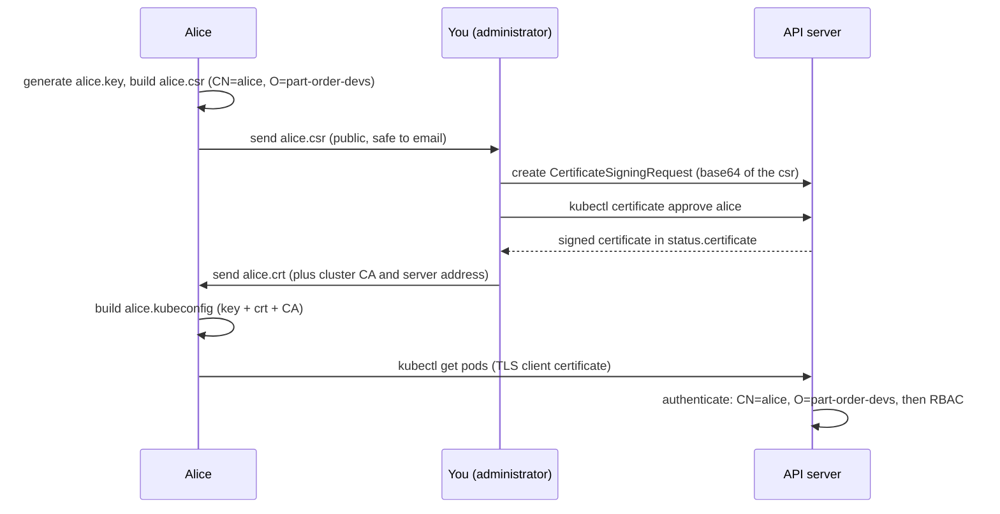

# Step 7 — A Real User: A Client Certificate Through the CSR API

> [Back to index](README.md) · Previous: [Step 6](06-cluster-scope.md) · Next: [Step 8 — The CI Deployer](08-ci-deployer.md)

## Goal

Issue `alice` a real credential, put it in her own kubeconfig, and use it, so the group `part-order-devs` stops being a flag on `--as-group` and becomes something the API server reads off a certificate.

## Why this matters

Until now you *claimed* Alice's identity with `--as`. Real users prove it. The API
server accepts a client certificate signed by the cluster's CA and reads two
things from it: `CN` becomes the user name, each `O` becomes a group. Nothing is
looked up anywhere; that is the "no user database" point from Step 1 made concrete.

The right way to get that certificate signed is the Kubernetes **CertificateSigningRequest**
(CSR) API, because the private key then never leaves the person's machine. The
flow has two roles, and in this lab you play both:



This needs a cluster whose signer you can use. Docker Desktop's kubeadm cluster
has one. Managed clouds (GKE, EKS) connect people through cloud identity instead; the
study note [09-rbac.md](../../../../kubernetes/kubernetes-intermediate/09-rbac.md) covers how that maps onto RBAC.

## 1. Alice generates a key and a signing request

```bash
mkdir -p ~/rbac-lab/alice && cd ~/rbac-lab/alice
openssl genrsa -out alice.key 2048
openssl req -new -key alice.key -out alice.csr -subj "/CN=alice/O=part-order-devs"
openssl req -in alice.csr -noout -subject
```

Expected: a subject with `CN=alice` and `O=part-order-devs` (spacing differs between OpenSSL versions). `part-order-devs` is the group the RoleBinding of Step 5 names. `alice.key` is a credential: keep it private.

## 2. You submit and approve the request

The request body is the base64 of the CSR file, so generate the manifest with a here-document:

```bash
cat > alice-csr.yaml <<EOF
apiVersion: certificates.k8s.io/v1
kind: CertificateSigningRequest
metadata:
  name: alice
spec:
  request: $(base64 < alice.csr | tr -d '\n')
  signerName: kubernetes.io/kube-apiserver-client
  expirationSeconds: 86400
  usages:
    - client auth
EOF
kubectl apply -f alice-csr.yaml
kubectl get csr alice
```

- `signerName: kubernetes.io/kube-apiserver-client` asks the built-in signer for a certificate that works for API client authentication.
- `expirationSeconds: 86400` makes the certificate valid for a day. Kubernetes keeps no revocation list, so a short life is your main control (the minimum is 600 seconds).
- `usages: client auth` is required by this signer: the certificate is for authenticating a client, not for serving TLS.

Expected: the request is `Pending`. Approving it is a deliberate administrator step, not automatic:

```bash
kubectl certificate approve alice
kubectl get csr alice
kubectl get csr alice -o jsonpath='{.status.certificate}' | base64 -d > alice.crt
openssl x509 -in alice.crt -noout -subject -issuer -dates
```

Expected: `Approved,Issued`, then a certificate whose subject is `alice` / `part-order-devs`, issuer `CN=kubernetes`, and `notAfter` 24 hours after `notBefore`.

## 3. Build Alice's kubeconfig

A kubeconfig has three lists (cluster, user, context). Take the cluster's address and CA from your own kubeconfig:

```bash
CLUSTER=$(kubectl config view --minify -o jsonpath='{.clusters[0].name}')
SERVER=$(kubectl config view --minify -o jsonpath='{.clusters[0].cluster.server}')
kubectl config view --raw --minify -o jsonpath='{.clusters[0].cluster.certificate-authority-data}' | base64 -d > ca.crt

kubectl config set-cluster "$CLUSTER" --server="$SERVER" --certificate-authority=ca.crt --embed-certs --kubeconfig=alice.kubeconfig
kubectl config set-credentials alice --client-certificate=alice.crt --client-key=alice.key --embed-certs --kubeconfig=alice.kubeconfig
kubectl config set-context alice --cluster="$CLUSTER" --user=alice --namespace=part-order-app --kubeconfig=alice.kubeconfig
kubectl config use-context alice --kubeconfig=alice.kubeconfig
chmod 600 alice.key alice.kubeconfig
```

`--embed-certs` copies the file contents into the kubeconfig so it is one portable file. Handing `alice.kubeconfig` over is equivalent to handing over a password: anyone holding it is Alice until the certificate expires.

## Try it

Point a single command at her kubeconfig with the `KUBECONFIG` variable. Prefixing one command, rather than exporting the variable, means your shell cannot get stuck as Alice:

```bash
KUBECONFIG=alice.kubeconfig kubectl auth whoami
KUBECONFIG=alice.kubeconfig kubectl get pods
KUBECONFIG=alice.kubeconfig kubectl get secrets
KUBECONFIG=alice.kubeconfig kubectl get pods -n default
KUBECONFIG=alice.kubeconfig kubectl get nodes
```

Expected: `whoami` shows `Username  alice` and `Groups  [part-order-devs system:authenticated]`, which came from the certificate. `get pods` lists the stack (the context's namespace is `part-order-app`); `secrets` and the `default` namespace are `Forbidden`; `nodes` works through the ClusterRoleBinding. This is exactly the result of the `--as` tests in Steps 5 and 6, now earned by a credential.

### Authenticated is not authorized

As administrator, remove the binding, and ask again with the same certificate:

```bash
kubectl delete rolebinding app-developer-binding -n part-order-app
KUBECONFIG=alice.kubeconfig kubectl auth whoami
KUBECONFIG=alice.kubeconfig kubectl get pods
kubectl apply -f ~/rbac-lab/app-developer-binding.yaml
```

Expected: `whoami` still says `alice` (authentication is unaffected), but `get pods` is now `Forbidden`. The RoleBinding was the only thing granting Pods. Re-applying it restores access immediately. **Removing bindings is the fast way to cut someone off**, because the certificate itself cannot be revoked.

Deleting the CSR object does not help either:

```bash
kubectl delete csr alice
KUBECONFIG=alice.kubeconfig kubectl auth whoami
```

Expected: still `alice`. The certificate lives in `alice.kubeconfig`, not in the cluster; the CSR object was only the means of obtaining it.

## Checkpoint

No manifest is shipped for this step, because `alice-csr.yaml` contains a per-request base64 body. The files you should have, and what must hold:

<details>
<summary>Expected contents of <code>~/rbac-lab/alice/</code></summary>

```text
alice.key          private key (never shared)
alice.csr          signing request (public)
alice-csr.yaml     the CertificateSigningRequest object you applied
alice.crt          the signed certificate, subject CN=alice O=part-order-devs
ca.crt             the cluster CA, taken from your kubeconfig
alice.kubeconfig   cluster + user + context in one file, mode 600
```

```text
$ KUBECONFIG=alice.kubeconfig kubectl auth whoami
Username  alice
Groups    [part-order-devs system:authenticated]
```

</details>

## Common mistakes

| Symptom | Cause | Fix |
| --- | --- | --- |
| `Forbidden` for everything although `whoami` is correct | the group in `O=` does not match the RoleBinding subject, or the binding is missing | compare `whoami` Groups with `kubectl get rolebinding -n part-order-app -o wide` |
| `Unauthorized` (401) | the certificate expired, or was signed by a different cluster's CA | check `notAfter`; re-issue; confirm `ca.crt` is this cluster's |
| CSR stays `Pending` | nobody approved it | `kubectl certificate approve alice` |
| Re-running the step fails because the CSR `alice` already exists | CSR names are unique and a CSR's spec cannot be edited | `kubectl delete csr alice`, or use another name |
| `base64 -d` is rejected | older macOS `base64` | use `base64 -D` |
| Your shell is stuck acting as Alice | `export KUBECONFIG=...` was used | `unset KUBECONFIG` |
| Committed `alice.key` or the kubeconfig to git | credentials look like ordinary files | rotate (re-issue) and remove from history; add to `.gitignore` |

Next: **[Step 8 — The CI Deployer](08-ci-deployer.md)**.
