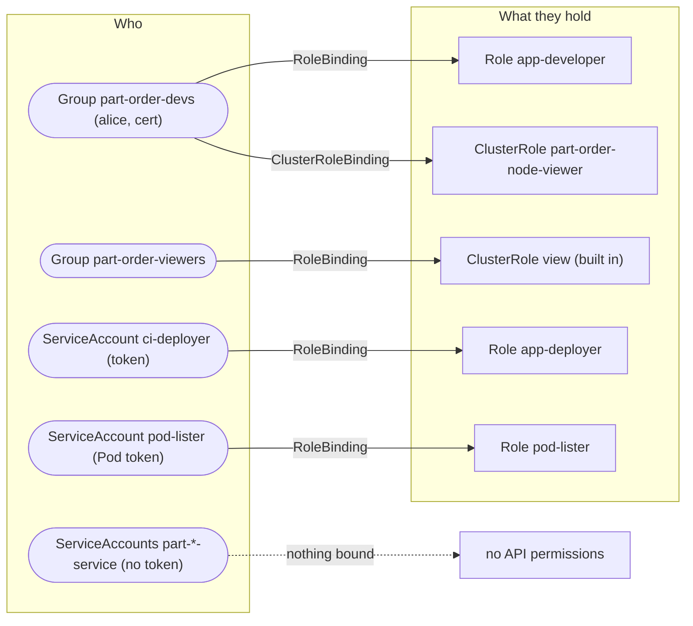
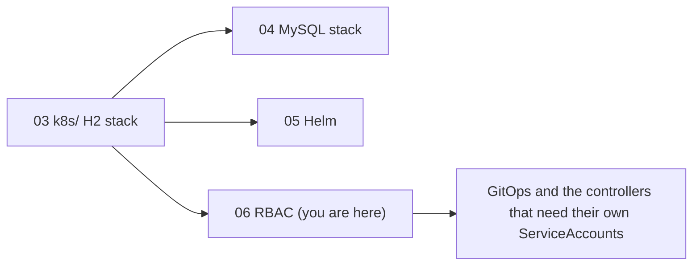

# Walkthrough 06 — RBAC: Who Can Do What in the part-order-app Namespace

Give every actor around the part-order-app its own identity and only the permissions it needs: the two services get no API access at all, developers get a hand-written Role, a viewer group gets the built-in `view`, a CI pipeline gets a deploy-only ServiceAccount, and a real person gets a client certificate. You prove each grant with `kubectl auth can-i` and by actually trying to break it. Part of the [part-order-app-java walkthrough series](../../README.md).

## What you'll build

Seven manifests in the `part-order-app` namespace (plus one cluster-scoped pair), and the kubeconfigs that use them:

## Who this is for / prerequisites

- A working Docker Desktop cluster: [walkthrough 01](../../basic/01-docker-desktop-cluster/README.md)
- The `k8s/` stack running in `part-order-app`, built in [walkthrough 03](../../basic/03-k8s-h2-stack/README.md): the steps exec into those Pods and change their Deployments
- `kubectl` 1.28 or newer (`kubectl auth whoami` is used throughout) and `openssl` (Step 7)
- Your kubeconfig identity on Docker Desktop is a cluster administrator. That is why every check here uses `--as`, a second kubeconfig or a token: as yourself, nothing is ever denied.
- Time: about 2 hours. Steps 3, 5, 8 and the optional end of 10 restart Deployments, so expect short waits while Spring Boot comes back up.

## Steps

| Step | File | What you'll add | Est. time |
| --- | --- | --- | --- |
| 1 | [01-concepts.md](01-concepts.md) | Authentication versus authorization, the four objects, the cast | 8 min |
| 2 | [02-baseline.md](02-baseline.md) | Who you are, what `default` can do, the token inside your app Pod | 12 min |
| 3 | [03-workload-service-accounts.md](03-workload-service-accounts.md) | `workload-serviceaccounts.yaml`: one identity per service, no token | 12 min |
| 4 | [04-role-for-developers.md](04-role-for-developers.md) | `app-developer-role.yaml`, rules derived from tasks | 15 min |
| 5 | [05-bindings-and-groups.md](05-bindings-and-groups.md) | Two RoleBindings, groups, impersonation, the Secrets boundary | 15 min |
| 6 | [06-cluster-scope.md](06-cluster-scope.md) | `node-viewer.yaml`: ClusterRole and ClusterRoleBinding | 10 min |
| 7 | [07-real-user-certificate.md](07-real-user-certificate.md) | A client certificate for `alice` through the CSR API, her kubeconfig | 20 min |
| 8 | [08-ci-deployer.md](08-ci-deployer.md) | `ci-deployer.yaml`: a short-lived token and a deploy-only Role | 15 min |
| 9 | [09-pods-calling-the-api.md](09-pods-calling-the-api.md) | `api-client.yaml`: a Pod that legitimately uses its token | 12 min |
| 10 | [10-guardrails-and-debugging.md](10-guardrails-and-debugging.md) | Escalation prevention, reading a 403, auditing bindings, cleanup | 15 min |
| 11 | [11-recap-and-exercises.md](11-recap-and-exercises.md) | Quick reference, gotchas, exercises | 10 min |

## Relationship to the reference implementation

The app's [k8s-rbac/](../../../part-order-app-java/k8s-rbac/) directory is empty, so there is no repo RBAC to copy. The reference here is [manifests/](manifests/), which was written for this walkthrough and run against a Docker Desktop cluster (Kubernetes v1.36.1). By the end, every trainee file should match its counterpart:

| Trainee file (in `~/rbac-lab/`) | Reference |
| --- | --- |
| `workload-serviceaccounts.yaml` | [workload-serviceaccounts.yaml](manifests/workload-serviceaccounts.yaml) |
| `app-developer-role.yaml` | [app-developer-role.yaml](manifests/app-developer-role.yaml) |
| `app-developer-binding.yaml` | [app-developer-binding.yaml](manifests/app-developer-binding.yaml) |
| `app-viewer-binding.yaml` | [app-viewer-binding.yaml](manifests/app-viewer-binding.yaml) |
| `node-viewer.yaml` | [node-viewer.yaml](manifests/node-viewer.yaml) |
| `ci-deployer.yaml` | [ci-deployer.yaml](manifests/ci-deployer.yaml) |
| `api-client.yaml` | [api-client.yaml](manifests/api-client.yaml) |

Each final checkpoint is diffed against its reference. The background reading is the study note [09-rbac.md](../../../../kubernetes/kubernetes-intermediate/09-rbac.md); this walkthrough applies it to the part-order-app and goes further on the practical side (the app's own ServiceAccounts, escalation prevention, real kubeconfigs).

## Suggested demo flow

- Open Step 2 by exec-ing into the running order service and calling the Kubernetes API with the token already sitting in `/var/run/secrets`. Nobody asked for that credential, and it is the strongest argument for Step 3.
- In Step 4, apply the Role and ask `can-i` straight away: `no`. A Role nobody is bound to grants nothing. Then do Step 5 and the same question flips to `yes`.
- In Step 5, run the same four `can-i` questions as `alice` and as `vera` back to back, and ask the room which of them can read the Secret before showing the answer.
- In Step 7, switch to Alice's kubeconfig, run `kubectl auth whoami`, then delete her RoleBinding as admin and re-run `kubectl get pods`. Same certificate, same identity, now denied. That is authentication versus authorization in thirty seconds.
- In Step 10, let the "attacker" try to grant herself `cluster-admin`. The refusal message is the part trainees remember.

## Where this sits

Start with **[Step 1 — Concepts](01-concepts.md)**.
