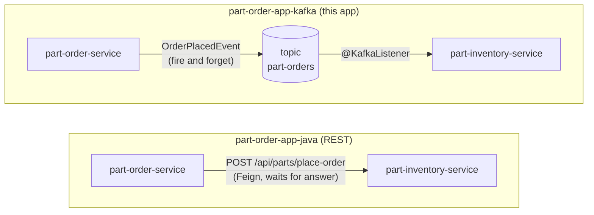

# part-order-app-kafka

A stripped-down version of [part-order-app-java](../part-order-app-java/) where the two services talk through **Kafka** instead of REST.

- **One message, one direction:** `part-order-service` → topic `part-orders` → `part-inventory-service`
- **H2 only:** no MySQL and no Spring profiles. Each service has one `application.yml`.
- **REST only:** no Thymeleaf UI. You drive it with `curl`.
- **Kubernetes:** step-by-step deploy guide in [k8s/NOTES.md](k8s/NOTES.md)
- **Autoscaling:** scale the consumer 0 → 3 → 0 on Kafka lag with KEDA in [k8s-with-keda/NOTES.md](k8s-with-keda/NOTES.md)

---

## REST version vs Kafka version



| | REST version | Kafka version |
| --- | --- | --- |
| Coupling | order-service needs inventory **up right now** | order-service needs only Kafka; inventory can be down and catch up later |
| Order response | `200` with the stock check result | `202 Accepted` with status `PLACED`, stock checked **later** |
| Rejected order (no stock) | caller sees the error | only shows in inventory's logs (one-way, no reply) |
| Order code | `InventoryServiceClient` (Feign) | `OrderEventPublisher` (`KafkaTemplate`) |
| Inventory code | `PartController.placeOrder()` | `OrderPlacedListener` (`@KafkaListener`) |

---

## The message

Topic `part-orders`, 3 partitions, **key = SKU**, value = JSON:

```json
{"orderNumber":"ORD-1A2B3C4D","sku":"SEAT-SAFE45-001","quantity":2,"placedAt":"2026-11-11T10:15:30.123"}
```

- Each service has its own `OrderPlacedEvent` record. They share a **JSON contract**, not a Java class.
- Keying by SKU puts all orders for one part on the same partition, so they're consumed in order.
- Producer: `JacksonJsonSerializer` with `spring.json.add.type.headers: false`, so it doesn't attach a `__TypeId__` header.
- Consumer: `ErrorHandlingDeserializer` wraps `JacksonJsonDeserializer`, with `spring.json.value.default.type` set to its own record.

---

## Code map

```
part-order-service/                     part-inventory-service/
  api/PartOrderController                 api/PartController         GET /api/parts[/{sku}]
      POST /api/orders, GET /api/orders   messaging/OrderPlacedListener  @KafkaListener
  service/PartOrderService                event/OrderPlacedEvent
      save order -> publish event         model/Part, repository/PartRepository
  messaging/OrderEventPublisher           resources/schema.sql, data.sql (10 seeded parts)
  config/KafkaTopicConfig  (NewTopic)
  event/OrderPlacedEvent
  model/PartOrder, repository/...
```

---

## Run locally (no Kubernetes)

```bash
# 1. a single-node Kafka (KRaft, no ZooKeeper) on localhost:9092
docker run -d --name kafka -p 9092:9092 apache/kafka:4.1.0

# 2. the two services, in two terminals (needs JDK 21+)
cd part-inventory-service && SERVER_PORT=8081 ./mvnw spring-boot:run
cd part-order-service     && ./mvnw spring-boot:run

# 3. place an order, then watch stock drop
curl -s localhost:8081/api/parts/SEAT-SAFE45-001          # stock: 100
curl -s -X POST localhost:8080/api/orders \
     -H 'Content-Type: application/json' \
     -d '{"sku":"SEAT-SAFE45-001","quantity":5}'          # 202, status PLACED
curl -s localhost:8081/api/parts/SEAT-SAFE45-001          # stock: 95

# clean up
docker rm -f kafka
```

## Build images

```bash
./build-commands-mac.sh   # pushes ram1uj/part-{inventory,order}-service-kafka:latest (amd64+arm64)
```

Single-arch local build, with no push. This is enough for Docker Desktop's Kubernetes:

```bash
docker build -t ram1uj/part-inventory-service-kafka:latest ./part-inventory-service
docker build -t ram1uj/part-order-service-kafka:latest     ./part-order-service
```
