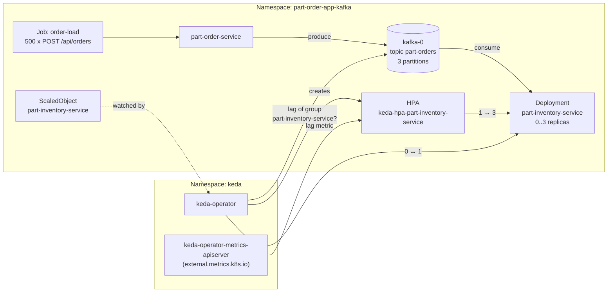
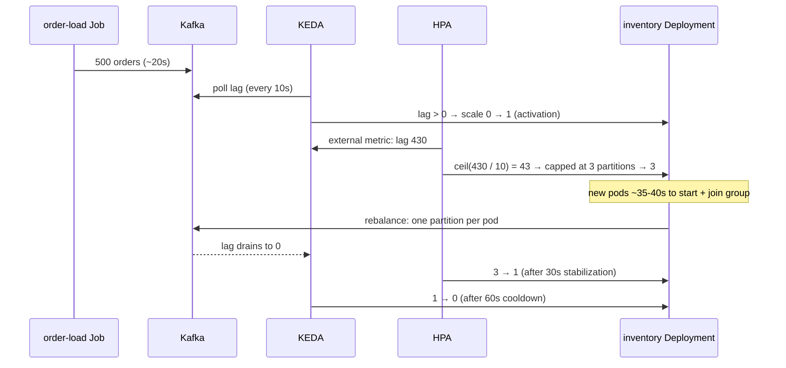

# part-order-app-kafka + KEDA: autoscaling the consumer on Kafka lag

Scale `part-inventory-service` between **0 and 3 replicas** based on how many orders are waiting on the `part-orders` topic, instead of on CPU.

- Concepts (what KEDA is, how the math works, gotchas): [12-keda-event-driven-autoscaling.md](../../../kubernetes/kubernetes-intermediate/12-keda-event-driven-autoscaling.md)
- Builds on the base stack: [../k8s/NOTES.md](../k8s/NOTES.md). Do Steps 1–6 there first.

> **Demo caveat:** `part-inventory-service` still uses **per-pod H2**.
> - Every new replica starts with fresh seeded stock.
> - 3 replicas means 3 separate stock tables.
>
> This demo shows the **scaling mechanics**. Ignore the stock numbers while it runs. For correct stock, the consumer needs a shared database first, as in [k8s-with-mysql](../../part-order-app-java/k8s-with-mysql/).

---

## Architecture



## Layout

```
k8s-with-keda/
  scaledobject.yaml      KEDA ScaledObject: kafka trigger, 0..3 replicas, lagThreshold 10
  load-test-job.yaml     in-cluster Job: 500 orders spread over the 10 SKUs
```

The rest of the setup already lives in the base stack:

| Change | Where | Why KEDA needs it |
| --- | --- | --- |
| `KAFKA_ADVERTISED_LISTENERS` uses the FQDN `…svc.cluster.local` | [k8s/kafka/statefulset.yaml](../k8s/kafka/statefulset.yaml) | the KEDA operator connects from the `keda` namespace, where the short name `kafka-0.kafka` doesn't resolve |
| `app.processing-delay-ms` (`PROCESSING_DELAY_MS`, default 0) | inventory `application.yml` + `OrderPlacedListener` | without artificial work, messages drain in milliseconds and no lag ever builds up to scale on |
| `max-poll-records: 20` | inventory `application.yml` | when a replica joins, the rebalance waits for the current batch. 500 × 200ms would stall it for 100s |

---

## Step 0: Prerequisites

```bash
kubectl -n part-order-app-kafka get pods     # kafka-0, part-inventory-service, part-order-service all Running
helm version --short                         # Helm v3 or v4
kubectl get apiservice | grep external.metrics
```

- If the last command prints anything, another **external metrics** provider is already installed, most often prometheus-adapter.
- A cluster can only have one, so KEDA's metrics server would fight it.

---

## Step 1: Pick up the new inventory code

The base stack's inventory image must include the `PROCESSING_DELAY_MS` setting. If you deployed before it was added, rebuild and restart:

```bash
./build-commands-mac.sh      # or: docker build -t ram1uj/part-inventory-service-kafka:latest ./part-inventory-service
kubectl -n part-order-app-kafka rollout restart deploy/part-inventory-service
```

Also re-apply Kafka if your broker still advertises the short name:

```bash
kubectl apply -f k8s/kafka/
kubectl -n part-order-app-kafka rollout status statefulset/kafka
```

---

## Step 2: Install KEDA

```bash
helm repo add kedacore https://kedacore.github.io/charts
helm repo update

helm install keda kedacore/keda --namespace keda --create-namespace --wait
```

Verify:

```bash
kubectl -n keda get pods
# keda-admission-webhooks-...           1/1  Running
# keda-operator-...                     1/1  Running
# keda-operator-metrics-apiserver-...   1/1  Running

kubectl get crd | grep keda.sh               # scaledobjects, scaledjobs, triggerauthentications, ...
kubectl get apiservice v1beta1.external.metrics.k8s.io   # AVAILABLE True
```

| Component | Job |
| --- | --- |
| `keda-operator` | watches ScaledObjects, polls the event source, creates the HPA, handles 0 ↔ 1 |
| `keda-operator-metrics-apiserver` | serves the lag as an **external metric**, which the HPA reads for 1 ↔ N |
| `keda-admission-webhooks` | rejects invalid ScaledObjects, e.g. a second autoscaler on the same Deployment |

---

## Step 3: Make the consumer slow enough to scale

```bash
kubectl -n part-order-app-kafka set env deploy/part-inventory-service PROCESSING_DELAY_MS=200
kubectl -n part-order-app-kafka rollout status deploy/part-inventory-service
```

One replica now handles about **5 messages/s**. That's slow enough for a backlog to build.

---

## Step 4: Apply the ScaledObject

```bash
kubectl apply -f k8s-with-keda/scaledobject.yaml

kubectl -n part-order-app-kafka get scaledobject
# NAME                     SCALETARGETKIND      SCALETARGETNAME          MIN  MAX  READY  ACTIVE ...
# part-inventory-service   apps/v1.Deployment   part-inventory-service   0    3    True   False

kubectl -n part-order-app-kafka get hpa
# NAME                              REFERENCE                           TARGETS            MINPODS  MAXPODS
# keda-hpa-part-inventory-service   Deployment/part-inventory-service   <x>/10 (avg) ...   1        3
```

- **`READY True`:** KEDA can reach Kafka and read the consumer group.
- **`ACTIVE False`:** the lag is 0, so the trigger is idle.
- **HPA `MINPODS 1`:** this is not a mistake. The HPA never goes below 1; the 1 → 0 step is KEDA's job.
- **Scale to zero:** after `cooldownPeriod` (60s) with no lag, the Deployment goes to **0 replicas**.

```bash
kubectl -n part-order-app-kafka get deploy part-inventory-service -w   # READY 1/1 ... then 0/0
```

---

## Step 5: Open a watch terminal

Use a second terminal, so you can see scaling and lag side by side:

```bash
watch -n 5 '
kubectl -n part-order-app-kafka get scaledobject,hpa,deploy/part-inventory-service --no-headers;
kubectl -n part-order-app-kafka exec kafka-0 -- /opt/kafka/bin/kafka-consumer-groups.sh \
  --bootstrap-server localhost:9092 --describe --group part-inventory-service 2>/dev/null \
  | awk "NR>2 {print \$3, \"lag=\"\$6, \$7}"'
```

(`watch` is in Homebrew on macOS: `brew install watch`. Without it, re-run the commands by hand.)

---

## Step 6: Generate load and watch it scale 0 → 1 → 3

```bash
kubectl apply -f k8s-with-keda/load-test-job.yaml
kubectl -n part-order-app-kafka logs -f job/order-load      # ends with "500 202" / "sent 500 orders"
```

**What happens:**



**Measured timeline:** this was measured on Docker Desktop with **manual** `kubectl scale`, to get the shape. KEDA adds up to `pollingInterval` (10s) of reaction time on top.

| t | Total lag | Per partition (p0 / p1 / p2) | Consumers |
| --- | --- | --- | --- |
| 11s | 133 | 66 / 67 / – | 1 |
| 24s | **431** (all 500 sent) | 129 / 129 / 173 | 1 |
| 49s | 311 | 129 / 129 / 53 | 1. Scale to 3 requested here |
| 77s | 191 | 129 / 62 / 0 | 1 (new pods still starting) |
| 90s | 109 | 109 / 0 / 0 | **3** |
| 116s | 0 | 0 / 0 / 0 | 3 |

**Reading it:**

- **One consumer at a time:** a single consumer works through one partition, then the next (p2 first, then p1). The others just wait.
- **Startup cost:** the new pods took about 35–40s to help. That's JVM startup, the readiness probe and the group rebalance, and it's the real cost of scaling from zero.
- **The partition ceiling:** after the rebalance, **p0 still drained at 5/s**, because one partition is only ever read by one consumer. Scaling adds parallelism **across** partitions, never within one.

**Inspect KEDA's view directly:**

```bash
kubectl -n part-order-app-kafka describe scaledobject part-inventory-service | sed -n '/Events/,$p'
kubectl -n part-order-app-kafka describe hpa keda-hpa-part-inventory-service | sed -n '/Metrics/,/Min/p'

# the raw external metric the HPA consumes
M=$(kubectl -n part-order-app-kafka get hpa keda-hpa-part-inventory-service \
      -o jsonpath='{.spec.metrics[0].external.metric.name}')
kubectl get --raw "/apis/external.metrics.k8s.io/v1beta1/namespaces/part-order-app-kafka/$M?labelSelector=scaledobject.keda.sh%2Fname%3Dpart-inventory-service"
```

---

## Step 7: Watch it scale back down

You don't need to do anything. Once the lag reaches 0:

1. **The HPA goes 3 → 1** after `stabilizationWindowSeconds: 30`. The default is 300s; it's shortened in the ScaledObject.
2. **KEDA goes 1 → 0** after `cooldownPeriod: 60` with no lag. `ACTIVE` flips to `False`.

```bash
kubectl -n part-order-app-kafka get deploy part-inventory-service -w
```

**Run it again:**

```bash
kubectl -n part-order-app-kafka delete job order-load
kubectl apply -f k8s-with-keda/load-test-job.yaml
```

---

## Step 8: Experiments

| Try | Change | Expect |
| --- | --- | --- |
| More partitions = more pods | `kafka-topics.sh --alter --topic part-orders --partitions 6` (in `kafka-0`), and `maxReplicaCount: 6` | scales to 6. Partitions can only go **up**, and adding them re-maps keys (SKU → partition) |
| No cold start | `minReplicaCount: 1` | never goes to 0. The first order is handled instantly instead of after a ~35s start |
| Only busy partitions | add `limitToPartitionsWithLag: "true"` to the trigger | replicas capped at the number of partitions that **have** lag |
| Bigger target | `lagThreshold: "100"` | needs about 300 waiting messages before reaching 3 replicas |
| Pause autoscaling | `kubectl annotate scaledobject part-inventory-service autoscaling.keda.sh/paused=true` | KEDA stops changing replicas. Remove the annotation to resume |

Edit `scaledobject.yaml` and `kubectl apply` it again. KEDA updates its HPA in place.

---

## Troubleshooting

| Symptom | Check |
| --- | --- |
| ScaledObject `READY False` | `kubectl describe scaledobject …` events, and `kubectl -n keda logs deploy/keda-operator \| grep -i error` |
| Operator log: `dial tcp: lookup kafka-0.kafka … no such host` | the broker still advertises the short name. Re-apply `k8s/kafka/` (Step 1) |
| `READY True` but never `ACTIVE` | `consumerGroup` must equal `spring.kafka.consumer.group-id` (`part-inventory-service`), and the lag must be > `activationLagThreshold` |
| Stays at 1 instead of 0 | the lag isn't 0 (check `kafka-consumer-groups.sh`), or `offsetResetPolicy: latest` with a partition that has no committed offset (KEDA reports lag 1 for it) |
| Never above 1 | `PROCESSING_DELAY_MS` not set (the lag drains too fast), or `maxReplicaCount` / partition count is 1 |
| New pods sit idle for minutes after scale-up | rebalance blocked on a big poll batch. Check `max-poll-records` |
| `kubectl apply -f k8s/part-inventory-service/` resets replicas to 1 | the Deployment has `replicas: 1`, and KEDA corrects it on the next poll. With GitOps, drop `replicas` or have Argo CD ignore it (`ignoreDifferences` on `/spec/replicas`) |
| admission webhook: `...is already managed by the hpa...` | your own HPA targets the same Deployment. Delete it; KEDA owns scaling |

---

## Clean up

```bash
kubectl delete -f k8s-with-keda/                         # ScaledObject (+ its HPA) and the Job
kubectl -n part-order-app-kafka scale deploy/part-inventory-service --replicas=1   # it stays wherever KEDA left it
kubectl -n part-order-app-kafka set env deploy/part-inventory-service PROCESSING_DELAY_MS-   # remove the delay

helm uninstall keda -n keda
kubectl delete namespace keda
```

- **Delete ScaledObjects before uninstalling KEDA:** removing the chart also removes the CRDs, and with them any ScaledObjects still in the cluster.
- **Leftover CRDs:** if any are still listed, delete them with `kubectl get crd -o name | grep keda.sh | xargs kubectl delete`.
