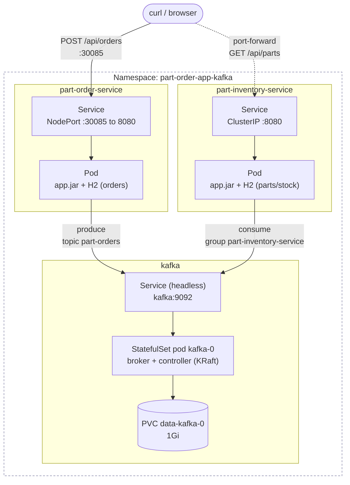
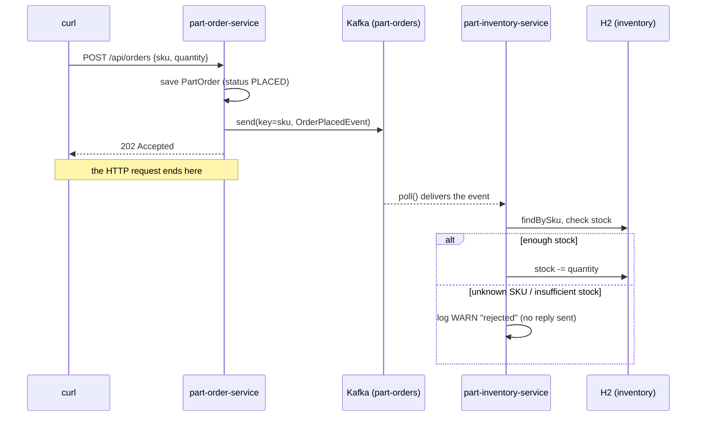
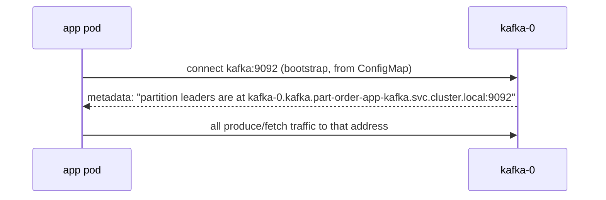

# part-order-app-kafka on Kubernetes: step by step

Deploy a single Kafka broker plus the two Kafka-based services to a local cluster: Docker Desktop, minikube or kind.

- Namespace `part-order-app-kafka`. It can run side by side with the `part-order-app-java` stacks.
- H2 only. No MySQL and no Secrets.
- The app is described in [../README.md](../README.md). The REST equivalent is [part-order-app-java/k8s/NOTES.md](../../part-order-app-java/k8s/NOTES.md).

---

## Architecture



- **The two apps never call each other.** Both of them only connect to `kafka:9092`.
- `part-inventory-service` keeps a ClusterIP Service only so you can port-forward to it and check stock.

## Request flow



## Layout

```
k8s/
  namespace.yaml
  kafka/
    service.yaml           headless Service "kafka"
    statefulset.yaml       apache/kafka:4.1.0, KRaft, 1 replica, 1Gi PVC
  part-inventory-service/
    configmap.yaml         KAFKA_BOOTSTRAP_SERVERS=kafka:9092
    deployment.yaml        initContainer waits for kafka
    service.yaml           ClusterIP
  part-order-service/
    configmap.yaml         KAFKA_BOOTSTRAP_SERVERS=kafka:9092
    deployment.yaml        initContainer waits for kafka
    service.yaml           NodePort 30085
```

## Quick reference

| | kafka | part-inventory-service | part-order-service |
| --- | --- | --- | --- |
| Kind | StatefulSet | Deployment | Deployment |
| Image | `apache/kafka:4.1.0` | `ram1uj/part-inventory-service-kafka:latest` | `ram1uj/part-order-service-kafka:latest` |
| Replicas | 1 | 1 | 1 |
| Service | headless, `9092`/`9093` | ClusterIP `8080` | NodePort `30085` |
| Storage | PVC `1Gi` (topic data, offsets) | H2 in-memory | H2 in-memory |
| Kafka role | broker + controller | consumer, group `part-inventory-service` | producer, owns topic `part-orders` |

> All commands below are run from `applications-and-source-code/part-order-app-kafka/`.

---

## Step 0: Prerequisites

```bash
kubectl config current-context   # docker-desktop / minikube / kind-...
kubectl get nodes                # STATUS Ready
kubectl get storageclass         # need one marked (default), for Kafka's PVC
```

---

## Step 1: Get the images into the cluster

**Option A: push to Docker Hub.** This works on any cluster.

```bash
./build-commands-mac.sh          # buildx, amd64+arm64, --push
```

**Option B: local build, no registry.**

```bash
docker build -t ram1uj/part-inventory-service-kafka:latest ./part-inventory-service
docker build -t ram1uj/part-order-service-kafka:latest     ./part-order-service

# Docker Desktop: images are already visible to the cluster
# kind:      kind load docker-image ram1uj/part-inventory-service-kafka:latest ram1uj/part-order-service-kafka:latest
# minikube:  minikube image load ram1uj/part-inventory-service-kafka:latest
#            minikube image load ram1uj/part-order-service-kafka:latest
```

With option B, change `imagePullPolicy: Always` to `IfNotPresent` in both `deployment.yaml` files. Otherwise the kubelet tries Docker Hub first, and the pull fails with `ErrImagePull` if the image was never pushed.

---

## Step 2: Namespace

```bash
kubectl apply -f k8s/namespace.yaml
kubectl config set-context --current --namespace=part-order-app-kafka   # optional: saves typing -n
```

The `-n part-order-app-kafka` flag is kept on every command below anyway.

---

## Step 3: Deploy Kafka

```bash
kubectl apply -f k8s/kafka/
kubectl -n part-order-app-kafka rollout status statefulset/kafka --timeout=180s
kubectl -n part-order-app-kafka get pods,svc,pvc -l app=kafka
```

Expected:

```
NAME          READY   STATUS    RESTARTS   AGE
pod/kafka-0   1/1     Running   0          40s

NAME            TYPE        CLUSTER-IP   EXTERNAL-IP   PORT(S)             AGE
service/kafka   ClusterIP   None         <none>        9092/TCP,9093/TCP   40s
```

The PVC (`data-kafka-0`) has no `app` label, so view it with `kubectl -n part-order-app-kafka get pvc`.

### Why the manifest looks like this

| Setting | Why |
| --- | --- |
| `StatefulSet` and not a Deployment | gives the pod a stable name (`kafka-0`) and its own PVC that survives restarts. See [deployment vs statefulsets](../../../kubernetes/kubernetes-intro/08-deployment-vs-statefulsets.md) |
| headless Service (`clusterIP: None`) | DNS resolves straight to the pod: `kafka` → the ready broker, and `kafka-0.kafka` → that exact pod |
| `KAFKA_PROCESS_ROLES=broker,controller` | **KRaft mode.** One process does both jobs, so no ZooKeeper is needed |
| `KAFKA_LISTENERS` `:9092` / `:9093` | 9092 is for clients and 9093 is for controller (metadata) traffic |
| `KAFKA_ADVERTISED_LISTENERS=PLAINTEXT://$(POD_NAME).kafka.$(POD_NAMESPACE).svc.cluster.local:9092` | **the key setting.** See below. It's fully qualified so clients in other namespaces can resolve it too, such as the KEDA operator in [k8s-with-keda](../k8s-with-keda/NOTES.md) |
| `*_REPLICATION_FACTOR=1` | internal topics (`__consumer_offsets`, …) default to RF 3. That can't work with one broker, and consumer groups break |
| `enableServiceLinks: false` | k8s would inject `KAFKA_PORT=tcp://…` style env vars for the `kafka` Service. The image turns **every** `KAFKA_*` env var into a broker property |
| `fsGroup: 1000` | the image runs as uid 1000, which needs write access to the PVC |
| `CLUSTER_ID` | KRaft formats the storage with this ID on first boot. Keep it fixed, or a restarted pod refuses the existing data |

**Bootstrap vs advertised listeners:**



- The client only uses the bootstrap address once, for the first connection. After that it uses whatever the broker **advertises**.
- If the advertised address isn't resolvable from the client, the first connect succeeds and then everything times out. This is the #1 Kafka-on-k8s mistake.

---

## Step 4: Sanity-check the broker

The image ships the Kafka CLI tools in `/opt/kafka/bin`:

```bash
# list topics (empty for now: part-orders gets created by order-service in Step 6)
kubectl -n part-order-app-kafka exec kafka-0 -- \
  /opt/kafka/bin/kafka-topics.sh --bootstrap-server localhost:9092 --list

# broker logs: look for "Kafka Server started"
kubectl -n part-order-app-kafka logs kafka-0 | grep -i "started"
```

---

## Step 5: Deploy part-inventory-service (the consumer)

```bash
kubectl apply -f k8s/part-inventory-service/
kubectl -n part-order-app-kafka get pods -l app=part-inventory-service -w   # Init:0/1 -> Running -> 1/1 READY
```

- **initContainer `wait-for-kafka`:** runs `nc -z kafka 9092` in a loop. Headless DNS only returns *ready* pods, so this blocks until Kafka passes its readiness probe. It's the same pattern as `wait-for-mysql` in [k8s-with-mysql](../../part-order-app-java/k8s-with-mysql/).
- **ConfigMap:** sets `KAFKA_BOOTSTRAP_SERVERS=kafka:9092`, which `application.yml` uses as `spring.kafka.bootstrap-servers`.

```bash
kubectl -n part-order-app-kafka logs deploy/part-inventory-service | grep -iE "partitions assigned|subscribed"
```

- **Starting before the topic exists is fine:** the consumer just waits for it.
- **`auto-offset-reset: earliest`:** the first time the group connects, it reads from the beginning of the topic. Orders sent before inventory came up are not lost.

---

## Step 6: Deploy part-order-service (the producer)

```bash
kubectl apply -f k8s/part-order-service/
kubectl -n part-order-app-kafka rollout status deploy/part-order-service --timeout=180s
```

On startup, Spring's `KafkaAdmin` creates the topic from the `NewTopic` bean in `KafkaTopicConfig`:

```bash
kubectl -n part-order-app-kafka exec kafka-0 -- \
  /opt/kafka/bin/kafka-topics.sh --bootstrap-server localhost:9092 --describe --topic part-orders
```

```
Topic: part-orders  PartitionCount: 3  ReplicationFactor: 1  ...
  Topic: part-orders  Partition: 0  Leader: 1  Replicas: 1  Isr: 1
  Topic: part-orders  Partition: 1  Leader: 1  Replicas: 1  Isr: 1
  Topic: part-orders  Partition: 2  Leader: 1  Replicas: 1  Isr: 1
```

Everything should be up:

```bash
kubectl -n part-order-app-kafka get pods,svc
```

---

## Step 7: Place an order end-to-end

**Reach the order service:**

```bash
# Docker Desktop: NodePorts are published on localhost
ORDER=http://localhost:30085
# minikube:  ORDER=$(minikube service part-order-service -n part-order-app-kafka --url)
# kind / anything else:
#   kubectl -n part-order-app-kafka port-forward svc/part-order-service 8080:8080 &
#   ORDER=http://localhost:8080
```

**Reach the inventory service:** it is ClusterIP, so use a port-forward. Leave it running in a second terminal.

```bash
kubectl -n part-order-app-kafka port-forward svc/part-inventory-service 8081:8080
INV=http://localhost:8081
```

**Check stock, order, check again:**

```bash
curl -s $INV/api/parts/SEAT-SAFE45-001          # "stock":100

curl -si -X POST $ORDER/api/orders \
     -H 'Content-Type: application/json' \
     -d '{"sku":"SEAT-SAFE45-001","quantity":5}'
# HTTP/1.1 202
# {"id":"...","orderNumber":"ORD-XXXXXXXX","partSku":"SEAT-SAFE45-001","quantity":5,"status":"PLACED",...}

curl -s $INV/api/parts/SEAT-SAFE45-001          # "stock":95
curl -s $ORDER/api/orders                       # the order, stored in order-service's H2
```

**Follow the message through both sides' logs:**

```bash
kubectl -n part-order-app-kafka logs deploy/part-order-service     | grep Published
#  Published ORD-XXXXXXXX to part-orders-0@0          <- topic-partition@offset

kubectl -n part-order-app-kafka logs deploy/part-inventory-service | grep -E "Received|reserved|rejected"
#  Received OrderPlacedEvent[orderNumber=ORD-XXXXXXXX, sku=SEAT-SAFE45-001, quantity=5, ...]
#  Order ORD-XXXXXXXX reserved 5 x SEAT-SAFE45-001, stock now 95
```

---

## Step 8: Look inside Kafka

**The raw messages on the topic:**

```bash
kubectl -n part-order-app-kafka exec kafka-0 -- \
  /opt/kafka/bin/kafka-console-consumer.sh --bootstrap-server localhost:9092 \
  --topic part-orders --from-beginning --property print.key=true --property print.partition=true \
  --timeout-ms 5000
# Partition:0   SEAT-SAFE45-001   {"orderNumber":"ORD-XXXXXXXX","sku":"SEAT-SAFE45-001","quantity":5,...}
# ... TimeoutException ... Processed a total of 1 messages   <- normal: --timeout-ms ended the read
```

**The consumer group:**

```bash
kubectl -n part-order-app-kafka exec kafka-0 -- \
  /opt/kafka/bin/kafka-consumer-groups.sh --bootstrap-server localhost:9092 \
  --describe --group part-inventory-service
```

```
GROUP                   TOPIC        PARTITION  CURRENT-OFFSET  LOG-END-OFFSET  LAG  CONSUMER-ID ...
part-inventory-service  part-orders  0          1               1               0    consumer-...
part-inventory-service  part-orders  1          -               0               -    consumer-...
part-inventory-service  part-orders  2          -               0               -    consumer-...
```

- **`CURRENT-OFFSET`:** how far the group has read.
- **`LOG-END-OFFSET`:** how many messages exist on that partition.
- **`LAG`:** the messages waiting to be processed, i.e. the difference between the two. It's normally 0.
- **`-` in `CURRENT-OFFSET`:** the group hasn't committed anything on that partition yet. All `SEAT-SAFE45-001` orders hash to partition 0, so 1 and 2 stay empty.

The console consumer above is not in this group, so reading with it doesn't move these offsets.

---

## Step 9: See the decoupling (inventory offline)

This experiment shows what Kafka gives you over the REST version.

```bash
# 1. take the consumer away
kubectl -n part-order-app-kafka scale deploy/part-inventory-service --replicas=0

# 2. orders still succeed (the REST version would fail here)
for i in 1 2 3; do
  curl -s -o /dev/null -w "%{http_code}\n" -X POST $ORDER/api/orders \
       -H 'Content-Type: application/json' -d '{"sku":"SEAT-SAFE45-001","quantity":10}'
done                                             # 202 202 202

# 3. messages pile up: "no active members", LAG 3 on partition 0
kubectl -n part-order-app-kafka exec kafka-0 -- \
  /opt/kafka/bin/kafka-consumer-groups.sh --bootstrap-server localhost:9092 \
  --describe --group part-inventory-service

# 4. bring it back: it resumes from its committed offset and drains the backlog
kubectl -n part-order-app-kafka scale deploy/part-inventory-service --replicas=1
kubectl -n part-order-app-kafka rollout status deploy/part-inventory-service
kubectl -n part-order-app-kafka logs deploy/part-inventory-service | grep reserved
```

```
Consumer group 'part-inventory-service' has no active members.
GROUP                   TOPIC        PARTITION  CURRENT-OFFSET  LOG-END-OFFSET  LAG  CONSUMER-ID
part-inventory-service  part-orders  0          1               4               3    -
```

- **The port-forward from Step 7 died with the old pod.** Restart it before checking stock again.
- **Expect stock 70, not 65.** The new pod gets a **fresh H2**, reseeded with the original stock of 100. It then replays only the 3 orders it hadn't consumed yet: 100 − 30 = 70.
- **The earlier 5-unit order from Step 7 is not re-applied.** Its offset was already committed in Kafka.
- **Only partitions with a committed offset show up while the group is down.** Ordering a SKU that lands on a partition the group never read from (1 or 2) shows no LAG at all, even though the messages are there. The consumer still picks them up on restart, via `auto-offset-reset: earliest`.
- **This is the per-pod H2 limitation showing.** Kafka remembers which messages were processed, but the database that held the result is gone.

**Rejected order:** there is no reply channel, so the rejection only appears in inventory's log.

```bash
curl -s -X POST $ORDER/api/orders -H 'Content-Type: application/json' \
     -d '{"sku":"SEAT-SAFE45-003","quantity":9999}'          # still 202 PLACED
kubectl -n part-order-app-kafka logs deploy/part-inventory-service | grep rejected
#  Order ORD-... rejected: insufficient stock for SEAT-SAFE45-003 (have 200, need 9999)
```

---

## Step 10: Iterating on code

The images use the `:latest` tag, so a rebuild doesn't change the manifests. Force a restart:

```bash
./build-commands-mac.sh            # or the local docker build from Step 1
kubectl -n part-order-app-kafka rollout restart deploy/part-inventory-service deploy/part-order-service
```

---

## Troubleshooting

| Symptom | Likely cause / check |
| --- | --- |
| App pod stuck in `Init:0/1` | Kafka isn't Ready. Check `kubectl logs kafka-0` and `kubectl logs <app-pod> -c wait-for-kafka` |
| `kafka-0` stuck in `Pending` | PVC not bound, usually no default StorageClass. Check `kubectl get pvc` and `kubectl describe pvc data-kafka-0` |
| `kafka-0` CrashLoop: `AccessDeniedException /var/lib/kafka/data` | Volume not writable by uid 1000. Check that `fsGroup: 1000` is set; some hostPath provisioners ignore it |
| `kafka-0` CrashLoop: `Invalid cluster.id` after changing `CLUSTER_ID` | The PVC was formatted with the old ID. Delete it: `kubectl delete pvc data-kafka-0`, then delete the pod |
| `ErrImagePull` on the apps | Image was never pushed. Push it, or use Step 1 option B with `IfNotPresent` |
| Order returns 202 but stock never changes | Check the inventory logs for `partitions assigned`, then check the consumer group in Step 8 for LAG and CONSUMER-ID |
| App logs `Connection to node 1 (<host>:9092) could not be established` | The advertised listener isn't resolvable from the client. A short name like `kafka-0.kafka` only resolves in the same namespace, which is why the manifest advertises the FQDN |
| Topic has 1 partition, not 3 | order-service started before Kafka was up (KafkaAdmin skipped it) and the broker auto-created the topic with defaults. Delete the topic and restart order-service |

General debugging flow: [01-debugging-common-issues.md](../../../kubernetes/kubernetes-intermediate/01-debugging-common-issues.md)

---

## Clean up

```bash
kubectl delete namespace part-order-app-kafka    # removes everything, including the Kafka PVC
kubectl config set-context --current --namespace=default   # if you changed it in Step 2
```

---

## Deliberately left out / next steps

| Left out | What adding it looks like |
| --- | --- |
| Reply message | a second topic, e.g. `inventory-results` (`RESERVED` / `REJECTED`). order-service consumes it and updates `PartOrder.status`. This is the start of a **saga** |
| Autoscaling the consumer on lag | [k8s-with-keda/NOTES.md](../k8s-with-keda/NOTES.md): KEDA scales inventory 0 → 3 → 0 on consumer lag |
| Scaling inventory > 1 | Kafka already supports it: replicas in one consumer group split the 3 partitions between them. H2 doesn't, because each pod would hold its own stock copy, so a shared DB is needed first (see [k8s-with-mysql](../../part-order-app-java/k8s-with-mysql/)) |
| Multi-broker / HA Kafka | 3 replicas, `KAFKA_CONTROLLER_QUORUM_VOTERS` listing all three, topic RF 3, `min.insync.replicas=2`. In practice, use the **Strimzi** operator (`Kafka` / `KafkaTopic` CRDs) instead of hand-written StatefulSets; see [CRDs](../../../kubernetes/kubernetes-advanced/04-crds.md) |
| Transactional outbox | today the DB save and `kafkaTemplate.send()` are not atomic. A crash between them gives an order with no event |
| Dead-letter topic | `DefaultErrorHandler` + `DeadLetterPublishingRecoverer` for messages that keep failing |
| Security | PLAINTEXT, no auth. Real clusters use TLS + SASL, with credentials in a Secret |
