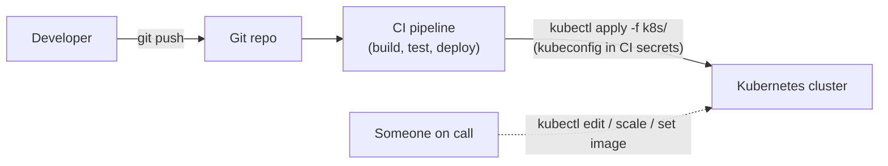
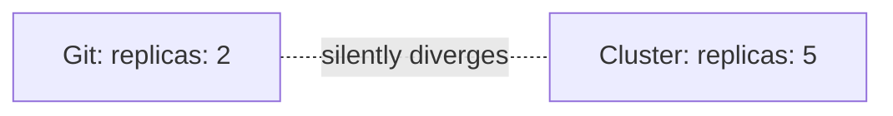
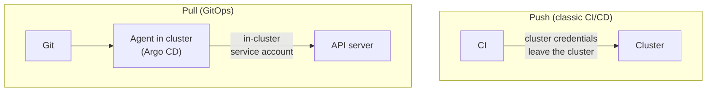
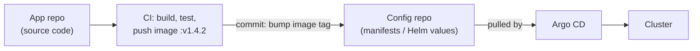

# GitOps — the problem it solves

Deep dive behind the first sections of
[01-argocd-intro.md](01-argocd-intro.md). Here: *why* the usual
`kubectl apply`-from-CI pipeline breaks down, and what GitOps changes.

---

## Where you start: kubectl + a CI pipeline



It works — until the cluster and the repo stop agreeing. Five problems
fall out of this shape.

---

## Problem 1: drift

- someone runs `kubectl scale deploy/order-service --replicas=5` during
  an incident, never writes it back to Git
- next pipeline run silently overwrites it — or doesn't touch that field
  at all, and the cluster keeps a setting no file contains
- result: **Git says 2 replicas, the cluster runs 5, nobody knows which
  is "right"**



CI only acts when a commit lands. Nothing *watches* the cluster between
commits.

---

## Problem 2: credentials sprawl

- the pipeline needs a kubeconfig / service-account token with
  create-and-delete rights on every namespace it deploys to
- that token lives in CI secrets, readable by anyone who can edit a
  pipeline or by a compromised build step
- N clusters × M pipelines = a lot of long-lived cluster credentials
  outside the cluster

Every pipeline is a path *into* production.

---

## Problem 3: no real source of truth, no audit trail

- "what's running in prod right now?" is answered by asking the cluster
  (`kubectl get`), not by reading the repo
- `kubectl` changes leave no commit, no author, no review, no diff
- staging and prod slowly become different in ways nobody wrote down

---

## Problem 4: rollback and disaster recovery are procedures, not actions

- rollback = find the old commit, re-run the old pipeline, hope its
  build inputs still exist
- cluster lost? Rebuilding means replaying pipelines in the right order,
  or remembering which manual `kubectl` fixes happened since

---

## Problem 5: deploys are tied to the CI system

- CI is both the *build* tool and the *deploy* tool, so a CI outage is a
  deploy outage — and a "redeploy the same thing" button needs a full
  pipeline run
- pipeline YAML ends up containing deployment logic (`kubectl apply`
  order, `sed` on image tags) that is not itself declarative

---

## GitOps: four principles

[OpenGitOps](https://opengitops.dev) boils it down to:

| Principle | In practice |
| --- | --- |
| **Declarative** | the whole desired state is YAML (plain, Helm, Kustomize) — no "run these 12 commands" |
| **Versioned and immutable** | desired state lives in Git: every change is a commit with an author, a diff, a review, and a revert |
| **Pulled automatically** | an agent *inside* the cluster pulls desired state from Git — nothing external pushes in |
| **Continuously reconciled** | the agent keeps comparing live vs. desired and corrects differences, not just once per deploy |

The last two are what separate GitOps from "we keep our YAML in Git".

---

## Push vs. pull



| | Push | Pull (GitOps) |
| --- | --- | --- |
| Who holds cluster credentials | CI system | the agent, in the cluster itself |
| Triggered by | a pipeline run | continuous loop (+ optional webhook) |
| Detects manual drift | no | yes — flags it, or reverts it |
| Source of truth | convention | enforced |
| Rollback | re-run a pipeline | `git revert`, agent applies it |

The pull loop is the same desired-state reconciliation Kubernetes already
runs on itself
([01-intro.md](../kubernetes/kubernetes-intro/01-intro.md)) — GitOps just
adds Git as one more place desired state is read from.

---

## Problem → GitOps answer

| Problem | What changes |
| --- | --- |
| Drift | agent diffs live vs. Git continuously; shows `OutOfSync` or self-heals |
| Credential sprawl | no cluster credentials in CI at all; CI only needs write access to *Git* |
| No source of truth / audit | the repo *is* the truth; `git log` is the audit trail; PR review is the change-approval process |
| Rollback / DR | `git revert` → agent applies it; new cluster + point agent at the same repo = restored |
| CI-coupled deploys | CI builds and publishes an image, then stops; deploy is a separate concern |

---

## The two-repo pattern (CI still has a job)

GitOps doesn't remove CI — it shrinks it to *build and publish*, then
hands off through Git:



- **app repo** — code + Dockerfile; changes often, reviewed as code
- **config repo** — only manifests; changes = deployments, reviewed as
  deployments, can have stricter access
- this learning repo is a **monorepo** (app code and manifests side by
  side) to keep things simple; real teams usually split them

---

## Rollback and recovery, concretely

```bash
git revert <bad-commit>     # desired state is now the previous one
git push                    # Argo CD notices, applies it — that's the rollback
```

New cluster after a disaster: install Argo CD
([04-argocd-installation.md](04-argocd-installation.md)), apply one root
`Application` (see *App of Apps* in
[01-argocd-intro.md](01-argocd-intro.md)), and everything the repo
describes comes back.

---

## What GitOps does not fix

- **Secrets** — Git is the wrong place for plaintext secrets. The demo
  manifests in this repo (`mysql-secret.yaml`) do exactly that, for
  learning only. Real setups use Sealed Secrets, External Secrets, or
  SOPS so that only encrypted data or a *reference* is committed
- **Mutable tags** — Argo CD triggers on *Git* changes. Tagging an image
  `:latest` and pushing a new build changes nothing in Git, so nothing
  rolls out. Pin immutable tags (`v1.4.2` or a digest) and change the tag
  in Git
- **Building images and running tests** — still CI's job
- **Imperative one-offs** — database migrations, data backfills, and
  manual approvals need other mechanisms (Argo CD hooks cover some —
  [03-argocd-concepts.md](03-argocd-concepts.md))
- **Bad commits** — Git history makes mistakes visible and revertible,
  not impossible; reviews and branch protection still matter

---

## Takeaway

GitOps is two decisions: **Git is the only way to change the cluster**,
and **an in-cluster agent pulls and enforces it**. Drift, credential
sprawl, missing audit trail, and painful rollback are all symptoms of
the same gap — nothing was continuously comparing "what we said" with
"what's running". Argo CD ([03-argocd-concepts.md](03-argocd-concepts.md))
is that comparer.
