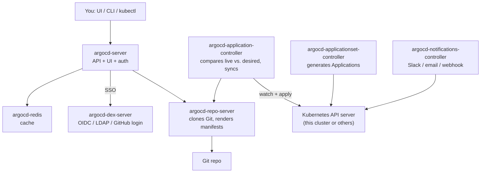
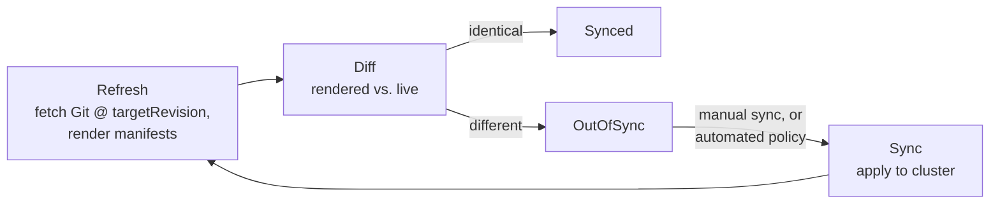
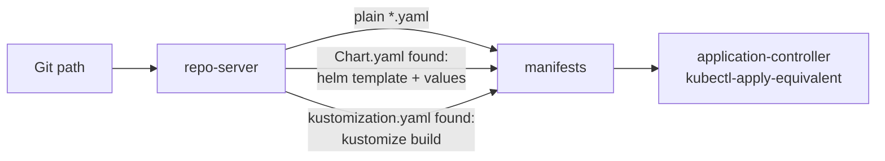
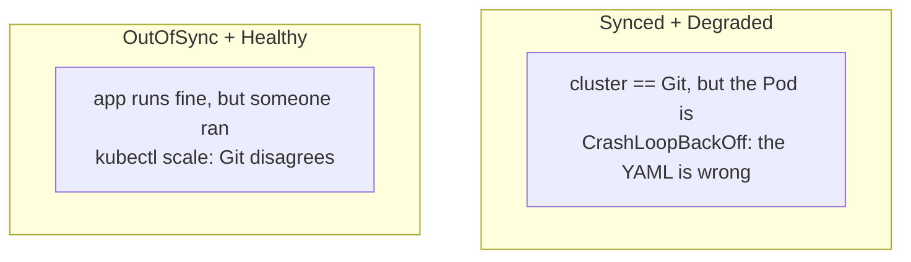
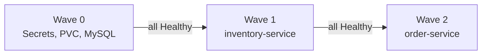
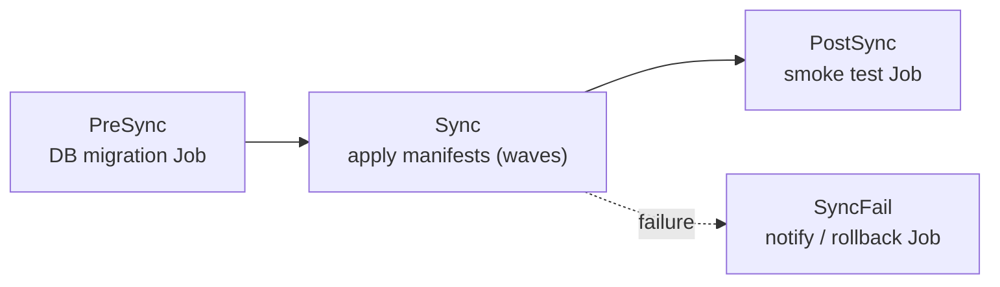
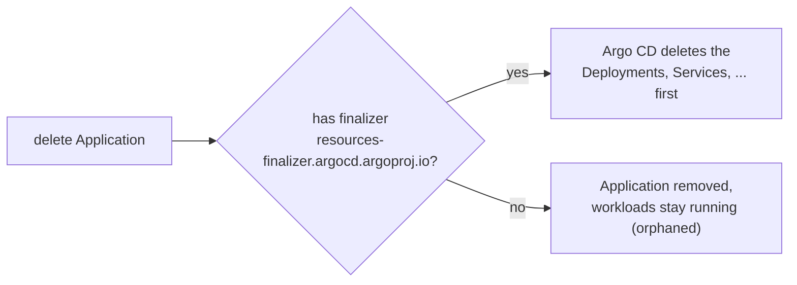

# Argo CD concepts

The vocabulary you need to read any `Application` YAML and any Argo CD UI
screen. Problem it solves:
[02-gitops-problem.md](02-gitops-problem.md). Hands-on first run:
[01-argocd-intro.md](01-argocd-intro.md).

---

## Architecture: what's actually running in the `argocd` namespace



| Component | Job |
| --- | --- |
| **argocd-server** | serves the UI and API; the CLI and UI both talk to it; handles login, RBAC |
| **argocd-repo-server** | clones the Git repo and **renders** manifests (plain YAML, `helm template`, `kustomize build`) into final Kubernetes objects. Never touches the cluster |
| **argocd-application-controller** | the reconciler. Watches `Application` objects and the live cluster, computes the diff, applies it. Runs as a StatefulSet |
| **argocd-applicationset-controller** | stamps out many `Application`s from one template (one per cluster, per folder, ...) |
| **argocd-dex-server** | optional SSO broker (GitHub, Google, LDAP, OIDC) |
| **argocd-redis** | cache for rendered manifests and app state |
| **argocd-notifications-controller** | sends events ("sync failed", "app healthy") to Slack/email/etc. |

Everything is configured by Kubernetes objects in the `argocd` namespace:
`Application`, `AppProject`, plus the ConfigMaps `argocd-cm` (settings),
`argocd-rbac-cm` (permissions) and `argocd-cmd-params-cm` (server flags).

---

## The loop: refresh, diff, sync



- **Refresh** happens every **3 minutes** by default
  (`timeout.reconciliation` in `argocd-cm`), immediately on a Git webhook,
  or on demand: `argocd app get <app> --refresh`
- `--hard-refresh` also throws away the cached rendered manifests — the
  fix when you changed something Argo CD didn't notice (e.g. a Helm
  dependency)
- **Refresh ≠ sync.** Refresh only *detects*; sync *changes the cluster*.
  With manual sync, an app can sit `OutOfSync` indefinitely, on purpose

---

## Application: the one CRD you write most

```yaml
apiVersion: argoproj.io/v1alpha1
kind: Application
metadata:
  name: inventory-order-app
  namespace: argocd                # always the argocd namespace
  finalizers:
    - resources-finalizer.argocd.argoproj.io   # cascade delete (see below)
spec:
  project: default                 # which AppProject's rules apply

  source:                          # WHERE desired state lives
    repoURL: https://github.com/ramanujds/devops-learning-journey
    targetRevision: main           # branch, tag, or commit SHA
    path: demo-test/inventory-order-app

  destination:                     # WHERE it gets applied
    server: https://kubernetes.default.svc   # "this cluster"
    namespace: inventory-order-app

  syncPolicy:                      # HOW / WHEN
    automated: { prune: true, selfHeal: true }
    syncOptions: [CreateNamespace=true]
```

An `Application` = **source** (repo + revision + path) → **destination**
(cluster + namespace). That's the whole model.

- `server: https://kubernetes.default.svc` is the cluster Argo CD runs in;
  other clusters are registered separately
  ([04-argocd-installation.md](04-argocd-installation.md))
- `targetRevision` can be a moving branch (`main` → continuous delivery)
  or a fixed tag/SHA (changes only when you edit it → promotion by PR)

---

## Source types: Argo CD renders, then applies



| Detected in `path` | Tool | Notes |
| --- | --- | --- |
| only `*.yaml` | **directory** | non-recursive unless `directory.recurse: true`; filter with `include`/`exclude` |
| `Chart.yaml` | **Helm** | `helm.valueFiles`, `helm.valuesObject`, `helm.parameters`, `helm.releaseName` |
| `kustomization.yaml` | **Kustomize** | `kustomize.images`, `namePrefix`, ... |

Important Helm detail: Argo CD only *renders* the chart. There is no Helm
release — `helm ls` shows nothing, and `helm rollback` doesn't apply.
History and rollback are Argo CD's. Example:
[argocd-inventory-order-app-helm](https://github.com/ramanujds/argocd-inventory-order-app-helm).

---

## Two independent statuses

Every Application has **both**, and they answer different questions.

| | Question | Values |
| --- | --- | --- |
| **Sync status** | does the cluster match Git? | `Synced`, `OutOfSync`, `Unknown` |
| **Health status** | are the resources actually working? | `Healthy`, `Progressing`, `Degraded`, `Suspended`, `Missing`, `Unknown` |



- health is derived per resource kind: a Deployment is `Healthy` when
  rolled out and available; a Service/Ingress by its endpoints/LB
  address; a PVC when `Bound`
- **Synced does not mean working.** Always read both

---

## Sync policy

| Setting | Meaning | Default |
| --- | --- | --- |
| *(no `automated`)* | **manual** — Argo CD detects drift, you run `argocd app sync` | yes |
| `automated` | apply on every detected difference | off |
| `automated.prune` | delete cluster objects whose file was removed from Git | off |
| `automated.selfHeal` | also revert **live** changes (manual `kubectl edit`), not just Git changes | off |

`syncOptions` worth knowing:

| Option | Effect |
| --- | --- |
| `CreateNamespace=true` | create `destination.namespace` if missing |
| `PruneLast=true` | delete removed objects only after everything else is healthy |
| `ApplyOutOfSyncOnly=true` | skip unchanged objects — faster on big apps |
| `ServerSideApply=true` | use server-side apply (needed for very large CRDs) |
| `Replace=true` | `kubectl replace` instead of apply — destructive, last resort |

Without `selfHeal`, a manual `kubectl scale` just flips the app to
`OutOfSync`. With it, Argo CD puts it back within seconds (the controller
watches live objects, so selfHeal doesn't wait for the 3-minute Git poll).

---

## Sync waves and hooks: ordering things

Plain `kubectl apply -f dir/` has no ordering guarantee between files
(beyond built-ins like Namespace first). Argo CD adds two tools.

**Sync waves** — an annotation puts a resource in a numbered wave:

```yaml
metadata:
  annotations:
    argocd.argoproj.io/sync-wave: "1"   # default 0; negatives allowed
```



Lower waves first; Argo CD **waits for the whole wave to be Healthy**
before starting the next. That's the difference from `initContainer`
polling: it's ordering at the *deploy* level. Used in
[argocd-inventory-order-app-helm](https://github.com/ramanujds/argocd-inventory-order-app-helm).

**Hooks** — resources (usually a `Job`) that run at a sync phase, then
clean up:

```yaml
metadata:
  annotations:
    argocd.argoproj.io/hook: PreSync                       # PreSync | Sync | PostSync | SyncFail
    argocd.argoproj.io/hook-delete-policy: HookSucceeded
```



---

## AppProject: guardrails

Every Application belongs to a **project** (`default` if you don't say).
`default` allows everything; a custom project restricts a team.

```yaml
apiVersion: argoproj.io/v1alpha1
kind: AppProject
metadata:
  name: inventory-team
  namespace: argocd
spec:
  sourceRepos:
    - https://github.com/ramanujds/devops-learning-journey   # only this repo
  destinations:
    - server: https://kubernetes.default.svc
      namespace: inventory-*                                  # only these namespaces
  clusterResourceWhitelist: []                                # no ClusterRoles, Namespaces...
```

An Application that points at an unlisted repo/namespace is rejected.
This is the multi-tenant answer to "any dev with Git access can deploy
anywhere" — the examples here use `default` to stay simple.

---

## Deleting: finalizers and cascade



- `argocd app delete <app>` cascades by default
- `kubectl delete application` only cascades if the finalizer is present
  (verified: with it, Deployments/Services/PVC/Secrets were removed; the
  namespace stayed). `kubectl apply` prints a warning that it prefers a
  domain-qualified finalizer name — harmless, this is Argo CD's own name
- the same applies when a **parent Application prunes a child** (App of
  Apps) — add the finalizer to children you want cleaned up with them

---

## ignoreDifferences: when something else owns a field

If another controller legitimately changes a field, Argo CD sees it as
drift and (with selfHeal) fights it forever. Classic case: an HPA owns
`spec.replicas`.

```yaml
spec:
  ignoreDifferences:
    - group: apps
      kind: Deployment
      jsonPointers:
        - /spec/replicas
```

Simpler alternative used in this repo: **omit `replicas`** from the
Deployment when an HPA manages it
([inventory-service-deployment.yaml](../demo-test/inventory-order-app/inventory-service-deployment.yaml)
does; the Helm chart makes it conditional).

---

## Scaling the pattern

| Pattern | Use when | Where |
| --- | --- | --- |
| Single `Application` | one app, one place | [argocd-inventory-order-app-simple](https://github.com/ramanujds/argocd-inventory-order-app-simple), [argocd-inventory-order-app-helm](https://github.com/ramanujds/argocd-inventory-order-app-helm) |
| **App of Apps** | one root `Application` whose "manifests" are other `Application`s — bootstrap a whole platform with one apply | [argocd-app-of-apps](https://github.com/ramanujds/argocd-app-of-apps), end of [01-argocd-intro.md](01-argocd-intro.md) |
| **ApplicationSet** | generate many near-identical `Application`s from a template + generator (list of clusters, folders in Git, PRs) | not demoed here |

ApplicationSet sketch — one Application per directory under `apps/`:

```yaml
apiVersion: argoproj.io/v1alpha1
kind: ApplicationSet
metadata: { name: all-services, namespace: argocd }
spec:
  generators:
    - git:
        repoURL: https://github.com/ramanujds/devops-learning-journey
        revision: main
        directories: [{ path: "apps/*" }]
  template:
    metadata: { name: "{{path.basename}}" }
    spec:
      project: default
      source:
        repoURL: https://github.com/ramanujds/devops-learning-journey
        targetRevision: main
        path: "{{path}}"
      destination: { server: https://kubernetes.default.svc, namespace: "{{path.basename}}" }
```

---

## Glossary

| Term | One-line meaning |
| --- | --- |
| **Application** | CRD: this Git path → this cluster/namespace |
| **AppProject** | CRD: allowed repos/clusters/namespaces/kinds for a group of Applications |
| **Sync** | apply the rendered manifests to the cluster |
| **Refresh** | re-read Git and re-diff, without changing the cluster |
| **Prune** | delete live objects that are no longer in Git |
| **Self-heal** | revert live changes that don't match Git |
| **Sync wave** | ordering number; each wave must be Healthy before the next |
| **Hook** | a resource run at PreSync / Sync / PostSync / SyncFail |
| **Target revision** | the branch / tag / commit the Application tracks |
| **Rollback** | re-sync an earlier entry from `argocd app history` (disables auto-sync while pinned) |

---

## Takeaway

An `Application` is *source → destination + policy*. The repo-server
renders, the application-controller diffs and applies, the server is just
the front door. Read **Sync** and **Health** separately, decide whether
sync is manual or automated, and use waves/hooks when order matters.
Everything else — projects, ApplicationSets, notifications — is scaling
that one idea to more teams and clusters.
