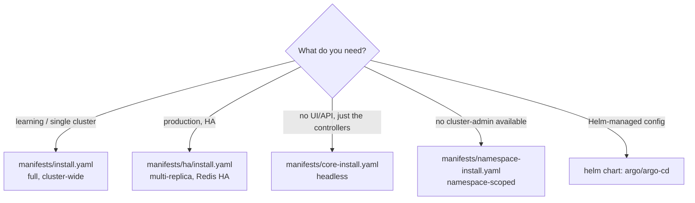
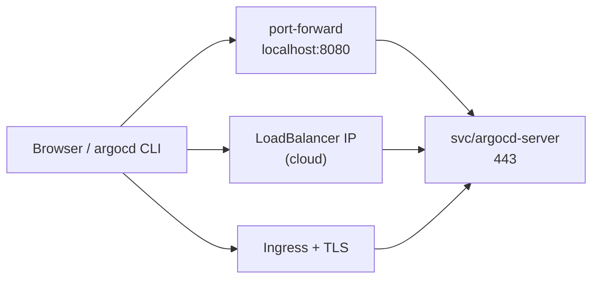
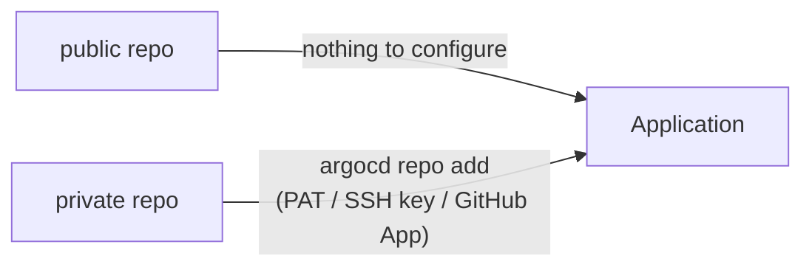

# Installing Argo CD

Concepts first: [03-argocd-concepts.md](03-argocd-concepts.md). This note
gets a working Argo CD you can log in to, then points it at a repo.

---

## What you need

- a cluster you can `kubectl` into — local (`kind`, `minikube`, Docker
  Desktop) or cloud (GKE, as in
  [07-kubernetes-on-cloud.md](../kubernetes/kubernetes-intermediate/07-kubernetes-on-cloud.md))
- `kubectl`, and optionally the `argocd` CLI and `helm`

```bash
kubectl config current-context        # make sure it's the cluster you mean
kind create cluster --name argocd-demo   # optional: a throwaway local one
```

---

## Which install flavour



| Flavour | Use |
| --- | --- |
| `install.yaml` | default; everything, can manage the cluster it's in |
| `ha/install.yaml` | same, with replicated components |
| `core-install.yaml` | minimal: controllers only, no UI/API server/Dex |
| `namespace-install.yaml` | no cluster-wide RBAC; manages only what you grant it |
| Helm chart | when you want values-driven config; maintained by the community (`argo-helm`) |

This repo uses `install.yaml`.

---

## Install with manifests

```bash
kubectl create namespace argocd
kubectl apply -n argocd --server-side --force-conflicts \
  -f https://raw.githubusercontent.com/argoproj/argo-cd/stable/manifests/install.yaml
```

- `--server-side`: the `ApplicationSet` CRD is too big for a
  client-side `kubectl apply` (it fails with
  `metadata.annotations: Too long: must have at most 262144 bytes`)
- `stable` tracks the latest release — fine for learning. For anything
  real, pin a tag: `.../argo-cd/<version>/manifests/install.yaml`, so
  upgrades are a deliberate commit, not a surprise

```bash
kubectl get pods -n argocd
kubectl wait --for=condition=Available deployment --all -n argocd --timeout=300s
```

```text
argocd-application-controller-0          1/1  Running     # StatefulSet
argocd-applicationset-controller-...     1/1  Running
argocd-dex-server-...                    1/1  Running
argocd-notifications-controller-...      1/1  Running
argocd-redis-...                         1/1  Running
argocd-repo-server-...                   1/1  Running
argocd-server-...                        1/1  Running
```

```bash
kubectl get crd | grep argoproj.io
# applications / applicationsets / appprojects .argoproj.io
```

---

## Or install with Helm

```bash
helm repo add argo https://argoproj.github.io/argo-helm
helm repo update
helm install argocd argo/argo-cd -n argocd --create-namespace
# customise: helm show values argo/argo-cd  >  my-values.yaml ; helm install ... -f my-values.yaml
```

Same components, but config (ingress, SSO, resource limits, HA) goes in a
values file instead of patching ConfigMaps. A common end state: Helm
installs Argo CD once, then an `Application` pointing at the same chart
makes Argo CD manage *itself* from Git. Not a day-one requirement.

---

## Access the UI and API



**1. Port-forward — no exposure, best for learning:**

```bash
kubectl port-forward svc/argocd-server -n argocd 8080:443
# open https://localhost:8080   (self-signed cert warning is expected)
```

**2. LoadBalancer — on a cloud cluster:**

```bash
kubectl patch svc argocd-server -n argocd -p '{"spec": {"type": "LoadBalancer"}}'
kubectl get svc argocd-server -n argocd -w     # wait for EXTERNAL-IP
```

**3. Ingress — the real-world answer** (see
[09-ingress.md](../kubernetes/kubernetes-intro/09-ingress.md)).
`argocd-server` serves TLS itself, so either pass the TLS through, or let
the ingress terminate TLS and run the server plain-HTTP by setting
`server.insecure: "true"` in the `argocd-cmd-params-cm` ConfigMap (then
restart `argocd-server`).

---

## First login

Username `admin`; the password is generated at install time:

```bash
argocd admin initial-password -n argocd
# or, without the CLI:
kubectl -n argocd get secret argocd-initial-admin-secret \
  -o jsonpath="{.data.password}" | base64 -d; echo
```

Install the CLI and log in:

```bash
brew install argocd                       # macOS; other OSes: GitHub release binary
argocd login localhost:8080 --username admin --insecure   # prompts for password
argocd version
argocd cluster list                       # shows https://kubernetes.default.svc
```

Then change the password and delete the bootstrap secret — it's
meant to be one-time:

```bash
argocd account update-password
kubectl -n argocd delete secret argocd-initial-admin-secret
```

---

## Point it at a Git repo



This repo is public, so an `Application` can use it directly. For a
private repo, register credentials once:

```bash
argocd repo add https://github.com/<you>/<private-repo> \
  --username <user> --password <personal-access-token>
# SSH instead:  argocd repo add git@github.com:<you>/<repo>.git --ssh-private-key-path ~/.ssh/id_ed25519
argocd repo list
```

(Under the hood this is a Secret labelled
`argocd.argoproj.io/secret-type: repository` in the `argocd` namespace —
so repo credentials can themselves be managed declaratively, though
with a real secret-management tool, not committed in plaintext.)

**Speed up detection** (optional): by default Argo CD polls every 3
minutes. A GitHub webhook to `https://<argocd-host>/api/webhook` makes
it react on push — needs the server reachable from the internet, so
skip it for a local cluster.

---

## Deploy a first Application (smoke test)

```bash
kubectl apply -f git-ops-argocd/example-nginx/application.yaml -n argocd
argocd app get nginx-demo
kubectl get all -n nginx-demo
```

If the app shows `Synced` + `Healthy`, the install works. Real examples:
[05-deploy-inventory-order-app.md](05-deploy-inventory-order-app.md).

Deploying to a **different** cluster than the one Argo CD runs in:

```bash
argocd cluster add <kubeconfig-context-name>
# creates a service account in that cluster, stores its token in a Secret
# in argocd; then use that cluster's API URL as destination.server
```

Not needed in this repo — everything targets
`https://kubernetes.default.svc` (the in-cluster alias).

---

## Upgrade and uninstall

**Upgrade:** re-apply the manifests of the new version (same
`--server-side` command). Read the release notes for breaking changes.

**Uninstall — order matters:**

```bash
# 1. delete Applications FIRST, so finalizers can clean up what they deployed
kubectl delete applications --all -n argocd
# 2. then Argo CD itself
kubectl delete -n argocd -f https://raw.githubusercontent.com/argoproj/argo-cd/stable/manifests/install.yaml
kubectl delete namespace argocd
```

Deleting the CRDs or namespace first removes the `Application` objects
without Argo CD there to process finalizers — workloads stay behind
orphaned, and a namespace can hang in `Terminating`.

---

## Troubleshooting

| Symptom | Likely cause / fix |
| --- | --- |
| `Too long: must have at most 262144 bytes` on install | use `--server-side` apply (above) |
| Pods `Pending` | cluster too small for the pods' resource requests — `kubectl describe pod` shows the scheduling event |
| App shows `ComparisonError` / "repository not accessible" | wrong `repoURL`, private repo without `argocd repo add`, or unpushed branch. Check `kubectl logs deploy/argocd-repo-server -n argocd` |
| Change pushed but app stays `Synced` | not pushed to `targetRevision`, or still within the 3-min poll — `argocd app get <app> --refresh` |
| `OutOfSync` that never resolves | another controller mutates a field (HPA replicas, injected sidecar, defaulted fields) — [`ignoreDifferences`](03-argocd-concepts.md) |
| Stuck `Progressing` | a resource isn't healthy: `argocd app get <app>`, then `kubectl describe` that resource |
| Login loop / blank page behind an Ingress | TLS mismatch — see Ingress option above (`server.insecure`) |
| `argocd login` says certificate error on port-forward | add `--insecure` (self-signed cert) |

---

## Cheat sheet

```bash
kubectl get pods -n argocd
kubectl port-forward svc/argocd-server -n argocd 8080:443
argocd admin initial-password -n argocd
argocd login localhost:8080 --insecure
argocd app list
argocd repo list
argocd cluster list
kubectl logs deploy/argocd-repo-server -n argocd           # rendering / Git problems
kubectl logs statefulset/argocd-application-controller -n argocd   # sync problems
```
