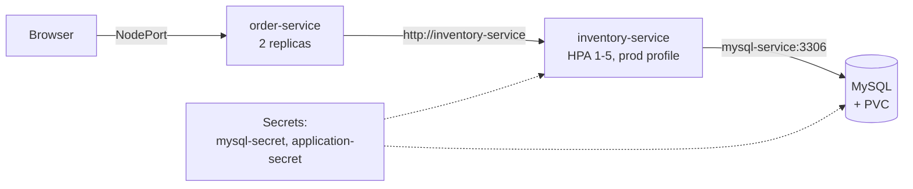
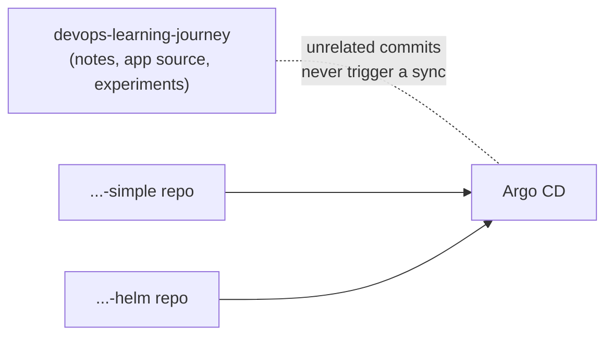
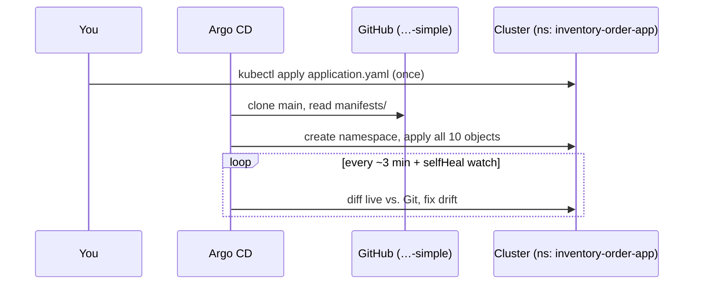
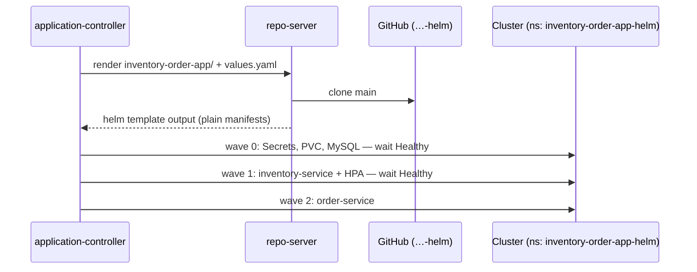

# Deploying the inventory-order-app with Argo CD

The same app, deployed three ways, each in **its own GitHub repo** — the
usual GitOps shape, where a config repo holds only what Argo CD syncs:

| Repo | Pattern |
| --- | --- |
| [argocd-inventory-order-app-simple](https://github.com/ramanujds/argocd-inventory-order-app-simple) | one `Application` over plain YAML |
| [argocd-inventory-order-app-helm](https://github.com/ramanujds/argocd-inventory-order-app-helm) | one `Application` over a Helm chart |
| [argocd-app-of-apps](https://github.com/ramanujds/argocd-app-of-apps) | a root `Application` managing child `Application`s (walkthrough at the end of [01-argocd-intro.md](01-argocd-intro.md)) |

Prerequisite: Argo CD installed and reachable —
[04-argocd-installation.md](04-argocd-installation.md).

---

## The app



Two Deployments, three Services, an HPA, a MySQL Deployment + PVC, two
Secrets. The original manifests are in
[demo-test/inventory-order-app/](../demo-test/inventory-order-app/); the
simple repo holds a snapshot of the committed version, the Helm repo a
chart templated from it. No `namespace:` in any of them — the namespace
comes from the Application's `destination`.

---

## Why a separate repo per deployment



- Argo CD syncs from **Git, not your disk** — only what's pushed to
  `main` of the Application's `repoURL` counts
- with the manifests in their own repo, half-finished experiments in a
  working repo like `demo-test/` can't land in a deployed app by accident,
  and the commit history is just deployment changes
- this is the *config repo* half of the two-repo pattern in
  [02-gitops-problem.md](02-gitops-problem.md)

---

## Option 1 — simple deployment (plain YAML)

[`application.yaml`](https://github.com/ramanujds/argocd-inventory-order-app-simple/blob/main/application.yaml)
is one `Application` whose `path` is `manifests/`, a directory of plain YAML.



```bash
kubectl apply -n argocd -f \
  https://raw.githubusercontent.com/ramanujds/argocd-inventory-order-app-simple/main/application.yaml

argocd app get inventory-order-app
argocd app wait inventory-order-app --health --timeout 300
kubectl get all -n inventory-order-app
```

Reach it (works on any cluster):

```bash
kubectl port-forward svc/order-service -n inventory-order-app 8081:80
# http://localhost:8081
```

What to notice:

- no ordering: Argo CD applies everything at once, so `inventory-service`
  may crash-loop briefly until MySQL is ready — Kubernetes retries and it
  settles. (The Helm version below fixes this properly with sync waves)
- the inventory Deployment has **no `replicas`** on purpose — the HPA
  owns it, so Argo CD's selfHeal doesn't fight autoscaling
- the Secrets are plaintext in Git: fine for a demo, see
  [02-gitops-problem.md](02-gitops-problem.md) → *What GitOps does not fix*

---

## Option 2 — Helm deployment

[`application.yaml`](https://github.com/ramanujds/argocd-inventory-order-app-helm/blob/main/application.yaml)
points at a **chart**, not a directory of manifests:

```text
argocd-inventory-order-app-helm/
  application.yaml                 # the Argo CD Application
  inventory-order-app/             # the chart
    Chart.yaml
    values.yaml                    # defaults == the plain manifests
    values-prod.yaml               # overlay: more replicas, LoadBalancer
    templates/
      mysql.yaml                   # Secrets, PVC, Service, Deployment (wave 0)
      inventory-service.yaml       # Deployment, Service, HPA (wave 1)
      order-service.yaml           # Deployment, Service (wave 2)
```

How Argo CD handles it:



```bash
kubectl apply -n argocd -f \
  https://raw.githubusercontent.com/ramanujds/argocd-inventory-order-app-helm/main/application.yaml

argocd app get inventory-order-app-helm      # watch resources go wave by wave
kubectl get all -n inventory-order-app-helm
kubectl port-forward svc/order-service -n inventory-order-app-helm 8082:80
```

Preview locally exactly what Argo CD will apply:

```bash
git clone https://github.com/ramanujds/argocd-inventory-order-app-helm && cd argocd-inventory-order-app-helm
helm template inventory-order-app ./inventory-order-app
helm template inventory-order-app ./inventory-order-app -f inventory-order-app/values-prod.yaml
```

What to notice:

- **`helm ls -n inventory-order-app-helm` is empty.** Argo CD only runs
  `helm template`; it never creates a Helm release. Rollbacks and history
  are Argo CD's (`argocd app history/rollback`)
- **change values, not templates** — `orderService.replicaCount: 3` in
  `values.yaml`, commit, push → rolled out. To use the prod overlay, add
  it to `helm.valueFiles` in `application.yaml`, or set inline overrides
  with `helm.valuesObject`
- **sync waves** (`argocd.argoproj.io/sync-wave` on each resource) make
  MySQL healthy before inventory starts, and inventory before order.
  Helm ignores the annotation, so the chart still works with a plain
  `helm install`
- `mysql.enabled: false` drops all MySQL objects and flips
  `SPRING_PROFILES_ACTIVE` to `dev` (in-memory H2)
- NodePorts are 30083/30084, not the plain manifests' 30081/30082, so
  both Applications fit on one cluster

---

## Same experiments, either option

**Drift reverted** (selfHeal):

```bash
kubectl scale deploy order-service-deployment -n inventory-order-app --replicas=5
kubectl get deploy order-service-deployment -n inventory-order-app -w
# back to 2 within seconds — Git says 2
```

**Change through Git** (automated sync) — in a clone of the relevant repo:

```bash
# simple repo: edit replicas in manifests/order-service-deployment.yaml
# helm repo:   bump orderService.replicaCount in inventory-order-app/values.yaml
git commit -am "order-service: 3 replicas" && git push
argocd app get inventory-order-app --refresh    # skip the 3-min wait (…-helm for the Helm app)
```

**Roll back:**

```bash
git revert HEAD && git push                      # the GitOps way
# or, temporarily: argocd app history <app>; argocd app rollback <app> <id>
```

**Remove everything:**

```bash
kubectl delete application inventory-order-app -n argocd
# the resources-finalizer removes the namespace's workloads too
```

---

## Simple vs. Helm vs. App of Apps

| | Simple | Helm | App of Apps |
| --- | --- | --- | --- |
| `source.path` contains | plain YAML | `Chart.yaml` + values | child `Application` YAMLs |
| Config per environment | copy the files | values files | whatever the children use |
| Ordering | none (K8s retries) | sync waves | per-child `Application` |
| Good for | one app, one place, learning | one app, several environments | bootstrapping many apps at once |
| Repo | [simple](https://github.com/ramanujds/argocd-inventory-order-app-simple) | [helm](https://github.com/ramanujds/argocd-inventory-order-app-helm) | [app-of-apps](https://github.com/ramanujds/argocd-app-of-apps) |

---

## Takeaway

Argo CD doesn't care which of these you pick — the `Application` always
means *this Git path → that namespace*. Plain YAML is the shortest path
to GitOps; Helm adds per-environment values; sync waves are what you
reach for when "apply everything at once" isn't safe. In all of them the
only thing you apply by hand is the `Application` itself — after that,
`git push` is the deploy.
