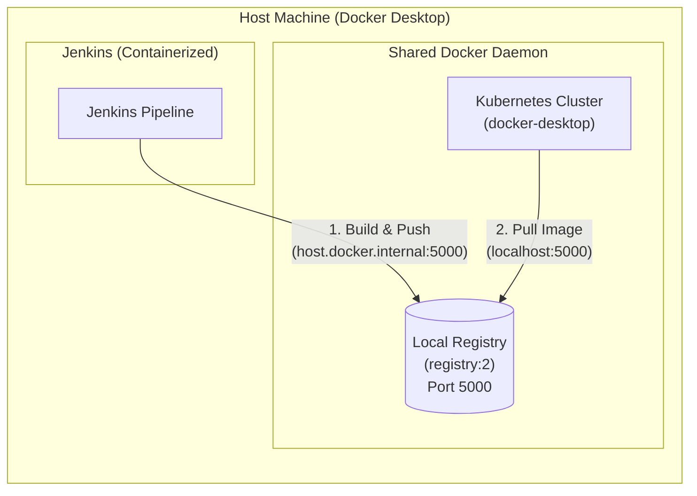

# Local CI/CD Setup: Docker Registry, Kubernetes & Jenkins on Docker Desktop

A quick-reference guide for running a local Docker registry in Docker Desktop, pushing images from Jenkins, and deploying them to Docker Desktop's built-in Kubernetes cluster.

---

## Architecture Overview



---

## 1. Local Docker Registry Setup

Run the official `registry:2` image on port `5000` so it persists across Docker Desktop restarts:

```bash
docker run -d -p 5000:5000 --restart=always --name registry registry:2
```

* **Optional Data Persistence:** Add `-v ~/.registry/storage:/var/lib/registry` to prevent losing images if the container is removed.
* **macOS Port Conflict:** If AirPlay Receiver uses port `5000`, map to `5001` instead (`-p 5001:5000`).
* **Verify Stored Images:**
  ```bash
  curl http://localhost:5000/v2/_catalog
  ```

---

## 2. Using the Registry with Docker Desktop Kubernetes

Because Docker Desktop's Kubernetes cluster shares the same Docker daemon as your host CLI, **no extra network or insecure-registry configuration is needed** for `localhost:5000`.

### Deployment Manifest (`deployment.yaml`)
```yaml
apiVersion: apps/v1
kind: Deployment
metadata:
  name: my-app
spec:
  replicas: 1
  selector:
    matchLabels:
      app: my-app
  template:
    metadata:
      labels:
        app: my-app
    spec:
      containers:
        - name: my-app
          image: localhost:5000/my-app:v1
          imagePullPolicy: Always
          ports:
            - containerPort: 8080
```

* **Why `imagePullPolicy: Always`?** Forces Kubernetes to fetch the newest image from your local registry on pod restart, even if the tag name hasn't changed.

---

## 3. Pushing from Jenkins to the Local Registry

### Scenario A: Jenkins Running in a Docker Container (Most Common)
Inside a container, `localhost` refers to the Jenkins container itself. Route traffic to the host registry using `host.docker.internal:5000`.

1. **Mount the Docker socket** when running Jenkins:
   ```bash
   docker run -d \
     --name jenkins \
     -p 8080:8080 -p 50000:50000 \
     -v jenkins_home:/var/jenkins_home \
     -v /var/run/docker.sock:/var/run/docker.sock \
     jenkins/jenkins:lts
   ```
2. **Trust the insecure registry** in **Docker Desktop > Settings > Docker Engine**, then click **Apply & Restart**:
   ```json
   {
     "insecure-registries": ["host.docker.internal:5000"]
   }
   ```
3. **Configure your `Jenkinsfile`:**
   ```groovy
   pipeline {
       agent any
       environment {
           REGISTRY = "host.docker.internal:5000"
           IMAGE_NAME = "my-app"
       }
       stages {
           stage('Build & Push') {
               steps {
                   sh """
                       docker build -t \${REGISTRY}/\({IMAGE_NAME}:\){BUILD_NUMBER} .
                       docker push \${REGISTRY}/\({IMAGE_NAME}:\){BUILD_NUMBER}
                   """
               }
           }
       }
   }
   ```

### Scenario B: Jenkins Running Natively on the Host OS
If Jenkins runs directly on macOS, Windows, or Linux:
1. Add the `jenkins` user to the `docker` group (`sudo usermod -aG docker jenkins`) and restart Jenkins.
2. Push directly to `localhost:5000/my-app:${BUILD_NUMBER}` (no `insecure-registries` config needed).

---

## Key Takeaways & Troubleshooting

* **Cross-Compatible Addresses:** Even when containerized Jenkins pushes to `host.docker.internal:5000`, your Kubernetes manifests can still pull from `localhost:5000`—both point to the exact same registry container.
* **Socket Permission Denied:** If Jenkins fails to access `/var/run/docker.sock`, run:
  ```bash
  docker exec -u root jenkins chmod 666 /var/run/docker.sock
  ```
* **HTTPS Client Error:** Seeing `server gave HTTP response to HTTPS client` means the registry hostname needs to be added to `"insecure-registries"` in Docker Desktop's engine settings.
