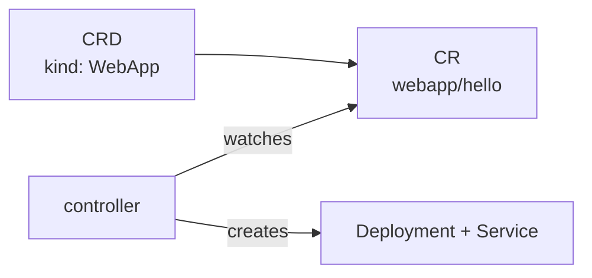

# Part 1 — What are CRDs?

---

## The problem

Kubernetes only knows its built-in kinds: `Pod`, `Deployment`, `Service`, ...
You can't `kubectl get webapps` — there's no such kind.

A **CRD (CustomResourceDefinition)** adds a new kind to the API server.

---

## Three words

| Word | Meaning | Built-in equivalent |
| --- | --- | --- |
| **CRD** | defines a new kind | the `Deployment` type itself |
| **CR** (custom resource) | one object of that kind | `deployment/hello` |
| **controller** | a program that makes the CR *do* something | the Deployment controller |



**CRD + controller = an Operator.**

---

## A CRD alone only stores data

- with just a CRD: you can `apply`, `get`, `delete` objects — nothing else happens
- with a controller: the controller reads the CR and creates real things

The controller is the same loop from [01-intro.md](../kubernetes-intro/01-intro.md):


---

## You've already used CRDs

```bash
kubectl get crd
```

Argo CD's `Application`, Istio's `VirtualService`, cert-manager's
`Certificate` — all CRDs, each with its own controller.

Next: [02-your-first-crd.md](02-your-first-crd.md)
