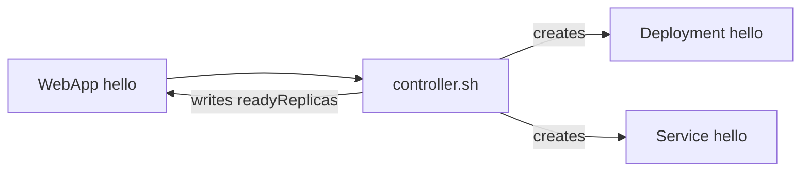

# Part 5 — Use case 2: a `WebApp` kind + a shell controller

**Problem:** deploying one service means writing a Deployment *and* a
Service, every time.

**Solution:** a short `WebApp` object, plus a controller that creates
the Deployment and Service for you.

```yaml
kind: WebApp
spec:
  image: nginx:1.27
  replicas: 2
```

Files: [examples/05-webapp-controller/](examples/05-webapp-controller/)



---

## Step 1: The CRD

`examples/05-webapp-controller/crd.yaml` (the important parts)

```yaml
names:
  kind: WebApp
  plural: webapps
  shortNames: [wa]
...
subresources:
  status: {}                  # lets the controller write .status
...
spec:
  required: [image]
  properties:
    image:    {type: string}
    replicas: {type: integer, default: 1}
    port:     {type: integer, default: 8080}
    env:      ...             # same shape as a container's env
status:
  properties:
    readyReplicas: {type: integer}
```

Two parts of every object:

- `spec` — what the **user** wants (image, replicas)
- `status` — what the **controller** saw (ready pods)

```bash
kubectl apply -f examples/05-webapp-controller/crd.yaml
```

---

## Step 2: Create a WebApp — nothing happens yet

```bash
kubectl apply -f examples/05-webapp-controller/hello-webapp.yaml
kubectl get wa           # READY is empty
kubectl get deploy       # no Deployment - no controller is running
```

---

## Step 3: The controller

`examples/05-webapp-controller/controller.sh` — three steps in a loop:

```bash
while true; do
  for NAME in $(kubectl get webapps -o jsonpath='{.items[*].metadata.name}'); do

    # 1. READ what the user wants
    IMAGE=$(kubectl get webapp "$NAME" -o jsonpath='{.spec.image}')
    REPLICAS=$(kubectl get webapp "$NAME" -o jsonpath='{.spec.replicas}')
    PORT=$(kubectl get webapp "$NAME" -o jsonpath='{.spec.port}')
    ENV=$(kubectl get webapp "$NAME" -o jsonpath='{.spec.env}')
    OWNER_UID=$(kubectl get webapp "$NAME" -o jsonpath='{.metadata.uid}')

    # 2. APPLY the Deployment + Service ("unchanged" lines are hidden)
    kubectl apply -f - <<YAML | grep -v unchanged
apiVersion: apps/v1
kind: Deployment
metadata:
  name: $NAME
  ownerReferences:   # delete the WebApp -> Kubernetes deletes this Deployment too
    - {apiVersion: platform.example.com/v1alpha1, kind: WebApp, name: $NAME, uid: $OWNER_UID}
spec:
  replicas: $REPLICAS
  ...                # selector, labels, container with $IMAGE / $PORT / $ENV
---
apiVersion: v1
kind: Service
...                  # same ownerReferences, port $PORT
YAML

    # 3. WRITE STATUS: how many pods are ready
    READY=$(kubectl get deployment "$NAME" -o jsonpath='{.status.readyReplicas}')
    kubectl patch webapp "$NAME" --subresource=status --type=merge \
      -p "{\"status\":{\"readyReplicas\":${READY:-0}}}" > /dev/null
  done
  sleep 5
done
```

- `kubectl apply` is safe to repeat — it only changes what differs
- `ownerReferences` — when the WebApp is deleted, Kubernetes deletes the Deployment and Service
- `--subresource=status` — the only way to write `status`

---

## Step 4: Run it

In a **second terminal**:

```bash
cd kubernetes/kubernetes-crds
./examples/05-webapp-controller/controller.sh
# deployment.apps/hello created
# service/hello created
```

Back in the first terminal:

```bash
kubectl get wa
# NAME    IMAGE        DESIRED   READY
# hello   nginx:1.27   2         2

kubectl get deploy,svc hello
```

---

## Step 5: See it work

```bash
# change the WebApp -> Deployment follows
kubectl patch wa hello --type=merge -p '{"spec":{"replicas":3}}'
kubectl get wa hello

# change the Deployment by hand -> controller puts it back within 5s
kubectl scale deploy/hello --replicas=1
sleep 6; kubectl get deploy hello        # wants 3 again (READY catches up in a few seconds)

# delete the WebApp -> Deployment and Service are deleted too
kubectl delete wa hello
kubectl get deploy,svc
```

---

## Step 6: Deploy the part-order-app with it

`examples/05-webapp-controller/part-order-app.yaml`

```yaml
apiVersion: platform.example.com/v1alpha1
kind: WebApp
metadata:
  name: part-inventory-service
spec:
  image: ram1uj/part-inventory-service:latest
---
apiVersion: platform.example.com/v1alpha1
kind: WebApp
metadata:
  name: part-order-service
spec:
  image: ram1uj/part-order-service:latest
  env:
    - {name: INVENTORY_SERVICE_URL, value: "http://part-inventory-service:8080"}
```

```bash
kubectl apply -f examples/05-webapp-controller/part-order-app.yaml
kubectl get wa -w                 # wait until READY is 1 (1-3 min the first time)

kubectl port-forward svc/part-order-service 9090:8080
# open http://localhost:9090
```

Compare with [k8s/](../../applications-and-source-code/part-order-app-java/k8s/): 7 YAML files there, 2 short objects here.

---

## Clean up

```bash
# Ctrl+C the controller, then:
kubectl delete -f examples/05-webapp-controller/crd.yaml    # also deletes all WebApps
```

**Takeaway:** a controller is just *read → apply → write status*, in a
loop. A shell script is fine for learning; part 6 does it properly in Go.

Next: [06-usecase-webapp-operator-kubebuilder.md](06-usecase-webapp-operator-kubebuilder.md)
