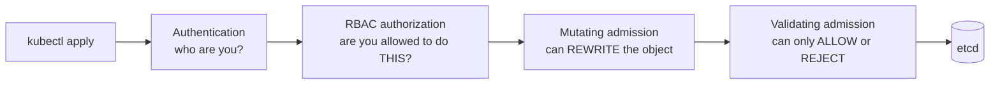
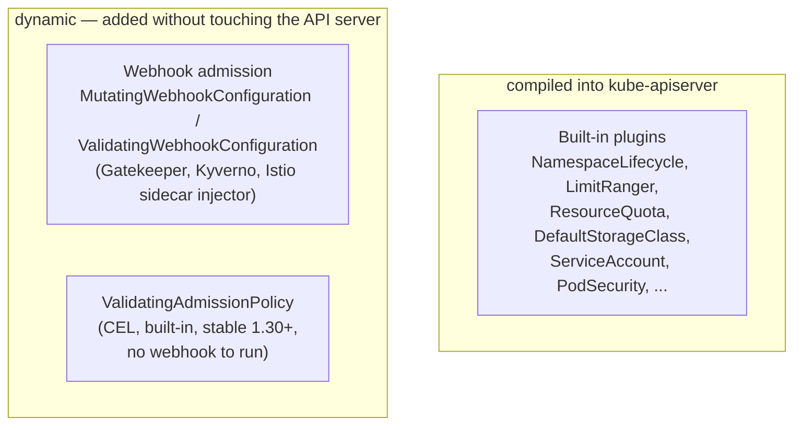
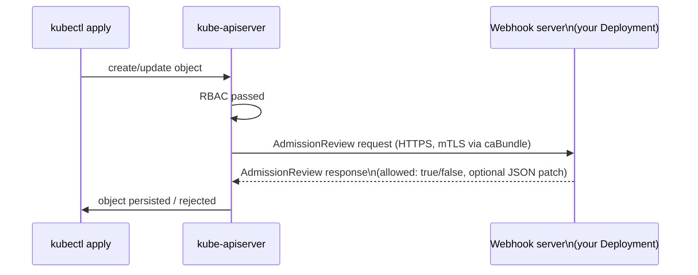
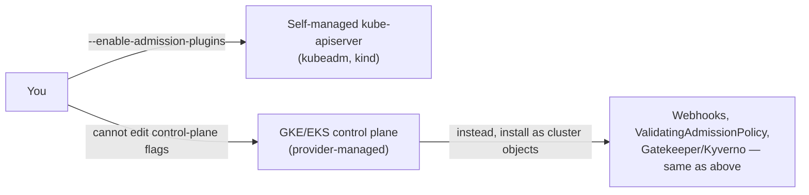

# Admission controllers — the gate between "allowed" and "exists"

[09-rbac.md](09-rbac.md) answers "is this identity allowed to `verb` this
`resource`." It says nothing about the *content* of the request — RBAC
will happily let you create a Pod running as root with no resource limits,
in a namespace that's already over quota. Admission control is the stage
that inspects (and can rewrite or reject) the object itself, after RBAC
has already said yes.

---

## Where admission sits in a request's lifecycle

This is the same diagram from
[09-rbac.md](09-rbac.md#where-rbac-sits-in-a-requests-lifecycle), with the
single "Admission control" box expanded into its two phases:



Two phases, always in that order: every mutating plugin runs first (so
later plugins validate the *final*, already-rewritten object), then every
validating plugin runs. A rejection at either phase means the object is
never persisted — `kubectl apply` gets an error back, nothing changes.

---

## Two kinds of admission plugin



| | Built-in plugin | Webhook | `ValidatingAdmissionPolicy` |
| --- | --- | --- | --- |
| Ships with | kube-apiserver binary | a separate Deployment you (or a tool) run | kube-apiserver binary |
| Enabled via | `--enable-admission-plugins` flag | a Kubernetes object (`*WebhookConfiguration`) | a Kubernetes object (`ValidatingAdmissionPolicy`) |
| Rule language | Go, fixed at compile time | whatever the webhook server implements (Rego for Gatekeeper, YAML for Kyverno) | CEL expressions |
| Adds a network hop to every `apply`? | no | yes — webhook must respond in time or `failurePolicy` decides | no — evaluated in-process |
| Can mutate? | some can (`DefaultStorageClass`) | yes, if registered as a `MutatingWebhookConfiguration` | no — validating only |

Reach for a webhook or `ValidatingAdmissionPolicy` once a built-in plugin
can't express the rule you need; most clusters run with only built-ins
enabled and never notice admission control at all until something like
`ResourceQuota` rejects a Pod.

---

## Built-in plugins: what's actually enabled

Unlike RBAC objects, built-in admission plugins are **not** Kubernetes API
objects — there's nothing to `kubectl get`. They're a flag on the API
server binary itself.

```bash
# on a kubeadm/self-managed cluster, the flag lives in the static Pod manifest
grep enable-admission-plugins /etc/kubernetes/manifests/kube-apiserver.yaml
```

```yaml
# excerpt of kube-apiserver.yaml
spec:
  containers:
    - command:
        - kube-apiserver
        - --enable-admission-plugins=NodeRestriction,ResourceQuota,PodSecurity
        - --disable-admission-plugins=AlwaysAdmit
```

| Plugin | What it does |
| --- | --- |
| `NamespaceLifecycle` | rejects creating objects in a `Namespace` that's terminating or doesn't exist |
| `LimitRanger` | applies a namespace's `LimitRange` defaults/min/max to Pods that don't set their own |
| `ResourceQuota` | rejects a create/update that would push a namespace over its `ResourceQuota` |
| `DefaultStorageClass` | mutating — stamps a `PersistentVolumeClaim` with the cluster's default `StorageClass` if none was set |
| `ServiceAccount` | mutating — attaches the namespace's `default` ServiceAccount to Pods that didn't specify one |
| `NodeRestriction` | limits what a kubelet can modify to just its own `Node`/Pods — stops a compromised node from editing others |
| `PodSecurity` | the replacement for the removed `PodSecurityPolicy` — enforces `privileged`/`baseline`/`restricted` per namespace label, covered in depth in [07-security-best-practices.md](../kubernetes-advanced/07-security-best-practices.md#pod-security-admission--cluster-wide-enforcement-of-the-above) |

Almost all of these ship **enabled by default** in any current distro —
`--enable-admission-plugins` is for adding the handful that are opt-in
(`NodeRestriction` isn't always default depending on distro version), not
for building the list from scratch. `--disable-admission-plugins` is the
one worth knowing: `AlwaysAdmit` (allows everything, used for debugging)
and `AlwaysDeny` still exist as legacy no-op plugins that should stay off.

```bash
# on a managed cluster (GKE/EKS) you cannot edit this flag —
# the control plane isn't yours to reach; see "GKE/EKS" section below
```

---

## Worked example: `LimitRange` + `ResourceQuota`

Both are ordinary namespaced objects that the `LimitRanger` and
`ResourceQuota` built-in plugins read and enforce — no separate "turn this
on" step beyond the plugin already being enabled (it is, by default).

```yaml
# namespace-team.yaml
apiVersion: v1
kind: Namespace
metadata:
  name: team-a
```

```yaml
# limitrange.yaml — LimitRanger mutates Pods that don't set requests/limits
apiVersion: v1
kind: LimitRange
metadata:
  name: default-limits
  namespace: team-a
spec:
  limits:
    - type: Container
      default:                # applied if a container omits limits
        cpu: "500m"
        memory: "256Mi"
      defaultRequest:         # applied if a container omits requests
        cpu: "250m"
        memory: "128Mi"
      max:                     # ResourceQuota-adjacent: hard ceiling per container
        cpu: "2"
        memory: "1Gi"
```

```yaml
# resourcequota.yaml — ResourceQuota rejects anything that would exceed the namespace total
apiVersion: v1
kind: ResourceQuota
metadata:
  name: team-a-quota
  namespace: team-a
spec:
  hard:
    requests.cpu: "4"
    requests.memory: 4Gi
    limits.cpu: "8"
    limits.memory: 8Gi
    pods: "20"
```

```bash
kubectl apply -f namespace-team.yaml -f limitrange.yaml -f resourcequota.yaml

# a Pod with no resources block gets LimitRanger's defaults stamped on it (mutating)
kubectl run test --image=nginx -n team-a
kubectl get pod test -n team-a -o jsonpath='{.spec.containers[0].resources}'

# a 21st Pod gets rejected outright (validating)
kubectl run overflow --image=nginx -n team-a
# Error from server (Forbidden): pods "overflow" is forbidden: exceeded quota: team-a-quota
```

`LimitRange` runs first as a **mutating** step (fills in what's missing),
then `ResourceQuota` runs as a **validating** step against the now-complete
object — the same mutating-then-validating order from the lifecycle
diagram above, just with two built-in plugins instead of custom ones.

---

## Dynamic admission: webhooks

A webhook is how you add admission logic without recompiling
kube-apiserver — Gatekeeper, Kyverno, Istio's sidecar injector, and
cert-manager's CA injector are all ordinary webhook servers registered
this way.



```yaml
apiVersion: admissionregistration.k8s.io/v1
kind: ValidatingWebhookConfiguration
metadata:
  name: require-team-label
webhooks:
  - name: require-team-label.example.com
    clientConfig:
      service:
        name: policy-webhook       # Service fronting your webhook Deployment
        namespace: policy-system
        path: /validate
      caBundle: <base64 CA cert>    # so the API server trusts the webhook's TLS cert
    rules:
      - apiGroups: [""]
        apiVersions: ["v1"]
        operations: ["CREATE"]
        resources: ["pods"]
    namespaceSelector:
      matchLabels:
        admission-enforced: "true"  # opt namespaces in, rather than webhooking the whole cluster
    failurePolicy: Fail             # Fail = reject if webhook is unreachable; Ignore = allow through
    sideEffects: None
    admissionReviewVersions: ["v1"]
```

- **`failurePolicy: Fail`** turns your webhook into a hard dependency for
  every matching `kubectl apply` — if the webhook Deployment is down,
  those creates start failing cluster-wide. This is the tradeoff
  `ValidatingAdmissionPolicy` exists to avoid.
- **`namespaceSelector`/`objectSelector`** scope the webhook down so it
  isn't evaluated on every object in the cluster (including `kube-system`,
  which can deadlock a cluster if a webhook there is unreachable) —
  always scope, never register cluster-wide by accident.
- Gatekeeper and Kyverno are exactly this mechanism, packaged: they
  install their own webhook + a CRD (`ConstraintTemplate`/`Constraint` for
  Gatekeeper, `ClusterPolicy` for Kyverno) so you write policy YAML
  instead of a webhook server; see the Kyverno example in
  [07-security-best-practices.md](../kubernetes-advanced/07-security-best-practices.md#admission-control-more-generally).

```bash
kubectl get validatingwebhookconfigurations
kubectl get mutatingwebhookconfigurations
kubectl describe validatingwebhookconfiguration require-team-label
```

---

## `ValidatingAdmissionPolicy` — the no-webhook alternative

Stable since 1.30, built into the API server: write the rule as CEL,
skip running/scaling/securing a webhook server entirely.

```yaml
apiVersion: admissionregistration.k8s.io/v1
kind: ValidatingAdmissionPolicy
metadata:
  name: require-team-label-policy
spec:
  failurePolicy: Fail
  matchConstraints:
    resourceRules:
      - apiGroups: [""]
        apiVersions: ["v1"]
        operations: ["CREATE"]
        resources: ["pods"]
  validations:
    - expression: "has(object.metadata.labels) && 'team' in object.metadata.labels"
      message: "every Pod must carry a 'team' label"
```

```yaml
apiVersion: admissionregistration.k8s.io/v1
kind: ValidatingAdmissionPolicyBinding
metadata:
  name: require-team-label-binding
spec:
  policyName: require-team-label-policy
  validationActions: ["Deny"]    # or ["Warn"] / ["Audit"] to roll out non-blocking first
  matchResources:
    namespaceSelector:
      matchLabels:
        admission-enforced: "true"
```

```bash
kubectl apply -f policy.yaml -f binding.yaml
kubectl get validatingadmissionpolicies
kubectl get validatingadmissionpolicybindings

kubectl run no-label --image=nginx -n team-a
# Error: ValidatingAdmissionPolicy 'require-team-label-policy' ... every Pod must carry a 'team' label
```

The `ValidatingAdmissionPolicy`/`...Binding` split mirrors
`ClusterRole`/`ClusterRoleBinding` from [09-rbac.md](09-rbac.md#the-four-rbac-objects-and-how-they-pair-up):
define the rule once, bind it to different namespace selectors without
duplicating the CEL expression.

---

## How this maps onto GKE and EKS



On a managed control plane you never see or edit
`--enable-admission-plugins` — the provider chooses the built-in set
(both GKE and EKS ship the common ones: `NamespaceLifecycle`,
`LimitRanger`, `ResourceQuota`, `ServiceAccount`, `PodSecurity`, etc.,
already on). Anything beyond that built-in set — a custom rule, a
registry allow-list, mandatory labels — has to be a cluster-side object
(`ValidatingWebhookConfiguration`, `ValidatingAdmissionPolicy`, or a
policy engine's CRDs) rather than a flag change, since flags require
access none of GKE/EKS/AKS grant you. This is the same "same in-cluster
objects everywhere, different front door underneath" pattern as
[09-rbac.md](09-rbac.md#gke-vs-eks-side-by-side)'s GKE/EKS comparison.

---

## Debugging: is a rejection admission or RBAC?

```bash
# RBAC denial: "forbidden: User ... cannot create resource ..."
# admission denial: "forbidden: <plugin/policy name> ... <your custom message>"

# confirm RBAC isn't the cause first — if this says yes, the rejection is admission's
kubectl auth can-i create pods --as=system:serviceaccount:team-a:default -n team-a

# then check what's actually registered and might be rejecting
kubectl get validatingwebhookconfigurations,mutatingwebhookconfigurations
kubectl get validatingadmissionpolicybindings
kubectl get resourcequota,limitrange -n team-a
kubectl get namespace team-a -o jsonpath='{.metadata.labels}'   # PodSecurity / webhook namespaceSelector labels
```

Order matters when debugging: RBAC failing looks like "cannot create
resource"; admission failing looks like a message naming the specific
plugin, webhook, or policy that rejected it — the error text tells you
which stage to go check.

---

## Cleanup

```bash
kubectl delete resourcequota team-a-quota -n team-a
kubectl delete limitrange default-limits -n team-a
kubectl delete namespace team-a
kubectl delete validatingwebhookconfiguration require-team-label
kubectl delete validatingadmissionpolicybinding require-team-label-binding
kubectl delete validatingadmissionpolicy require-team-label-policy
```

---

## Takeaway

RBAC decides who can ask; admission control decides whether what they're
asking for is allowed to exist, running as two ordered phases (mutating,
then validating) after every RBAC check passes. Built-in plugins
(`ResourceQuota`, `PodSecurity`, ...) cover most cases and are a
kube-apiserver flag you can't touch on managed clusters; webhooks and
`ValidatingAdmissionPolicy` are how you add custom rules as ordinary
cluster objects instead, portable across self-managed and managed
clusters alike. [09-rbac.md](09-rbac.md) and this note together are the
full "who, then what" story before an object ever reaches etcd;
[07-security-best-practices.md](../kubernetes-advanced/07-security-best-practices.md)
picks up from here for the security-specific application (Pod hardening,
Kyverno policy examples).
