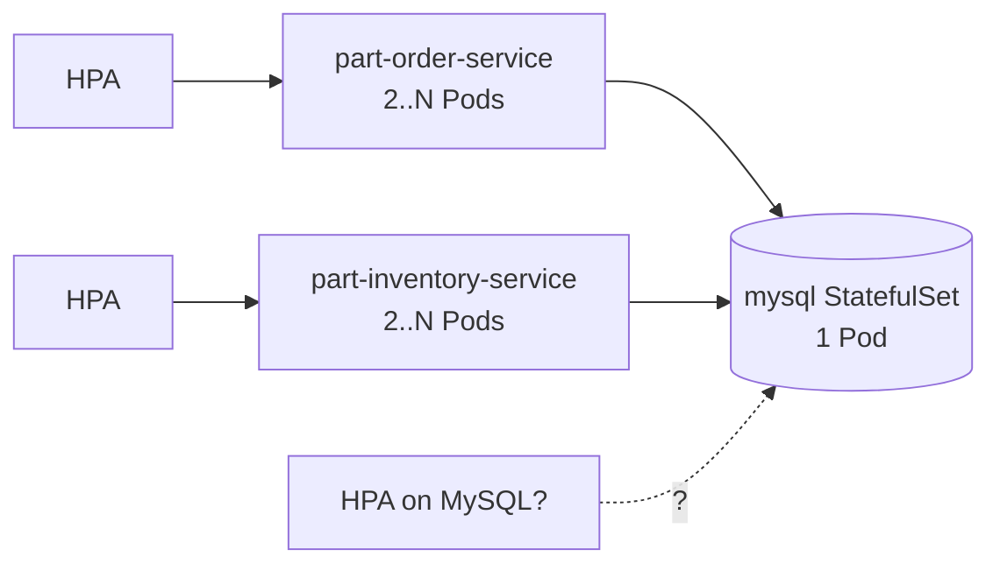
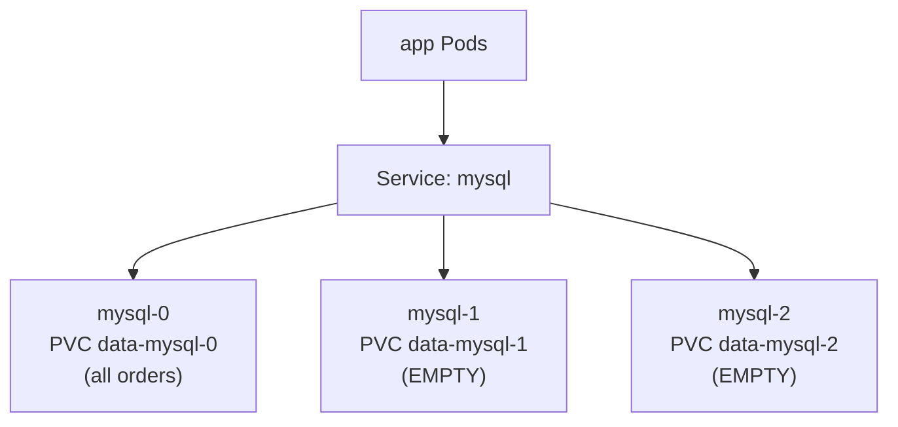
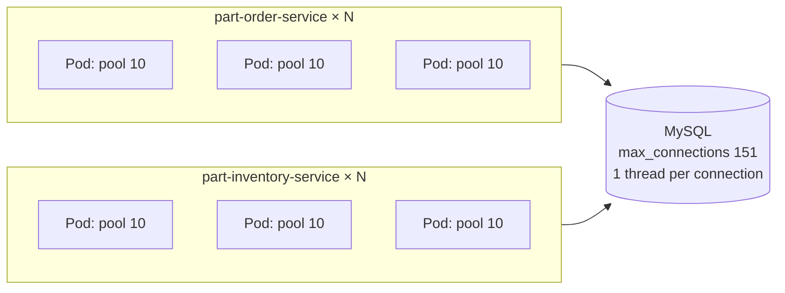
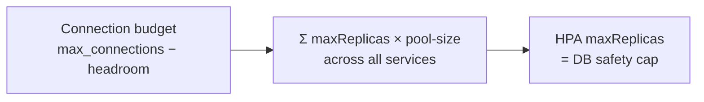
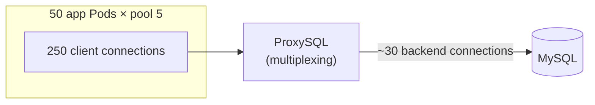
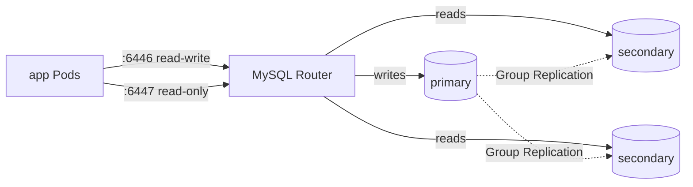
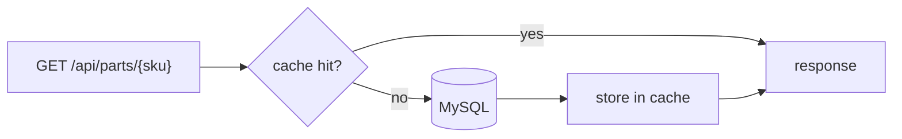
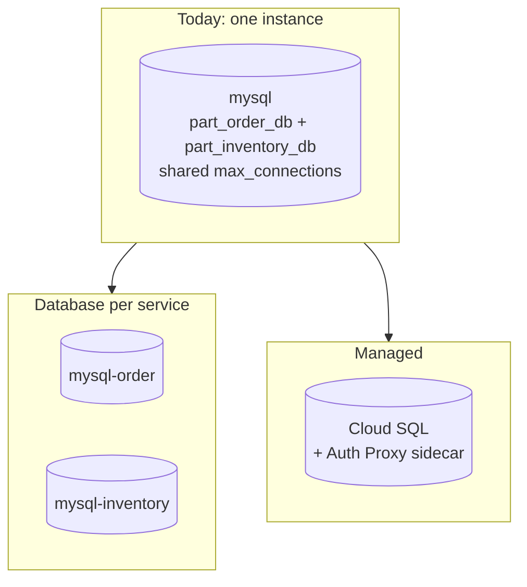
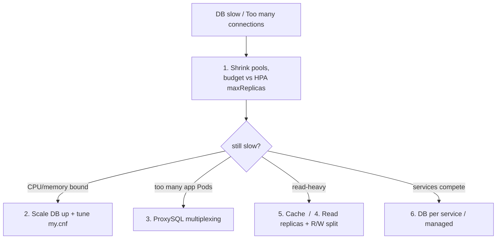

# Scaling with a Database: Why Not HPA on MySQL, and Fixing Connection Pressure

Builds on [02-scaling-vpa-hpa.md](02-scaling-vpa-hpa.md) (HPA/VPA basics)
and [08-deployment-vs-statefulsets.md](../kubernetes-intro/08-deployment-vs-statefulsets.md).
Concrete example: the `prod`/MySQL stack in
[k8s-with-mysql/](../../applications-and-source-code/part-order-app-java/k8s-with-mysql/NOTES.md).

---

## The question



- Apps are stateless → HPA scales them freely.
- MySQL is the single shared state → **should it get an HPA too?**
- **No.** Stateless tiers scale automatically; stateful tiers scale
  **deliberately**.

---

## Why HPA on the MySQL StatefulSet breaks data

`volumeClaimTemplates` gives **each replica its own PVC**. Plain
`mysql:8.0` has **no replication** configured.



- Scale to 3 → `mysql-1` and `mysql-2` start as **empty, independent databases**.
- Service load-balances across all three → write lands on `mysql-0`, next
  read hits `mysql-2` → "order not found". **Silent split-brain.**
- Even **with** replication, single-primary MySQL sends **all writes to one
  node** — extra Pods only add read capacity.
- A new replica must **clone the full dataset** before serving (minutes);
  scale-down means removing replication members. HPA's fast,
  CPU-triggered scaling is the wrong control loop.

| | Stateless app | Database |
| --- | --- | --- |
| New Pod useful immediately? | Yes | No — needs data copy first |
| Any Pod can serve any request? | Yes | Writes: primary only |
| Scale with | HPA | Vertical sizing, operator-managed replicas |

---

## The real problem: HPA on apps multiplies DB connections

Each app Pod opens its own **HikariCP pool** — default `maximum-pool-size: 10`.
MySQL 8.0 default `max_connections = 151`.



| Scenario | Connections |
| --- | --- |
| 2 services × 2 replicas × 10 (current `k8s-with-mysql/`) | 40 |
| HPA → 5 replicas each | 100 |
| HPA → 8 replicas each | **160 → `Too many connections`** |

- MySQL = **one thread per connection**, each with per-thread buffers →
  memory climbs with connection count.
- With a `1Gi` limit on the MySQL Pod it slows down / OOM-kills **before**
  hitting the connection limit.
- More connections ≠ more throughput: past a point, concurrent queries
  fight over CPU, locks, and the buffer pool → everything gets slower.

Check where you stand:

```bash
kubectl exec -it mysql-0 -n part-order-app-mysql -- \
  sh -c 'mysql -uroot -p"$MYSQL_ROOT_PASSWORD" -e "
    SHOW VARIABLES LIKE \"max_connections\";
    SHOW GLOBAL STATUS LIKE \"Threads_connected\";
    SHOW GLOBAL STATUS LIKE \"Max_used_connections\";
    SHOW PROCESSLIST;"'
```

---

## Fix 1: Smaller pools + a connection budget (do this first)



```yaml
# application-prod.yml (both services)
spring:
  datasource:
    hikari:
      maximum-pool-size: 5
      minimum-idle: 2
      connection-timeout: 3000   # fail fast, don't queue forever
      max-lifetime: 1800000      # 30 min, keep < MySQL wait_timeout (8h default)
```

**Budget rule:**

```text
Σ (HPA maxReplicas × maximum-pool-size)  ≤  max_connections − ~20 (admin/monitoring headroom)

e.g. order maxReplicas 10 × 5  +  inventory maxReplicas 10 × 5  =  100  ≤  151 − 20
```

- Small pools are usually **faster** — fewer concurrent queries = less contention.
- HPA `maxReplicas` now does double duty: cluster-capacity cap **and** DB-load cap.
- Also turn off `show-sql: true` in prod (both `application-prod.yml` files
  set it) — per-query logging overhead.

---

## Fix 2: Vertical scaling + MySQL tuning

The DB scales **up**, not out. Mount a `my.cnf` via ConfigMap
(see [07-configmap-and-secrets.md](../kubernetes-intro/07-configmap-and-secrets.md)):

```yaml
apiVersion: v1
kind: ConfigMap
metadata:
  name: mysql-config
  namespace: part-order-app-mysql
data:
  tuning.cnf: |
    [mysqld]
    max_connections = 300
    innodb_buffer_pool_size = 1G     # ~60-70% of the container memory limit
    wait_timeout = 600               # reap idle connections after 10 min
```

```yaml
# StatefulSet container (sketch)
          resources:
            requests: { cpu: "1", memory: 2Gi }
            limits:   { cpu: "2", memory: 2Gi }
          volumeMounts:
            - name: mysql-config
              mountPath: /etc/mysql/conf.d   # official image includes this dir
      volumes:
        - name: mysql-config
          configMap:
            name: mysql-config
```

```bash
kubectl exec -it mysql-0 -n part-order-app-mysql -- \
  sh -c 'mysql -uroot -p"$MYSQL_ROOT_PASSWORD" -e "SHOW VARIABLES LIKE \"max_connections\";"'
```

- Raising `max_connections` without raising memory just moves the failure to OOM.
- VPA: use `updateMode: "Off"` (recommendations only) for sizing — **not**
  `Auto`, which evicts/restarts the DB Pod.

---

## Fix 3: Connection pooler / proxy (ProxySQL)



- Apps connect to ProxySQL instead of MySQL; ProxySQL **multiplexes** many
  client connections onto a few real backend connections.
- Also does query routing (reads → replicas), query caching, rewriting.
- Stateless itself → **this** tier can sit behind a Deployment + HPA.
- MySQL equivalent of PgBouncer for Postgres.
- Note: MySQL Router (used by the Operator) routes connections but does
  **not** multiplex them the way ProxySQL does.

---

## Fix 4: Read replicas + read/write split (operator-managed)

Already in the repo:
[k8s-with-mysql-operator/](../../applications-and-source-code/part-order-app-java/k8s-with-mysql-operator/NOTES.md)
(InnoDB Cluster, background in
[05-mysql-operator-example.md](../kubernetes-advanced/05-mysql-operator-example.md)).



Scale **declaratively** — the Operator handles clone + group membership:

```bash
kubectl patch innodbcluster mycluster -n part-order-app-mysql-operator \
  --type merge -p '{"spec":{"instances":5}}'
kubectl get innodbcluster -n part-order-app-mysql-operator -w
```

- Only helps if the app actually sends reads to `:6447`. Today both services
  use **one** datasource → everything goes to `:6446` (primary).
- Needs an app change: two datasources + routing on `@Transactional(readOnly = true)`:

```java
// sketch - not in the app today
class ReadWriteRoutingDataSource extends AbstractRoutingDataSource {
    @Override
    protected Object determineCurrentLookupKey() {
        return TransactionSynchronizationManager.isCurrentTransactionReadOnly()
                ? "reader" : "writer";
    }
}
// wrap in LazyConnectionDataSourceProxy so the readOnly flag is known
// before a connection is fetched
```

- Replication lag: a read right after a write may not see it → keep
  read-your-own-write paths (e.g. "place order → show order") on the primary.
- Group Replication caps at **9 members**; writes still don't scale out.

---

## Fix 5: Send fewer queries



- **Cache** hot reads (part lookups, stock checks) — Spring Cache +
  Caffeine (per-Pod) or Redis (shared). Invalidate on stock change.
- **Indexes** on lookup columns (e.g. SKU).
- Hunt **N+1** queries (`show-sql` in *dev* is useful for this, not prod).
- Short transactions — don't hold a connection while calling another
  service over Feign.

---

## Fix 6: Split or offload the database



- Both services' databases share one MySQL → they compete for the same
  connection limit, CPU, and buffer pool.
- **Database per service** → each sizes/scales independently.
- **Managed DB** (Cloud SQL on GKE) → replicas, failover, backups,
  connection limits handled by the provider.

---

## Decision summary



| Approach | Effort | Helps with |
| --- | --- | --- |
| Smaller pools + budget | Config only | Connection exhaustion |
| Vertical scale + `my.cnf` | Manifest change | CPU / memory bound DB |
| ProxySQL | New component | Many app Pods |
| Read replicas + R/W split | Operator + app code | Read-heavy load |
| Caching / indexes | App code | Read-heavy load, slow queries |
| DB per service / managed | Architecture | Contention, ops burden |

**Rule:** HPA the stateless tiers, cap them with a connection budget, and
scale the database deliberately — never with HPA.
