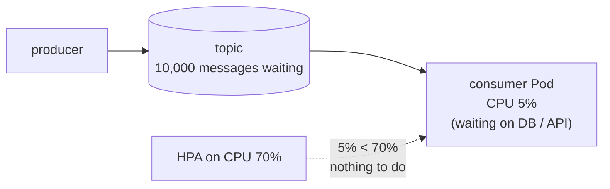
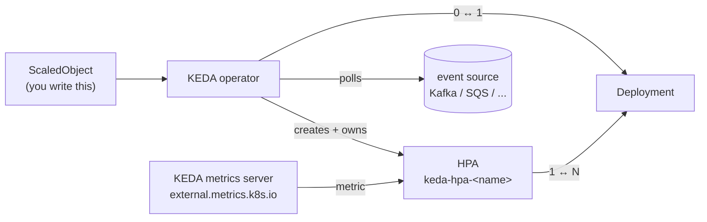
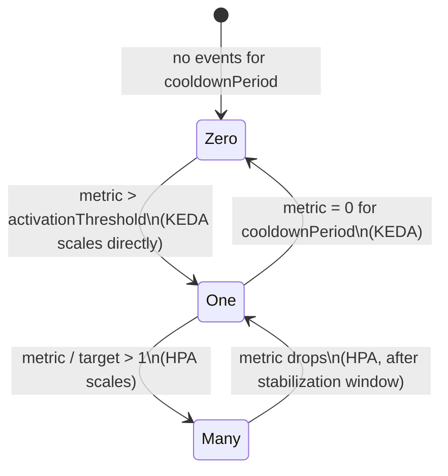
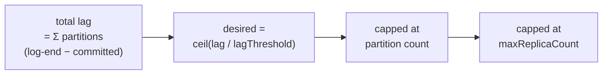
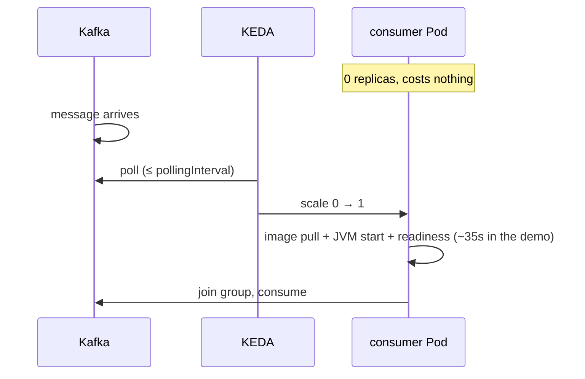
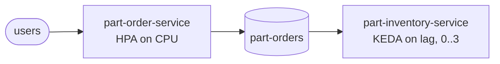

# Event-Driven Autoscaling with KEDA

Builds on [02-scaling-vpa-hpa.md](02-scaling-vpa-hpa.md), where the HPA scales on CPU and memory. This note covers scaling on **work waiting in a queue** instead.

- Hands-on, step by step: [part-order-app-kafka/k8s-with-keda/NOTES.md](../../applications-and-source-code/part-order-app-kafka/k8s-with-keda/NOTES.md). It autoscales a Kafka consumer 0 → 3 → 0 on consumer lag.
- The numbers quoted below come from that demo.

---

## The problem: CPU is the wrong signal for a consumer



- A message consumer is often **I/O-bound**: it waits on a database, an API or a disk. Its CPU stays low while the backlog grows.
- **CPU HPA:** it sees 5% and does nothing, while users wait minutes for their orders.
- **The useful signal is the backlog.** That means the queue length, or for Kafka the **consumer lag**: messages produced minus messages processed.
- **The plain HPA can't read this.** Its built-in sources are CPU and memory, plus whatever metrics adapter you install for custom or external metrics.

---

## What KEDA is

**KEDA = Kubernetes Event-Driven Autoscaling.** It's a CNCF graduated project that you install as an operator.

- **Not a replacement for the HPA:** KEDA **creates and drives** an HPA for you.
- **Bridges event sources to the HPA:** it reads Kafka, SQS, RabbitMQ or Prometheus and turns that into a metric the HPA understands.
- **Adds scale to zero:** an HPA can't go below 1 replica, and KEDA can.
- **Built-in scalers:** 70+ "scalers" ship with it, so you don't write a metrics adapter per source.



---

## The three components

| Pod (namespace `keda`) | Job |
| --- | --- |
| `keda-operator` | watches `ScaledObject`s, polls the event source, creates the HPA, does 0 ↔ 1 |
| `keda-operator-metrics-apiserver` | registers `external.metrics.k8s.io` and answers the HPA's "what's the metric now?" |
| `keda-admission-webhooks` | validates ScaledObjects, e.g. blocks two autoscalers on the same Deployment |

```bash
helm repo add kedacore https://kedacore.github.io/charts && helm repo update
helm install keda kedacore/keda --namespace keda --create-namespace --wait
kubectl get apiservice v1beta1.external.metrics.k8s.io      # served by keda/keda-operator-metrics-apiserver
```

Only one component can serve `external.metrics.k8s.io` per cluster. If prometheus-adapter already serves external metrics, the two conflict.

---

## Two phases: activation (0 ↔ 1) and scaling (1 ↔ N)



| | Who does it | Controlled by |
| --- | --- | --- |
| 0 → 1 | KEDA operator | `activation…Threshold` in the trigger (Kafka: `activationLagThreshold`) |
| 1 → N → 1 | the HPA KEDA created | the target value (Kafka: `lagThreshold`), plus `advanced.horizontalPodAutoscalerConfig.behavior` |
| 1 → 0 | KEDA operator | `cooldownPeriod` (default 300s) |

The generated HPA always shows `MINPODS 1`, even with `minReplicaCount: 0`. That's expected: the HPA can't go below 1, so the last step is KEDA's.

---

## ScaledObject anatomy

```yaml
apiVersion: keda.sh/v1alpha1
kind: ScaledObject
metadata:
  name: part-inventory-service
spec:
  scaleTargetRef:
    name: part-inventory-service    # Deployment (or StatefulSet / any /scale resource)
  minReplicaCount: 0
  maxReplicaCount: 3
  pollingInterval: 10               # how often KEDA checks the source (default 30s)
  cooldownPeriod: 60                # idle time before 1 -> 0 (default 300s)
  advanced:
    horizontalPodAutoscalerConfig:  # passed straight into the generated HPA
      behavior:
        scaleDown:
          stabilizationWindowSeconds: 30
  triggers:                         # one or more; the HPA takes the MAX across them
    - type: kafka
      metadata:
        bootstrapServers: kafka.part-order-app-kafka.svc.cluster.local:9092
        consumerGroup: part-inventory-service
        topic: part-orders
        lagThreshold: "10"
        offsetResetPolicy: earliest
```

```bash
kubectl get scaledobject          # READY = KEDA can reach the source; ACTIVE = metric above activation
kubectl get hpa                   # keda-hpa-part-inventory-service
kubectl describe scaledobject part-inventory-service
```

---

## Scalers: what KEDA can scale on

| Category | Examples (`type:`) | Metric |
| --- | --- | --- |
| Message brokers | `kafka`, `rabbitmq`, `nats-jetstream`, `redis-streams` | consumer lag / queue length |
| Cloud queues | `aws-sqs-queue`, `azure-servicebus`, `gcp-pubsub` | messages visible / undelivered |
| Databases | `postgresql`, `mysql`, `mongodb` | the result of a query you write, e.g. `SELECT count(*) … WHERE status='PENDING'` |
| Metrics | `prometheus`, `datadog` | any query result, e.g. requests/s |
| Time | `cron` | desired replicas during a time window, e.g. scale up at 09:00 |
| Resource | `cpu`, `memory` | the same as a plain HPA, so you can mix it with event triggers |

- **Several triggers on one ScaledObject:** the HPA takes the **max** across them. A common combination is "Kafka lag OR CPU, whichever needs more pods".
- **ScaledJob instead of ScaledObject:** for long-running, one-off work. KEDA starts **one Job per batch of messages** instead of scaling long-lived Pods.

---

## The Kafka scaler math



A worked example from the demo:

| | Value |
| --- | --- |
| Total lag after 500 orders were sent | 431 |
| `lagThreshold` | 10 |
| ceil(431 / 10) | 43 |
| Partitions of `part-orders` | **3**, so the cap is 3 |
| `maxReplicaCount` | 3 |
| **Replicas** | **3** |

- **Why the partition cap:** in a consumer group, **one partition is read by exactly one consumer**. With 3 partitions, a 4th pod would get nothing, so KEDA caps replicas at the partition count by default. `allowIdleConsumers: "true"` turns the cap off.
- **`limitToPartitionsWithLag: "true"`:** tightens the cap further, to only the partitions that currently have lag.

---

## Partitions are the real ceiling

From the demo, with 3 pods running:

```
t=90s   lag=109   p0=109  p1=0  p2=0   consumers=3
t=103s  lag=49    p0=49   p1=0  p2=0   consumers=3
```

- **The bottleneck:** p1 and p2 were done, but p0 still drained at **one pod's speed** (about 5 msg/s). The other two pods sat idle.
- **More pods don't help a hot partition.** You need more partitions, or a better key spread, or faster per-message work.
- **Choose partition count up front.** It sets your **maximum consumer parallelism**. Partitions can be added later but never removed, and adding them re-maps keys to partitions (which breaks per-key ordering for a moment).

---

## Scale to zero: the trade-off



- **Worth it for** bursty or rare work: nightly batches, dev environments, per-tenant consumers. Kafka holds the messages safely until a consumer arrives.
- **Not worth it when** latency matters. The first message waits `pollingInterval` plus the cold start. Use `minReplicaCount: 1`.
- **Brokers make it safe.** With HTTP you need something to hold the request while the pod starts; that's the separate KEDA HTTP add-on. With a broker, the queue *is* the buffer.

---

## Connecting to secured sources: TriggerAuthentication

Real Kafka uses TLS + SASL. Keep the credentials in a Secret and reference them from the trigger:

```yaml
apiVersion: keda.sh/v1alpha1
kind: TriggerAuthentication
metadata:
  name: kafka-auth
spec:
  secretTargetRef:
    - parameter: sasl
      name: kafka-credentials
      key: sasl            # e.g. "scram_sha512"
    - parameter: username
      name: kafka-credentials
      key: username
    - parameter: password
      name: kafka-credentials
      key: password
---
# in the ScaledObject trigger:
#   authenticationRef:
#     name: kafka-auth
```

On cloud queues, prefer **workload identity** (IRSA / GKE Workload Identity / Azure Workload Identity) via `podIdentity` over static keys. See [07-security-best-practices.md](../kubernetes-advanced/07-security-best-practices.md).

---

## Is KEDA relevant to event-driven architecture?

**Yes. It's the standard autoscaler for the consumer side of one.**

| Workload | Load shows up as | Scale with |
| --- | --- | --- |
| REST API (`part-order-service`) | CPU, requests/s | **HPA** (CPU), or KEDA `prometheus` on requests/s |
| Message consumer (`part-inventory-service`) | consumer lag / queue depth | **KEDA** (`kafka`, `rabbitmq`, `aws-sqs-queue`, …) |
| Batch / one-off jobs per message | messages waiting | **KEDA `ScaledJob`** |
| Predictable daily peaks | time of day | KEDA `cron` (+ another trigger) |



The two sit side by side in the same cluster: HPA for the request path and KEDA for the event path.

---

## Gotchas

1. **The consumer must be stateless.** New replicas and scale-from-zero get a fresh Pod. Per-pod state (the demo's H2) is reset, or split across replicas. Keep state in a shared DB ([11-scaling-stateful-db-connections.md](11-scaling-stateful-db-connections.md)).
2. **Rebalances pause consumption.**
   - Every scale up or down triggers a consumer-group rebalance, and with the classic protocol the group waits for in-flight batches.
   - Keep `max.poll.records` × per-message time small (the demo uses 20).
   - Kafka 4's new consumer protocol (`group.protocol=consumer`, KIP-848) makes rebalances incremental.
3. **KEDA connects from its own namespace.** Kafka must **advertise** an address the operator can resolve, i.e. an FQDN, not a namespace-local short name. Otherwise you get `READY False` and `no such host`.
4. **A partition with no committed offset.**
   - For partitions the group never read from, the default `offsetResetPolicy: latest` reports lag **1**, so KEDA never reaches 0.
   - `earliest` reports the retained message count instead.
   - Set it to match the app's `auto.offset.reset`.
5. **Don't add your own HPA** for the same Deployment. KEDA owns it, and the admission webhook blocks the conflict.
6. **`spec.replicas` vs `kubectl apply` / GitOps.**
   - Re-applying a manifest with `replicas: 1` fights KEDA for a poll cycle.
   - Drop the field, or have Argo CD ignore `/spec/replicas` (see [git-ops-argocd](../../git-ops-argocd/03-argocd-concepts.md)).
7. **One `external.metrics.k8s.io` provider per cluster.** KEDA and prometheus-adapter's external metrics can't both serve it.
8. **Scaling down kills consumers mid-message.**
   - Handle `SIGTERM`; Spring Kafka stops its listener containers on shutdown.
   - Give the pod enough `terminationGracePeriodSeconds`.
   - Make processing **idempotent**, because uncommitted messages are redelivered.

---

## Cheat sheet

```bash
kubectl get scaledobject,scaledjob -A
kubectl describe scaledobject <name>                    # Conditions + Events
kubectl get hpa keda-hpa-<name>                         # the HPA KEDA generated
kubectl -n keda logs deploy/keda-operator | grep -i <name>

kubectl annotate scaledobject <name> autoscaling.keda.sh/paused=true            # freeze
kubectl annotate scaledobject <name> autoscaling.keda.sh/paused-replicas="2"    # freeze at 2
kubectl annotate scaledobject <name> autoscaling.keda.sh/paused-                # resume
```

---

## Takeaway

KEDA is still an HPA underneath, but it scales on the work waiting instead of CPU, and it adds the 0 ↔ 1 step the HPA can't do. That makes it a natural fit for event-driven systems, where the broker buffers work and consumers come and go with the backlog.

The limits come from the event system, not from KEDA:
- **Partitions:** they cap parallelism.
- **Rebalances:** they cost a pause every time the group changes.
- **Consumer state:** it must survive pods appearing and disappearing.
