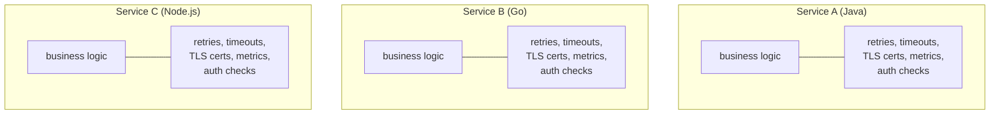
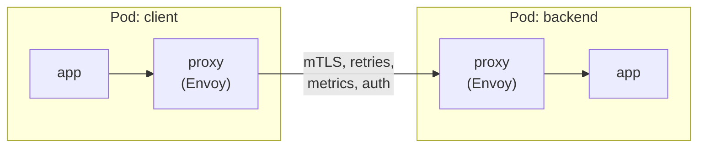
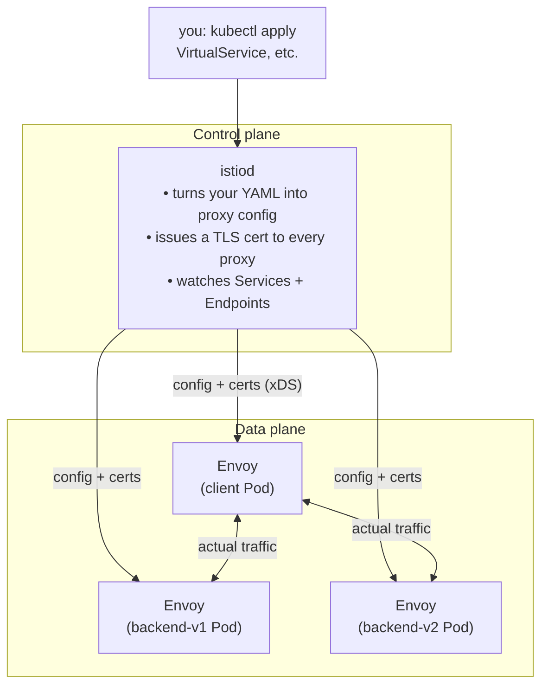
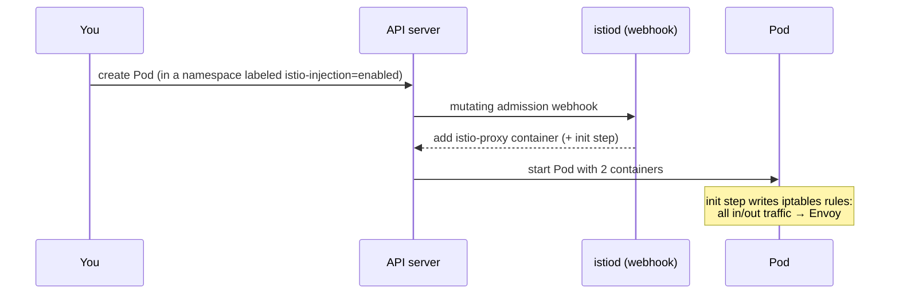
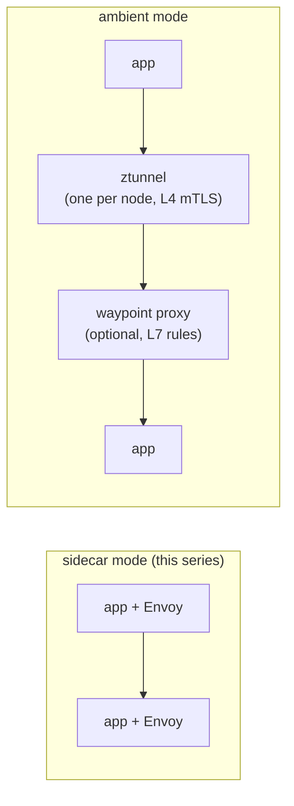

# Part 1 — What is a service mesh?

Goal: build the mental model before installing anything. No commands in
this part.

---

## The problem: every service re-solves the same network problems

Once you have more than a few services calling each other, every one of
them needs the same things:

- the same logic gets written 3 times, in 3 libraries, with 3 sets of defaults
- changing a retry policy means a code change + redeploy in every service
- nobody can easily prove that "all internal traffic is encrypted"

A service mesh moves all of that **out of the app** and into the
infrastructure.

---

## The idea: put a proxy next to every app

This is the sidecar pattern from
[05-sidecars.md](../kubernetes-intermediate/05-sidecars.md), applied to
**every** Pod automatically.

- the app still sends plain `http://backend`, so **no code changes**
- the proxy on the sending side does the routing, retries, timeouts, and encryption
- the proxy on the receiving side decrypts, checks who's calling, and records metrics
- the proxy doesn't care what language the app is written in

---

## Data plane vs control plane

| | Data plane | Control plane |
| --- | --- | --- |
| What | The Envoy proxies, one per Pod | `istiod`, one Deployment in `istio-system` |
| Touches requests? | Yes, every request goes through it | No, it never sees app traffic |
| If it goes down | That Pod's traffic stops | Traffic keeps flowing on the last config; only new config/certs wait |

---

## How the sidecar gets there, and how traffic reaches it

- **Injection** is done by a mutating admission webhook
  ([10-admission-controllers.md](../kubernetes-intermediate/10-admission-controllers.md)).
  It only acts when a Pod is created, so existing Pods need a restart.
- **Interception** uses iptables rules inside the Pod's network namespace.
  The app connects to `backend:80`, and the kernel quietly sends that
  connection to Envoy on `localhost:15001` instead.
- That's why `kubectl get pods` shows `2/2`: the app plus `istio-proxy`.

---

## Where a mesh sits next to things you already know

| Tool | Answers | Layer |
| --- | --- | --- |
| [Service](../kubernetes-intro/05-services.md) | *Which* Pod gets this connection? | L4 (IP:port) |
| [Ingress / Gateway API](../kubernetes-intro/09-ingress.md) | How does outside traffic get *in*? | L7, at the edge |
| [NetworkPolicy](../kubernetes-intermediate/04-networking-policy.md) | Which IPs/ports may connect at all? | L3/L4 |
| Service mesh | What *happens* to each request between services: encryption, identity, retries, % splits, metrics | L7, everywhere |

A mesh **doesn't replace** Services. Envoy reads the same Endpoints
Kubernetes already tracks. It adds an HTTP-aware layer on top.

---

## Istio's building blocks used in this series

| Kind | What it does | Part |
| --- | --- | --- |
| `DestinationRule` | Defines *subsets* of a service (e.g. v1/v2 by label), plus connection policies | 3 |
| `VirtualService` | Routing rules: weights, header matches, faults, timeouts, retries | 3 |
| `PeerAuthentication` | mTLS mode for receiving workloads: `PERMISSIVE` or `STRICT` | 4 |
| `AuthorizationPolicy` | Who (identity) may call what (method/path) | 4 |
| `Gateway` | Edge traffic into the mesh (not used here; see the Gateway API notes) | — |

They're all CRDs
([kubernetes-crds/](../kubernetes-crds/README.md)), so `kubectl get`,
`apply`, and `describe` work on them like on any other object.

---

## Sidecar mode vs ambient mode

Istio also has a newer **ambient mode** with no per-Pod sidecar:

- **sidecar**: the most mature mode and the one most docs and examples
  show. It costs one proxy (CPU/memory) per Pod.
- **ambient**: cheaper and needs no Pod restarts, but L7 features need a
  waypoint deployed as well.

The YAML in Parts 3 and 4 is the same in both modes. Only the install
and onboarding steps differ. This series uses sidecar mode because the
proxy is visible in every Pod, which makes it easier to learn.

---

## Takeaway

A service mesh is an Envoy proxy next to every Pod (the data plane),
configured centrally by `istiod` (the control plane). Your apps keep
making plain HTTP calls. Encryption, routing, resilience, and metrics
all happen in the proxies.

Next: [Part 2 — install Istio and the demo app](02-install-istio-and-demo-app.md)
