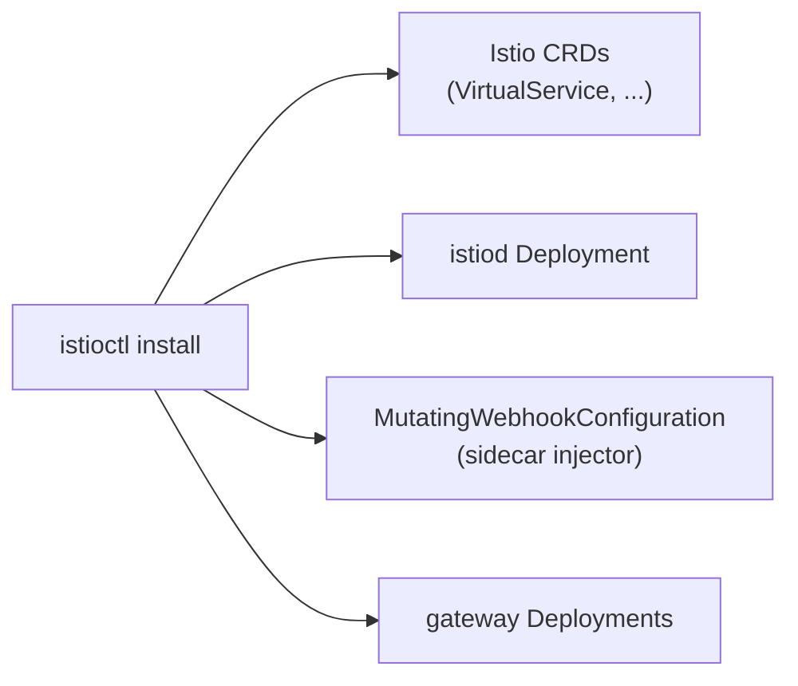
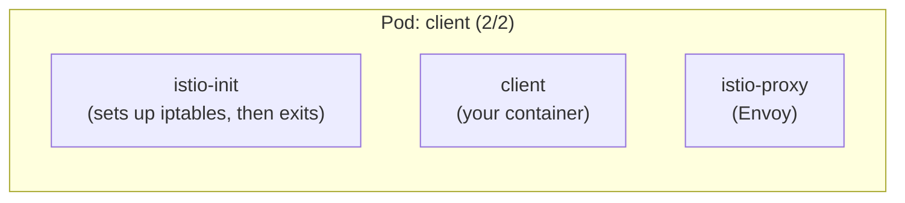

# Part 2 — Install Istio and the demo app

Goal: Istio running in the cluster, and the demo app running with a
sidecar in every Pod. Files: [examples/02-demo-app/](examples/02-demo-app/).

---

## Step 1: Get `istioctl`

```bash
curl -L https://istio.io/downloadIstio | sh -
cd istio-*/
export PATH=$PWD/bin:$PATH
export ISTIO_DIR=$PWD          # Part 5 needs samples/addons/ from here
cd -

istioctl version               # client version; no control plane yet
```

> `brew install istioctl` also works, but it doesn't include the
> `samples/` folder that Part 5 uses.

---

## Step 2: Install the control plane

```bash
istioctl x precheck                      # is this cluster OK for Istio?
istioctl install --set profile=demo -y

kubectl get pods -n istio-system
# istiod-...                 1/1 Running    <- the control plane
# istio-ingressgateway-...   1/1 Running    <- edge proxy (not used in this series)
# istio-egressgateway-...    1/1 Running
```

| Profile | Installs | Use for |
| --- | --- | --- |
| `minimal` | `istiod` only | When you bring your own gateway |
| `default` | `istiod` + ingress gateway | Production starting point |
| `demo` | `istiod` + ingress + egress gateways, access logs on, 100% trace sampling | Learning (this series), **not** production |



```bash
kubectl get crd | grep istio.io | wc -l              # 15 new kinds on Istio 1.32
kubectl get mutatingwebhookconfiguration | grep istio
```

---

## Step 3: The demo app

`examples/02-demo-app/namespace.yaml`: the label is what turns injection on.

```yaml
apiVersion: v1
kind: Namespace
metadata:
  name: mesh-demo
  labels:
    istio-injection: enabled
```

`examples/02-demo-app/backend.yaml`: one Service, two Deployments
(trimmed here):

```yaml
kind: Service
metadata: { name: backend }
spec:
  selector: { app: backend }         # matches BOTH v1 and v2
  ports:
    - name: http                     # tells Istio "this is HTTP"
      port: 80
      targetPort: 5678
---
kind: Deployment
metadata: { name: backend-v1 }
spec:
  template:
    metadata:
      labels: { app: backend, version: v1 }   # "version" is used in Part 3
    spec:
      containers:
        - image: hashicorp/http-echo:1.0
          args: ["-text=hello from backend v1", "-listen=:5678"]
# backend-v2: identical except version: v2 and the text
```

`examples/02-demo-app/client.yaml`: `curl` that sleeps, so you can exec
into it. It runs as ServiceAccount `client`, which becomes its mesh
identity in Part 4.

---

## Step 4: Deploy it

Apply the namespace first. `kubectl apply -f dir/` goes in alphabetical
order, so `backend.yaml` would otherwise run before the namespace exists.

```bash
kubectl apply -f examples/02-demo-app/namespace.yaml
kubectl apply -f examples/02-demo-app/

kubectl rollout status deploy -n mesh-demo
kubectl get pods -n mesh-demo
# NAME                          READY   STATUS
# backend-v1-...                2/2     Running     <- app + istio-proxy
# backend-v2-...                2/2     Running
# client-...                    2/2     Running
```

`2/2` means the webhook added the sidecar. Neither manifest mentions
Istio anywhere.

```bash
kubectl get pod -n mesh-demo -l app=client \
  -o jsonpath='{.items[0].spec.initContainers[*].name} | {.items[0].spec.containers[*].name}{"\n"}'
# istio-init istio-proxy | client
```

> `istio-proxy` is listed under **init containers**. Istio runs it as a
> [native sidecar](https://kubernetes.io/docs/concepts/workloads/pods/sidecar-containers/)
> (an init container with `restartPolicy: Always`), so it starts **before**
> your app and keeps running for the Pod's whole life. `istio-init` sets up
> the iptables rules and then exits.



---

## Step 5: Is every sidecar connected to istiod?

```bash
istioctl proxy-status
# NAME                          CLUSTER     ISTIOD          VERSION  SUBSCRIBED TYPES
# backend-v1-....mesh-demo      Kubernetes  istiod-...      1.32.0   4 (CDS,LDS,EDS,RDS)
# backend-v2-....mesh-demo      Kubernetes  istiod-...      1.32.0   4 (CDS,LDS,EDS,RDS)
# client-....mesh-demo          Kubernetes  istiod-...      1.32.0   4 (CDS,LDS,EDS,RDS)
# istio-egressgateway-...       ...                                  3 (CDS,LDS,EDS)
# istio-ingressgateway-...      ...                                  3 (CDS,LDS,EDS)
```

Every Pod in `mesh-demo` should be listed. A missing one means no
sidecar, or a sidecar that can't reach `istiod`. To check that one proxy
really has the latest config, give it a Pod name:

```bash
istioctl proxy-status $(kubectl get pod -n mesh-demo -l app=client -o jsonpath='{.items[0].metadata.name}').mesh-demo
# Clusters Match
# Listeners Match
# Routes Match (RDS last loaded at ...)
```

This is the first thing to check whenever routing looks wrong.

---

## Step 6: The baseline, before any Istio rules

Send 20 requests from `client` to `backend`:

```bash
kubectl exec -n mesh-demo deploy/client -- \
  sh -c 'for i in $(seq 1 20); do curl -s http://backend; done' | sort | uniq -c
#   11 hello from backend v1
#    9 hello from backend v2
```

Roughly 50/50, because the Service selects both Deployments and each has
1 replica. With plain Kubernetes, the **only** way to change that ratio
is to change replica counts (see the canary section of
[03-rolling-update.md](../kubernetes-intermediate/03-rolling-update.md)).
Part 3 changes it with one YAML object instead.

Keep this loop handy. Every part reuses it:

```bash
hit() { kubectl exec -n mesh-demo deploy/client -- \
  sh -c "for i in \$(seq 1 ${1:-20}); do curl -s http://backend; done" | sort | uniq -c; }
hit        # 20 requests
hit 100    # 100 requests
```

---

## Takeaway

One `istioctl install` adds the control plane. One namespace label
injects a sidecar into every new Pod. The app itself is unchanged, and so
far behaves exactly as it did without Istio.

Next: [Part 3 — traffic management](03-traffic-management.md)
