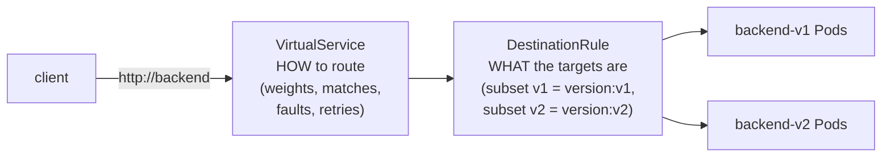
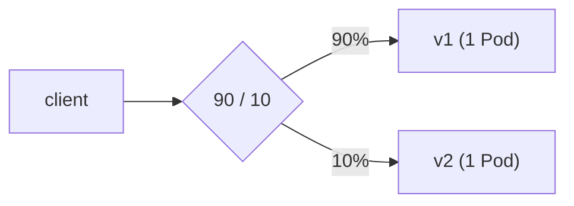
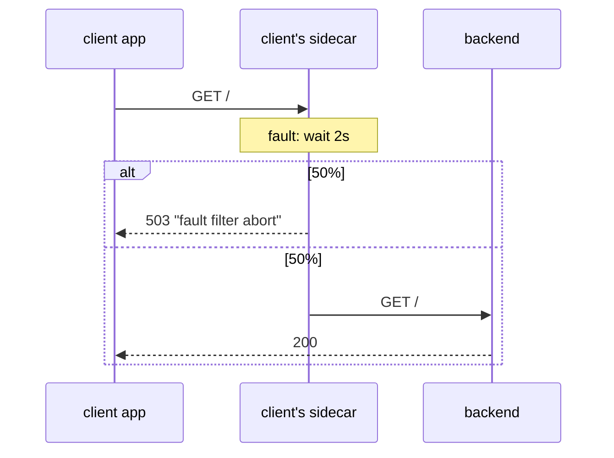
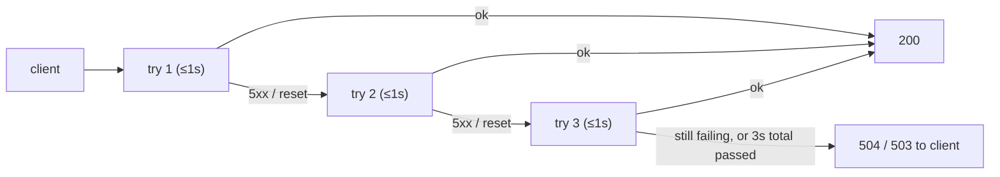

# Part 3 — Traffic management

Goal: control **where** each request goes and **what happens** to it on
the way, without touching `client` or `backend`.
Files: [examples/03-traffic/](examples/03-traffic/).

Uses the `hit` helper from [Part 2, Step 6](02-install-istio-and-demo-app.md#step-6-the-baseline-before-any-istio-rules).

---

## The two objects



| | `DestinationRule` | `VirtualService` |
| --- | --- | --- |
| Defines | Named subsets (by Pod label) + connection policy | Routing rules that point at those subsets |
| Analogy | "These are the shelves" | "Put this order on that shelf" |

> **Routing happens in the caller's sidecar.** The `client` Pod's Envoy
> reads the VirtualService and picks v1 or v2 before the request ever
> leaves the Pod. A caller with no sidecar (like Part 4's `outsider`)
> ignores these rules and still gets plain 50/50.

---

## Step 1: Define the subsets

`examples/03-traffic/destination-rule.yaml`

```yaml
apiVersion: networking.istio.io/v1
kind: DestinationRule
metadata:
  name: backend
  namespace: mesh-demo
spec:
  host: backend
  subsets:
    - name: v1
      labels: { version: v1 }
    - name: v2
      labels: { version: v2 }
```

```bash
kubectl apply -f examples/03-traffic/destination-rule.yaml
hit        # still ~50/50; subsets alone don't route anything
```

---

## Step 2: Pin all traffic to v1

`examples/03-traffic/vs-all-v1.yaml`

```yaml
apiVersion: networking.istio.io/v1
kind: VirtualService
metadata:
  name: backend
  namespace: mesh-demo
spec:
  hosts: ["backend"]
  http:
    - route:
        - destination: { host: backend, subset: v1 }
```

```bash
kubectl apply -f examples/03-traffic/vs-all-v1.yaml
hit
#   20 hello from backend v1
```

v2 Pods are still running and still Ready. They just get no traffic.
This is how you deploy a new version **dark** and release it later.

---

## Step 3: Canary — 90% v1, 10% v2

`examples/03-traffic/vs-canary-90-10.yaml`

```yaml
  http:
    - route:
        - destination: { host: backend, subset: v1 }
          weight: 90
        - destination: { host: backend, subset: v2 }
          weight: 10
```

```bash
kubectl apply -f examples/03-traffic/vs-canary-90-10.yaml
hit 100
#   94 hello from backend v1
#    6 hello from backend v2      <- weighted random, so ~90/10, not exact
```



- 1 Pod each, yet a 90/10 split: **weights are separate from replica counts**
- each apply replaces the previous VirtualService (same `name`), so you
  only ever edit one object
- to roll forward, edit the weights 90/10 → 50/50 → 0/100, then delete v1

```bash
# try it: scale v2 up, the split doesn't move
kubectl scale deploy/backend-v2 -n mesh-demo --replicas=3
hit 100                     # still ~90/10 (86/14 in a test run)
kubectl scale deploy/backend-v2 -n mesh-demo --replicas=1
```

---

## Step 4: Route by header — testers get v2

`examples/03-traffic/vs-header-route.yaml`

```yaml
  http:
    - match:                       # rule 1: checked first
        - headers:
            x-user:
              exact: tester
      route:
        - destination: { host: backend, subset: v2 }
    - route:                       # rule 2: everyone else
        - destination: { host: backend, subset: v1 }
```

```bash
kubectl apply -f examples/03-traffic/vs-header-route.yaml

kubectl exec -n mesh-demo deploy/client -- curl -s http://backend
# hello from backend v1
kubectl exec -n mesh-demo deploy/client -- curl -s -H 'x-user: tester' http://backend
# hello from backend v2
```

Rules are checked top to bottom and the **first match wins**, so the
catch-all goes last. You can match on headers, URI prefix/regex, method,
and query params.

---

## Step 5: Fault injection — break it on purpose

How does your app cope when a dependency is slow or failing? Istio can
inject the failure at the caller's sidecar. The backend stays healthy and
nothing gets redeployed.

`examples/03-traffic/vs-fault-injection.yaml`

```yaml
  http:
    - fault:
        delay:
          percentage: { value: 100 }
          fixedDelay: 2s           # every request waits 2s first...
        abort:
          percentage: { value: 50 }
          httpStatus: 503          # ...then half of them fail
      route:
        - destination: { host: backend, subset: v1 }
```

```bash
kubectl apply -f examples/03-traffic/vs-fault-injection.yaml

kubectl exec -n mesh-demo deploy/client -- sh -c \
  'for i in 1 2 3 4 5 6; do curl -s -o /dev/null -w "%{http_code}  %{time_total}s\n" http://backend; done'
# 503  2.004695s
# 503  2.003121s
# 503  2.002310s
# 200  2.008472s
# 200  2.004658s
# 200  2.002418s

kubectl exec -n mesh-demo deploy/client -- curl -s http://backend
# fault filter abort
```



The `503` never reached `backend`. The client's own sidecar generated it.

---

## Step 6: Timeouts and retries

What you'd otherwise write per service with a library like resilience4j:

`examples/03-traffic/vs-timeout-retries.yaml`

```yaml
  http:
    - timeout: 3s                 # whole request, all attempts included
      retries:
        attempts: 3
        perTryTimeout: 1s
        retryOn: 5xx,connect-failure,reset
      route:
        - destination: { host: backend, subset: v1 }
```

```bash
kubectl apply -f examples/03-traffic/vs-timeout-retries.yaml
hit                                                 # all v1, all fine

# confirm the sidecar actually received the policy
istioctl proxy-config route deploy/client -n mesh-demo --name 80
# NAME  VHOST NAME                               ...  VIRTUAL SERVICE
# 80    backend.mesh-demo.svc.cluster.local:80   ...  backend.mesh-demo
# 80    istio-egressgateway.istio-system...:80   ...

istioctl proxy-config route deploy/client -n mesh-demo --name 80 -o json \
  | grep -m1 -A3 '"retryPolicy"'
#   "retryPolicy": {
#       "retryOn": "5xx,connect-failure,reset",
#       "numRetries": 3,
#       "perTryTimeout": "1s",
```

Route `80` holds every port-80 service the client knows about. The first
`retryPolicy` is backend's. The others are Istio's **default**, which
already retries twice on connection failures even with no
VirtualService at all.



> Why not demo this with Step 5's faults? On the same route, injected
> faults are applied **before** the retry/timeout logic, so retries and
> timeouts never see them. Tested on Istio 1.32:
>
> - 50% abort + 3 retries → **43 of 100** still failed (working retries would leave ~6%)
> - 2s delay + `timeout: 1s` → `200` after 2s, no timeout
>
> To see retries fire, you need a backend that really fails, or the
> fault on one hop and the retry on the hop before it.

Retries are only safe for idempotent requests. Retrying a `POST
/orders` might create two orders.

---

## Reset

```bash
kubectl delete virtualservice backend -n mesh-demo
hit                       # back to ~50/50
# keep the DestinationRule; it's harmless on its own
```

---

## Takeaway

`DestinationRule` names the versions. `VirtualService` decides who gets
which version, and adds faults, timeouts, and retries. All of it runs in
the **caller's** sidecar, with zero changes to either app.

Next: [Part 4 — security: mTLS and authorization](04-security-mtls-authz.md)
