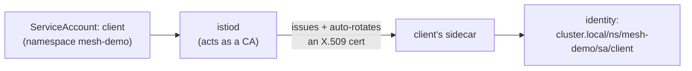
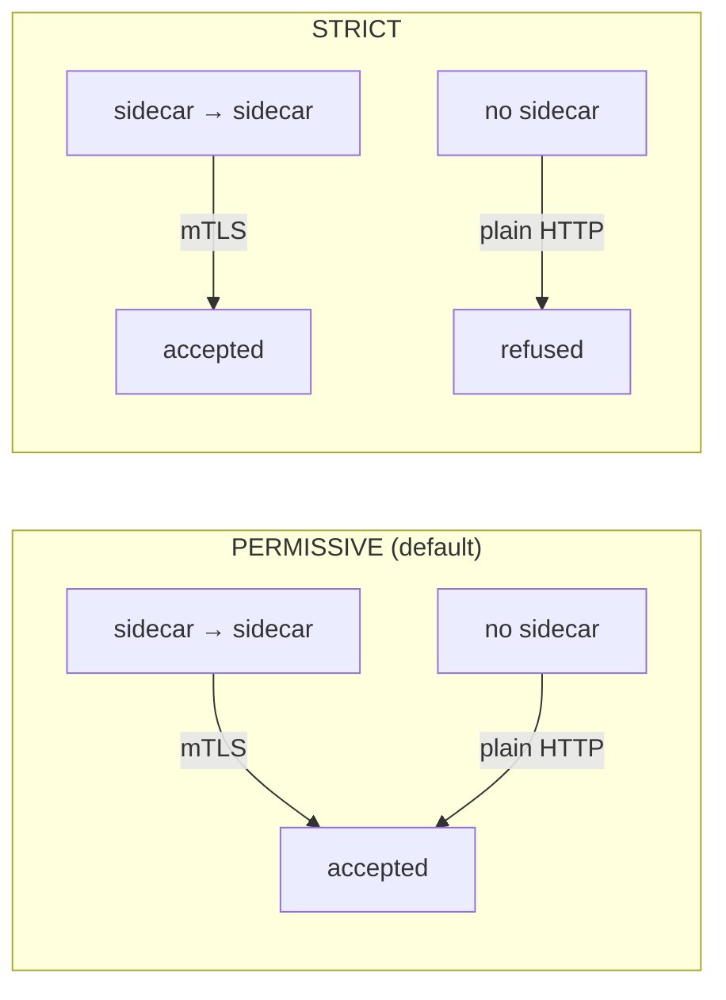
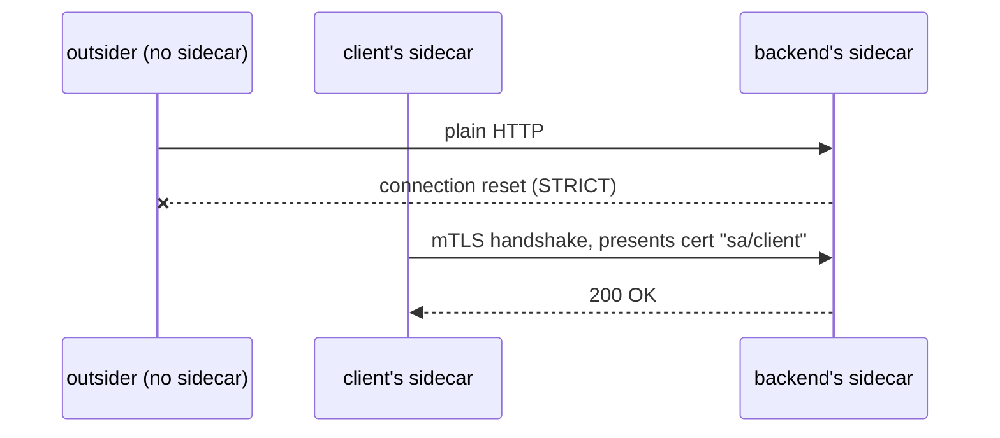
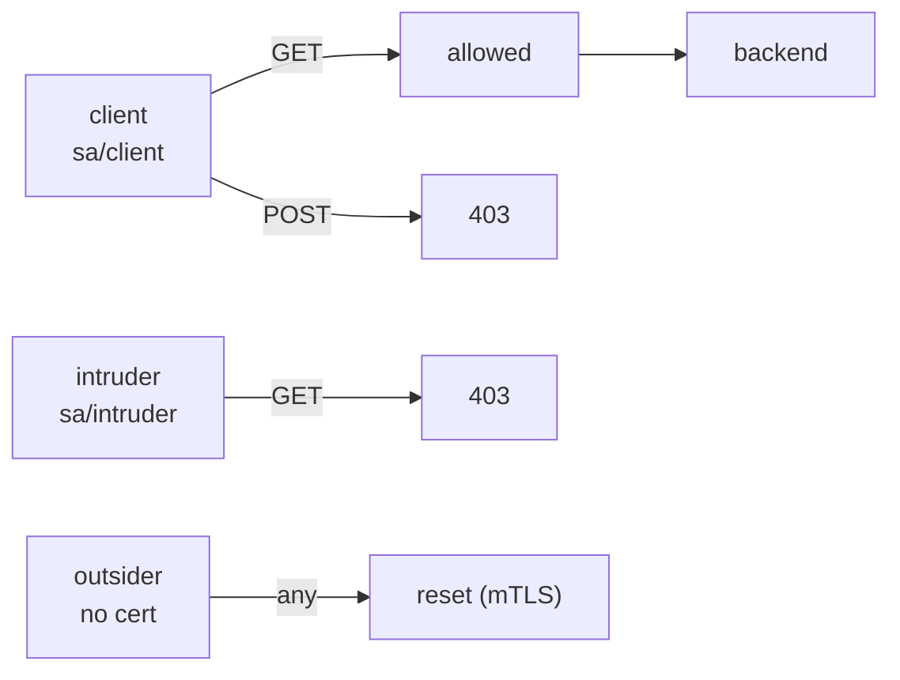

# Part 4 — Security: mTLS and authorization

Goal: encrypt all traffic in `mesh-demo`, refuse anyone outside the mesh,
then allow **only** `client` to call `backend`.
Files: [examples/04-security/](examples/04-security/).

---

## Identity: every Pod gets a certificate



- the identity comes from the Pod's **ServiceAccount**, not its IP
  (IPs change on every restart; ServiceAccounts don't)
- certs are short-lived and rotated automatically, so there's no PKI to manage
- this is a [SPIFFE](https://spiffe.io/) ID, written as
  `spiffe://cluster.local/ns/<namespace>/sa/<serviceaccount>`

---

## mTLS modes



- by default, sidecars **already** use mTLS with each other ("auto mTLS")
- `PERMISSIVE` also accepts plaintext, so you can migrate to the mesh one
  service at a time
- `STRICT` accepts mTLS only. Anything without a sidecar is cut off

---

## Step 1: The outsider gets in (for now)

`examples/04-security/outsider.yaml` creates a namespace **without**
`istio-injection`, plus a `curl` Pod in it. No sidecar means no cert.

```bash
kubectl apply -f examples/04-security/outsider.yaml
kubectl wait --for=condition=Ready pod/outsider -n outsider

kubectl get pod outsider -n outsider        # 1/1, no sidecar
kubectl exec -n outsider outsider -- curl -sS http://backend.mesh-demo
# hello from backend v1      <- plaintext, accepted (PERMISSIVE)
```

---

## Step 2: Turn on STRICT mTLS

`examples/04-security/peer-auth-strict.yaml`

```yaml
apiVersion: security.istio.io/v1
kind: PeerAuthentication
metadata:
  name: default            # "default" in a namespace = applies to the whole namespace
  namespace: mesh-demo
spec:
  mtls:
    mode: STRICT
```

```bash
kubectl apply -f examples/04-security/peer-auth-strict.yaml

kubectl exec -n outsider outsider -- curl -sS http://backend.mesh-demo
# curl: (56) Recv failure: Connection reset by peer      <- refused
# command terminated with exit code 56

kubectl exec -n mesh-demo deploy/client -- curl -s http://backend
# hello from backend v1                                   <- still works
```

`-sS` matters here: plain `-s` also hides curl's error message, so you'd
only see the exit code. The backend's sidecar logs the refused
connection as `NR filter_chain_not_found`:

```bash
kubectl logs -n mesh-demo deploy/backend-v1 -c istio-proxy --tail=5 | grep filter_chain_not_found
```



| Scope | Where to put the `PeerAuthentication` |
| --- | --- |
| One workload | in its namespace, with `spec.selector.matchLabels` |
| One namespace | in that namespace, named `default` (what we did) |
| Whole mesh | in `istio-system`, named `default` |

---

## Step 3: mTLS isn't authorization

STRICT proves *who* is calling. It doesn't decide *whether they're
allowed*. Any Pod with a sidecar still gets in. Add a second meshed Pod
with a different ServiceAccount:

`examples/04-security/intruder.yaml`: ServiceAccount `intruder` + a
`curl` Pod in `mesh-demo` (so it gets a sidecar and a valid cert).

```bash
kubectl apply -f examples/04-security/intruder.yaml
kubectl wait --for=condition=Ready pod/intruder -n mesh-demo

kubectl exec -n mesh-demo intruder -- curl -s http://backend
# hello from backend v1      <- valid mTLS, so it's allowed... for now
```

---

## Step 4: Only `client` may call `backend`, and only with GET

`examples/04-security/authz-backend.yaml`

```yaml
apiVersion: security.istio.io/v1
kind: AuthorizationPolicy
metadata:
  name: backend-allow-client
  namespace: mesh-demo
spec:
  selector:
    matchLabels:
      app: backend                 # enforced by backend's sidecar
  action: ALLOW
  rules:
    - from:
        - source:
            principals: ["cluster.local/ns/mesh-demo/sa/client"]
      to:
        - operation:
            methods: ["GET"]
```

```bash
kubectl apply -f examples/04-security/authz-backend.yaml
sleep 10      # policies take a few seconds to reach every backend sidecar

kubectl exec -n mesh-demo deploy/client -- curl -s http://backend
# hello from backend v1                 <- allowed

kubectl exec -n mesh-demo deploy/client -- curl -s -X POST http://backend
# RBAC: access denied                   <- right caller, wrong method (403)

kubectl exec -n mesh-demo intruder -- curl -s http://backend
# RBAC: access denied                   <- wrong identity (403)
```



How ALLOW policies work:

- with **no** policy on a workload, everything is allowed
- once **any** `ALLOW` policy selects a workload, anything it doesn't
  match is denied
- `DENY` policies are checked before `ALLOW`. A `CUSTOM` action hands
  the decision to an external auth service
- `principals` only work under mTLS, since the identity comes from the
  peer's cert. That's why Step 2 comes first

---

## mTLS + AuthorizationPolicy vs NetworkPolicy

| | [NetworkPolicy](../kubernetes-intermediate/04-networking-policy.md) | Istio security |
| --- | --- | --- |
| Identifies callers by | Pod labels / namespace / IP | Cryptographic identity (ServiceAccount cert) |
| Can match | Port | Method, path, headers, JWT claims |
| Encrypts | No | Yes (mTLS) |
| Enforced by | CNI plugin | Sidecar proxy |

They work well together. NetworkPolicy is a coarse L3/L4 fence that
doesn't depend on the mesh being healthy, and Istio adds fine-grained L7
rules on top.

---

## Reset

```bash
kubectl delete authorizationpolicy backend-allow-client -n mesh-demo
kubectl delete peerauthentication default -n mesh-demo
kubectl delete -f examples/04-security/intruder.yaml
kubectl delete -f examples/04-security/outsider.yaml
```

---

## Takeaway

`PeerAuthentication: STRICT` encrypts every call and refuses anyone
without a mesh identity. `AuthorizationPolicy` then decides which
identities may call what. Together they're zero-trust networking, done
in two YAML files instead of in every service's code.

Next: [Part 5 — observability](05-observability.md)
