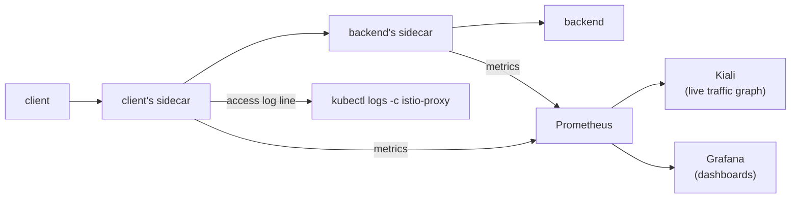
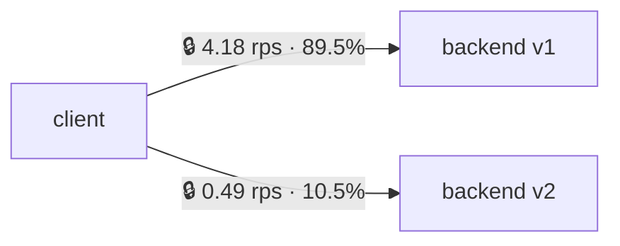

# Part 5 — Observability

Goal: see the traffic between `client` and `backend` (rates, errors,
latency, which version answered) without adding logging or metrics code
to either app.

---

## Why a mesh gets this for free



Every request already passes through two Envoys, and each one records
what it saw. You just need somewhere to collect it.

---

## Step 1: Access logs, no extra installs

The `demo` profile writes one access-log line per request to the
sidecar's stdout:

```bash
kubectl exec -n mesh-demo deploy/client -- curl -s http://backend
sleep 2      # Envoy flushes the log about once a second
kubectl logs -n mesh-demo deploy/client -c istio-proxy --tail=1
# [2026-11-11T17:20:43.033Z] "GET / HTTP/1.1" 200 - via_upstream - "-" 0 22 2 1 "-"
#   "curl/8.11.1" "1218b35e-..." "backend" "10.244.0.9:5678"
#   outbound|80|v2|backend.mesh-demo.svc.cluster.local ...
```

How to read it:

- `200`: response code (a `503 NC` or `503 UH` here means routing trouble, see Part 6)
- `22`: response bytes (`hello from backend v2` plus a newline)
- `2`: total time in ms
- `10.244.0.9:5678`: the exact backend Pod that answered
- `outbound|80|v2|backend...`: out on port 80 to **subset v2**. With no
  VirtualService, the subset part is empty: `outbound|80||backend...`

Look at the same request from the receiving end:

```bash
kubectl logs -n mesh-demo deploy/backend-v1 -c istio-proxy --tail=1
# ... inbound|5678|| ...
```

> Not on the `demo` profile? Turn access logs on with
> `istioctl install --set meshConfig.accessLogFile=/dev/stdout`.

---

## Step 2: Install the addons

They ship in the Istio download from Part 2, already matched to your
Istio version:

```bash
kubectl apply -f $ISTIO_DIR/samples/addons/prometheus.yaml
kubectl apply -f $ISTIO_DIR/samples/addons/grafana.yaml
kubectl apply -f $ISTIO_DIR/samples/addons/kiali.yaml

kubectl rollout status deploy/kiali -n istio-system
kubectl get pods -n istio-system
```

> These are single-replica, no-persistence demo installs. For a real
> monitoring stack, see the Prometheus + Grafana + Loki setup in
> [k8s-cluster-monitoring-logging/](../../applications-and-source-code/part-order-app-java/k8s-cluster-monitoring-logging/README.md).

---

## Step 3: Generate some traffic

Turn the canary from Part 3 back on so there's something interesting to
look at, and leave a loop running in a second terminal:

```bash
kubectl apply -f examples/03-traffic/destination-rule.yaml
kubectl apply -f examples/03-traffic/vs-canary-90-10.yaml

kubectl exec -n mesh-demo deploy/client -- \
  sh -c 'while true; do curl -s http://backend > /dev/null; sleep 0.2; done'
# leave running; Ctrl+C when done with this part
```

---

## Step 4: Kiali — the live traffic graph

```bash
istioctl dashboard kiali         # opens http://localhost:20001
```

In the UI: **Traffic Graph** → namespace `mesh-demo` → **Display**:
turn on *Traffic Distribution*, *Security*, and *Traffic Animation*.



(Numbers from a test run with the loop above.)

- the **90% / 10%** on the edges is your VirtualService, shown in the UI
- the **padlock** means the edge is mTLS (it's there even without
  Part 4's STRICT mode, thanks to auto mTLS)
- re-apply Part 3's fault injection and the edges turn **red**

Kiali also validates your Istio config. Under *Istio Config*, a
VirtualService pointing at a missing subset shows up as an error.

---

## Step 5: Prometheus — the raw metrics

```bash
istioctl dashboard prometheus    # opens http://localhost:9090
```

Requests per second to `backend`, by version and response code:

```promql
sum by (destination_version, response_code) (
  rate(istio_requests_total{destination_service_name="backend", reporter="destination"}[1m])
)
```

In a test run with the canary on:

```text
{destination_version="v1", response_code="200"}  4.18
{destination_version="v2", response_code="200"}  0.49
```

p95 latency (about 4 ms in the same run):

```promql
histogram_quantile(0.95,
  sum by (le) (rate(istio_request_duration_milliseconds_bucket{destination_service_name="backend"}[1m]))
)
```

| Metric | Gives you |
| --- | --- |
| `istio_requests_total` | Request count: rate, error %, version split |
| `istio_request_duration_milliseconds` | Latency histogram (p50/p95/p99) |
| `istio_request_bytes` / `istio_response_bytes` | Payload sizes |
| `istio_tcp_*` | Same idea for non-HTTP traffic |

Every metric has the same labels: `source_workload`,
`destination_workload`, `destination_version`, `response_code`, and so on.
These are the "golden signals" (traffic, errors, latency) for every
service, in a consistent format.

---

## Step 6: Grafana

```bash
istioctl dashboard grafana       # opens http://localhost:3000
```

Open **Dashboards → istio → Istio Service Dashboard**, then pick
`backend.mesh-demo.svc.cluster.local`. The dashboards come pre-built and
run the same PromQL as Step 5.

---

## What a mesh *can't* see: tracing across hops

Each sidecar can emit a trace span, but linking `A → B → C` into **one**
trace needs the app to pass trace headers (`traceparent`, etc.) from
each incoming request to its outgoing calls. A proxy can't know which
outgoing call belongs to which incoming one. That part needs app code
(e.g. OpenTelemetry), which is why
[k8s-with-tracing/](../../applications-and-source-code/part-order-app-java/k8s-with-tracing/README.md) changes the apps
themselves.

Our demo has only one hop, so there's nothing to link.

---

## Takeaway

Because every request passes through a sidecar, you get access logs,
standard metrics, and a live dependency graph for every service, in
every language, without writing any code for them.

Next: [Part 6 — troubleshooting and cheat sheet](06-troubleshooting-and-cheatsheet.md)
