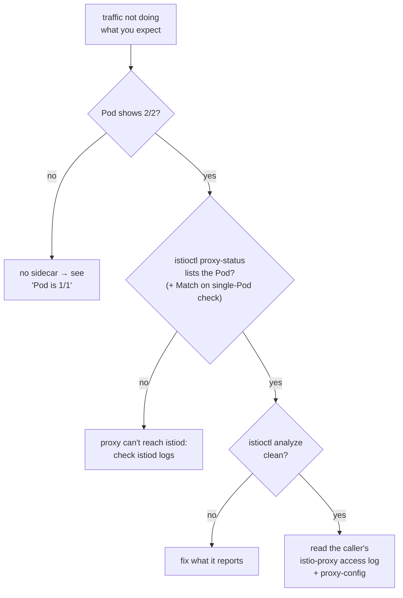
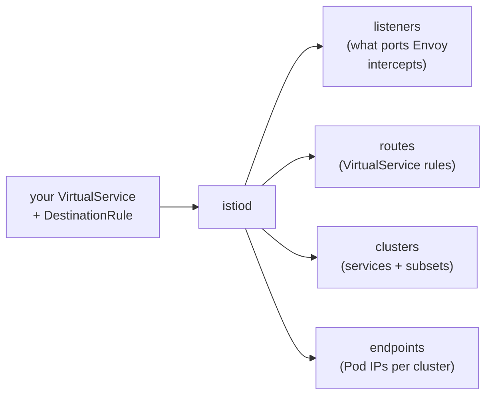

# Part 6 — Troubleshooting and cheat sheet

---

## First command, always: `istioctl analyze`

```bash
istioctl analyze -n mesh-demo
# ✔ No validation issues found when analyzing namespace: mesh-demo.
```

It catches most config mistakes before you start guessing: a missing
subset, a namespace that isn't injected, conflicting VirtualServices,
and so on.

---

## Where to look



---

## Common problems

| Symptom | Likely cause | Fix |
| --- | --- | --- |
| Pod is `1/1`, no sidecar (analyze: `IST0103`) | Namespace not labeled, or Pod created before the label | `kubectl get ns -L istio-injection`, then `kubectl rollout restart deploy -n <ns>` |
| VirtualService has no effect | Caller has no sidecar (routing happens on the **caller** side), or `hosts` doesn't match what the app calls | Check the caller is `2/2`; `hosts: ["backend"]` resolves in the VS's own namespace |
| `503`, empty body, `NC cluster_not_found` in caller's log (analyze: `IST0101`) | VirtualService points at a subset that isn't in the DestinationRule | Add the subset, or fix the name in the VirtualService |
| `503 no healthy upstream`, `UH` in caller's log (analyze: `IST0173`) | Subset exists, but no Pod has its labels | `kubectl get dr -o yaml` vs. `kubectl get pods --show-labels` |
| `curl: (56) Recv failure: Connection reset by peer`; `NR filter_chain_not_found` in the **receiver's** log | `STRICT` mTLS, caller has no sidecar | Inject the caller, or use a `PERMISSIVE` override for that workload |
| `RBAC: access denied` (403) | An `ALLOW` AuthorizationPolicy selects the workload and this caller/method isn't in it | Check the `principals` string: `cluster.local/ns/<ns>/sa/<sa>` |
| New policy "doesn't work" right after applying | It hasn't reached every sidecar yet (a few seconds) | Wait, then retry. Different Pods can briefly disagree |
| `fault filter abort` | A fault-injection VirtualService is still applied | `kubectl get vs -A` |
| Protocol features (retries, header routing) ignored | Istio treated the port as plain TCP | Name the Service port `http`/`http-*`/`grpc`, or set `appProtocol: http` |
| App can't connect at startup | App starts before Envoy is ready | Native sidecars (recent Istio) fix this; otherwise set `holdApplicationUntilProxyStarts: true` |

---

## Looking inside a sidecar

```bash
# one-shot summary of what applies to a Pod behind a Service
istioctl x describe pod $(kubectl get pod -n mesh-demo -l app=backend,version=v1 -o name | cut -d/ -f2) -n mesh-demo
# Service: backend
#    Port: http 80/HTTP targets pod port 5678
# DestinationRule: backend for "backend"
#    Matching subsets: v1
#       (Non-matching subsets v2)
# VirtualService: backend
#    Route to host "backend" subset "v1" with weight 90%
# Effective PeerAuthentication:
#    Workload mTLS mode: PERMISSIVE
# (on the client Pod it shows almost nothing: no Service selects it)

# what the client's Envoy knows
istioctl proxy-config cluster  deploy/client -n mesh-demo | grep backend   # upstreams + subsets
istioctl proxy-config route    deploy/client -n mesh-demo --name 80 -o json # routing rules
istioctl proxy-config endpoint deploy/client -n mesh-demo | grep backend   # actual Pod IPs, HEALTHY?
# 10.244.0.8:5678   HEALTHY   OK   outbound|80|v1|backend.mesh-demo.svc.cluster.local
# 10.244.0.9:5678   HEALTHY   OK   outbound|80|v2|backend.mesh-demo.svc.cluster.local

# turn up Envoy logging temporarily
istioctl proxy-config log deploy/client -n mesh-demo --level debug
kubectl logs -n mesh-demo deploy/client -c istio-proxy -f
istioctl proxy-config log deploy/client -n mesh-demo --level warning   # back to normal
```



`proxy-config` shows you each of those four layers, as Envoy really has them.

---

## Cheat sheet

```bash
# install / status
istioctl install --set profile=demo -y
kubectl label namespace <ns> istio-injection=enabled
kubectl rollout restart deploy -n <ns>          # inject into existing Pods
istioctl proxy-status
istioctl analyze -n <ns>

# traffic (Part 3)
kubectl apply -f examples/03-traffic/destination-rule.yaml
kubectl apply -f examples/03-traffic/vs-canary-90-10.yaml
kubectl get vs,dr -n mesh-demo

# security (Part 4)
kubectl apply -f examples/04-security/peer-auth-strict.yaml
kubectl apply -f examples/04-security/authz-backend.yaml
kubectl get peerauthentication,authorizationpolicy -A

# observability (Part 5)
kubectl logs deploy/<name> -n <ns> -c istio-proxy
istioctl dashboard kiali | prometheus | grafana

# remove a Pod from the mesh without touching the namespace label
#   Pod template label:  sidecar.istio.io/inject: "false"
```

| Object | Short name | One-line purpose |
| --- | --- | --- |
| `VirtualService` | `vs` | How to route requests to a host |
| `DestinationRule` | `dr` | Subsets + connection/outlier policy for a host |
| `PeerAuthentication` | `pa` | mTLS mode for incoming traffic |
| `AuthorizationPolicy` | `ap` | Who may call what |
| `ServiceEntry` | `se` | Add an external host (e.g. an outside API) to the mesh |
| `Gateway` | `gw` | Edge proxy config (or use Gateway API's `Gateway` + `HTTPRoute`) |

---

## Clean up

```bash
# just the demo
kubectl delete namespace mesh-demo outsider --ignore-not-found

# Istio itself
istioctl uninstall --purge -y
kubectl delete namespace istio-system

# or everything at once
kind delete cluster --name mesh-lab
```

---

## Where next

- **The real app:** [03-service-mesh.md](../kubernetes-advanced/03-service-mesh.md)
  applies the same ideas to `part-order-service` → `part-inventory-service`,
  and covers when a mesh is (and isn't) worth it for a small system
- **Run it on the real app:** [k8s-istio/](../../applications-and-source-code/part-order-app-java/k8s-istio/README.md)
  is the part-order-app with sidecars + STRICT mTLS, ready to apply
- **Circuit breaking:** `outlierDetection` in a DestinationRule ejects a
  failing Pod automatically (example in 03-service-mesh.md, Use case 3)
- **Edge traffic:** Istio implements the Gateway API, so the same
  `Gateway` + `HTTPRoute` from
  [09-ingress.md](../kubernetes-intro/09-ingress.md) works with
  `gatewayClassName: istio`
- **Ambient mode:** try `istioctl install --set profile=ambient` and
  `kubectl label ns mesh-demo istio.io/dataplane-mode=ambient`, with no
  sidecars and no restarts
