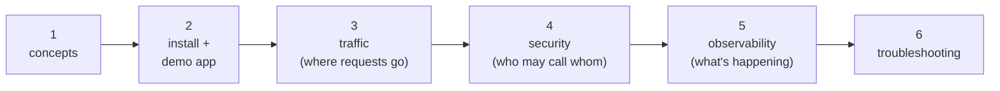
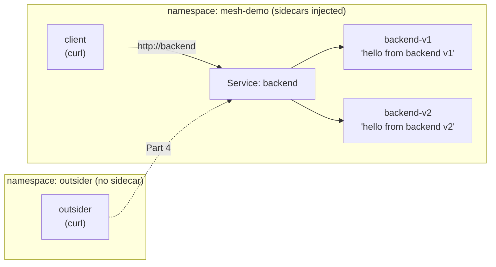

# Service Mesh with Istio — a simplified, hands-on series

What a service mesh is, and Istio's core features tried out on the
smallest possible app: a `client` Pod calling a `backend` Service that
has two versions. Every feature is one small YAML file, and you can see
it work with a single `curl`.

Short on time? [03-service-mesh.md](../kubernetes-advanced/03-service-mesh.md)
is the one-page version, using the real part-order-app, and
[k8s-istio/](../../applications-and-source-code/part-order-app-java/k8s-istio/README.md) is that app with Istio, ready to
apply. This folder is the step-by-step lab on a toy app.

---

## The parts

| # | File | What you do |
| --- | --- | --- |
| 1 | [01-what-is-a-service-mesh.md](01-what-is-a-service-mesh.md) | Nothing yet — the mental model: sidecar, data plane, control plane |
| 2 | [02-install-istio-and-demo-app.md](02-install-istio-and-demo-app.md) | Install Istio, deploy `client` + `backend` v1/v2, see the sidecars get injected |
| 3 | [03-traffic-management.md](03-traffic-management.md) | Pin, canary (90/10), header-based routing, fault injection, timeouts/retries |
| 4 | [04-security-mtls-authz.md](04-security-mtls-authz.md) | Turn on strict mTLS, then allow only `client` to call `backend` |
| 5 | [05-observability.md](05-observability.md) | Access logs, Prometheus metrics, and the Kiali traffic graph — zero app code |
| 6 | [06-troubleshooting-and-cheatsheet.md](06-troubleshooting-and-cheatsheet.md) | Common mistakes, debug commands, cleanup |



Parts 3, 4 and 5 are the three things a mesh gives you. Each one only
needs Part 2, so you can do them in any order.

---

## The demo app



- `backend` runs [`hashicorp/http-echo`](https://github.com/hashicorp/http-echo),
  which just returns a fixed string. The string says which version
  answered, so every routing change shows up in the `curl` output.
- `client` is a `curl` container that sleeps, so you can `kubectl exec` into it.
- `outsider` (Part 4) is a Pod outside the mesh, used to show what mTLS blocks.

---

## Lab setup (do this once)

You need Docker, `kind`, and `kubectl`. Istio's demo profile wants about
4 GB of memory for Docker. Minikube or Docker Desktop's Kubernetes work
too; only the cluster-creation line changes.

```bash
kind create cluster --name mesh-lab
kubectl config current-context        # must print: kind-mesh-lab
```

> Check the context first. Istio installs cluster-wide CRDs and webhooks,
> so you don't want them landing on a shared or cloud cluster by mistake.

Run all commands from this folder:

```bash
cd kubernetes/service-mesh
ls examples/
# 02-demo-app  03-traffic  04-security
```

Clean up at the end (this removes Istio and everything else too):

```bash
kind delete cluster --name mesh-lab
```
